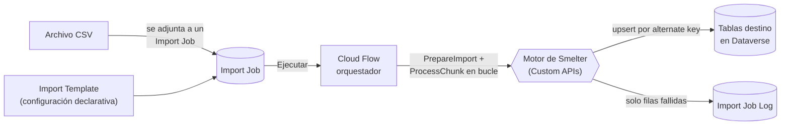

# Smelter

> **Mineral crudo entra, metal refinado sale.**

Normalizador de **CSV a Dataverse** sobre **Power Platform**. Toma archivos planos y denormalizados y los reparte en tablas de Dataverse correctamente normalizadas, mediante **configuración declarativa** (sin código por importación), procesamiento **por lotes e idempotente** que escala a más de 100.000 filas, y **portabilidad de la configuración** entre ambientes.



## Quién la usa

| Perfil | Rol de seguridad | Qué hace |
|---|---|---|
| **Configurador** | `Smelter Configurador` | Usa la app de configuración: crea templates y mappings, exporta e importa templates, ejecuta y monitorea jobs |
| **Operador** | `Smelter Operador` | Crea Import Jobs contra los templates de su equipo y ve su resultado, desde la aplicación del cliente. No usa la app de configuración |
| **Administrador de la plataforma** | System Administrator | Instala la solución, asigna roles y teams, carga la clave HMAC |
| **Desarrollador** | — | Mantiene el motor, las specs de aprovisionamiento y las pruebas |

## Documentación

### Para quien usa Smelter → [`docs/usuarios/`](docs/usuarios/)

| Guía | Para |
|---|---|
| [Conceptos básicos](docs/usuarios/00-conceptos.md) | Todos: templates, mappings, jobs, logs y estados |
| [Configurar un template](docs/usuarios/01-configurador.md) | Configurador |
| [Ejecutar y monitorear](docs/usuarios/02-ejecucion-y-monitoreo.md) | Configurador y operador |
| [Exportar e importar templates](docs/usuarios/03-exportar-e-importar.md) | Configurador |
| [Preguntas frecuentes](docs/usuarios/04-preguntas-frecuentes.md) | Todos |

### Para quien desarrolla, instala o mantiene la solución → [`docs/tecnica/`](docs/tecnica/)

| # | Documento | Qué explica |
|---|---|---|
| 01 | [Arquitectura](docs/tecnica/01-arquitectura.md) | Componentes, flujo de punta a punta, cursor de bytes, claim con lock de fila, idempotencia y dry run |
| 02 | [Modelo de datos](docs/tecnica/02-modelo-de-datos.md) | Las siete tablas, columnas, rangos, estados, choices y relaciones |
| 03 | [Seguridad](docs/tecnica/03-seguridad.md) | Roles, privilegios, propiedad por teams y custodia de la clave HMAC |
| 04 | [Plugins y Custom APIs](docs/tecnica/04-plugins-y-custom-apis.md) | Cada Custom API y message step: entradas, salidas, transacciones y errores |
| 05 | [Motor y DSL](docs/tecnica/05-motor-y-dsl.md) | Tipos de dato, funciones de transformación, `HMAC()`, claves del padre y categorías de error |
| 06 | [App de configuración](docs/tecnica/06-app-de-configuracion.md) | Sitemap, formularios, vistas, panel, botones, íconos e internacionalización 1033 y 3082 |
| 07 | [Ciclo de vida](docs/tecnica/07-ciclo-de-vida.md) | Estados de un job, transiciones y reintentos |
| 08 | [ALM y despliegue](docs/tecnica/08-alm-y-despliegue.md) | Workflows, pasos de `Smelter.Deploy`, `Smelter.Verify`, versionado y Releases |
| 09 | [Instalación en otro tenant](docs/tecnica/09-instalacion-en-otro-tenant.md) | Instalar y actualizar a mano, paso a paso |
| 10 | [Pruebas](docs/tecnica/10-pruebas.md) | Pruebas del núcleo, de plugins y de contrato, y la verificación contra Dev |
| 11 | [Mantenimiento](docs/tecnica/11-mantenimiento.md) | Tareas recurrentes, diagnóstico y catálogo de mensajes de error |
| 12 | [Decisiones de diseño](docs/tecnica/12-decisiones.md) | Las decisiones que conviene conocer antes de cambiar algo |

[Glosario](docs/glosario.md) · [Historial de cambios](CHANGELOG.md) · [Documentación anterior (histórico)](docs/historico/)

## Estructura del repositorio

| Carpeta | Contenido |
|---|---|
| [`src/Smelter.Plugins/`](src/Smelter.Plugins/) | Plugins, Custom APIs y servicios con acceso a Dataverse (.NET Framework 4.6.2, el que exige el sandbox) |
| [`src/Smelter.Core/`](src/Smelter.Core/) | Núcleo puro (netstandard2.0): parser CSV, DSL de transformaciones, DAG y serialización de templates |
| [`tools/Smelter.Deploy/`](tools/Smelter.Deploy/) | Aprovisionamiento de **Dev** por SDK: specs declarativas y provisioners idempotentes |
| [`tools/Smelter.Verify/`](tools/Smelter.Verify/) | Verificación de punta a punta contra Dev |
| [`tools/Smelter.DevAccess/`](tools/Smelter.DevAccess/) | Roles, teams y templates de prueba en Dev |
| [`tests/`](tests/) | Pruebas del núcleo, de plugins y de contrato, y CSV de muestra |
| [`solutions/unpacked/`](solutions/unpacked/) | Metadata de la solución `smlt_core_smelter` (espejo de solo lectura que mantiene `solution-sync`) |
| [`deploy/`](deploy/) | Deployment settings y guía de despliegue a Test y Prod |
| [`.github/workflows/`](.github/workflows/) | CI, despliegue a Dev, verificación, releases e importación a Test y Prod |
| [`openspec/`](openspec/) | Planes de diseño (SDD): propuestas, specs y diseños por cambio |
| [`docs/`](docs/) | Esta documentación |

## Desarrollo

```bash
dotnet build Smelter.sln                              # compila en cualquier sistema operativo
dotnet test tests/Smelter.Core.Tests -c Release       # núcleo (Linux o Windows)
dotnet test tests/Smelter.Contract.Tests -c Release   # contrato código y metadata (Linux o Windows)
dotnet test tests/Smelter.Plugins.Tests -c Release    # plugins: solo Windows (net462)
```

No corras `dotnet test Smelter.sln` a ciegas en Linux: las pruebas de plugins abortan. Ver [Pruebas](docs/tecnica/10-pruebas.md). El SDK se fija en [`global.json`](global.json).

## Convenciones

- **Idioma:** documentación y comentarios en español. El esquema de Dataverse usa el prefijo `sanic_`.
- **Commits:** [Conventional Commits](https://www.conventionalcommits.org/) (`feat:`, `fix:`, `docs:`...).
- **Versionado:** la solución usa `X.Y.Z.B` y se publica como Release `sol-vX.Y.Z.B`; el plugin package usa `X.Y.Z` y se sube en cada cambio de código para que Dataverse recargue el ensamblado.
- **Datos:** el repositorio nunca guarda claves, secretos ni datos reales. La clave HMAC se carga a mano en cada ambiente y no pasa por el repositorio, CI ni GitHub secrets.

## Licencia

Propietario — SANIC. Todos los derechos reservados.
