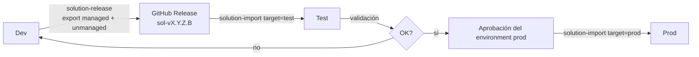

# Despliegue a Test / Prod

La solución `smlt_core_smelter` se exporta de Dev, se publica como Release y se importa (managed) a Test o Prod. Todo por workflows; no hay pasos manuales en la plataforma salvo el setup inicial de abajo.

## Flujo release → import

1. `solution-release` (versión `X.Y.Z.B`): exporta de Dev, crea el Release `sol-v<versión>` y sincroniza la metadata.
2. `solution-import` (`version`, `target=test`): baja el managed del Release, genera los settings, importa con upgrade, activa plugins/flows y verifica la versión instalada.
3. Validado en Test, se corre el mismo workflow con `target=prod`; el environment `prod` pide aprobación de los reviewers.

Se promueve siempre el **mismo zip** que pasó por Test.

## Deployment settings

`deploy/settings/{test,prod}.json` listan las dos connection references (`sanic_conn_wfe_dataverse` y `wf_sharedcommondataserviceforapps_3bc81`) con el placeholder `__DATAVERSE_CONNECTION_ID__`. El workflow lo reemplaza con `jq` usando la variable `DATAVERSE_CONNECTION_ID` del environment. Elegimos variable y no secret porque el id de una conexión no es sensible, y así se ve y se audita. No hay environment variables de solución.

## Setup único (checklist)

- [ ] Crear los GitHub Environments `test` y `prod` (Settings → Environments).
- [ ] En `prod` (y opcionalmente `test`): required reviewers y, si querés, restringir a la rama `main`.
- [ ] Secrets por environment: `DATAVERSE_URL`, `PP_CLIENT_ID`, `PP_CLIENT_SECRET`, `PP_TENANT_ID`.
- [ ] App Registration (puede ser la misma de Dev o una por entorno) y **application user** en cada entorno destino con rol System Customizer (o System Administrator si el import lo requiere).
- [ ] En cada entorno destino: crear una conexión Dataverse **propiedad del service principal** (la que será dueña del Cloud Flow) y guardar su id como variable `DATAVERSE_CONNECTION_ID` del environment.
- [ ] Verificar que el SP puede encender el flow (si falla el post-import, revisar propiedad de la conexión).
- [ ] Post-import, en cada entorno: cargar la clave HMAC a mano (un System Administrator; nunca por CI ni secret). Ver [Clave HMAC](../docs/04-admin-guide/security-and-roles.md#clave-hmac).

## Notas

- `Smelter.Deploy` es solo DEV: no se usa en este pipeline.
- El smoke post-import queda pendiente de wirear con `backend-verify`.
