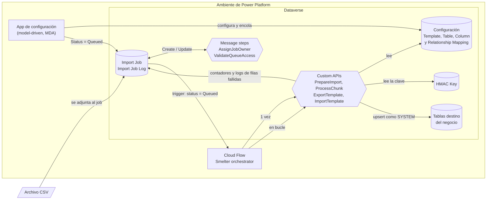
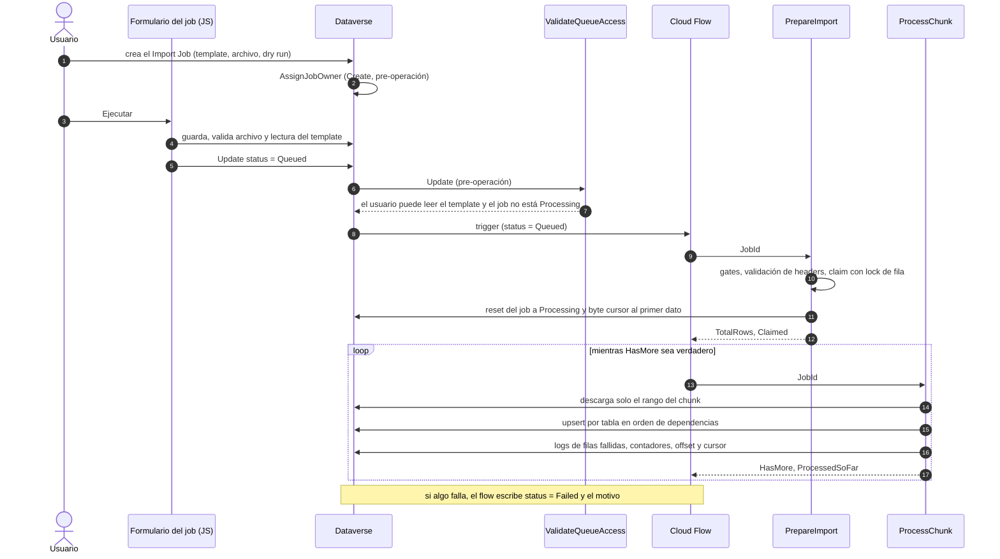
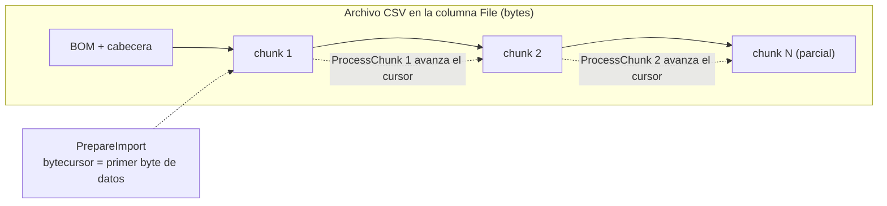
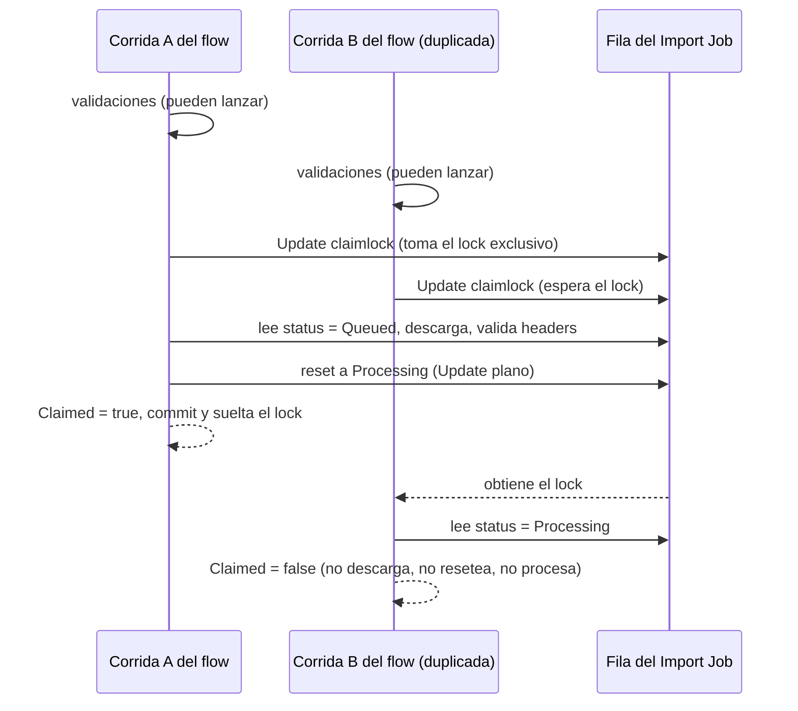

# Arquitectura

Visión de punta a punta de Smelter: qué componentes tiene, cómo viaja un archivo CSV desde que alguien pulsa **Ejecutar** hasta que las filas quedan en Dataverse y por qué se diseñó así. Está escrito para quien recibe la solución sin contexto y la tiene que instalar, mantener o modificar. El detalle de cada pieza está en los documentos 02 a 11; este documento los enlaza sin repetirlos.

## Cómo funciona

Smelter es un **normalizador de CSV a Dataverse** que corre entero dentro de Power Platform. Un archivo plano y denormalizado entra por un *Import Job*, y una configuración declarativa (el *Import Template*) decide cómo repartir cada fila en varias tablas de Dataverse. No hay código por importación: lo que cambia entre un import y otro es solo el template.

### Componentes

| Componente | Qué es | Para qué está |
|---|---|---|
| Solución `smlt_core_smelter` | Paquete de Dataverse (*solution*) con nombre visible «SMLT \| Core \| Smelter» y *publisher* de prefijo `sanic` | Transporta todo el esquema, el código, los roles, la app y el flow entre ambientes. Ver [Despliegue](08-alm-y-despliegue.md) |
| 6 tablas de Smelter más la de claves HMAC | `sanic_tbl_smlt_importtemplate`, `_tablemapping`, `_columnmapping`, `_relationshipmapping`, `_importjob`, `_importjoblog` y `_hmackey` | La configuración, el estado de cada ejecución y los fallos por fila. Ver [Modelo de datos](02-modelo-de-datos.md) |
| Plugin package `sanic_Smelter.Plugins` | Ensamblado `Smelter.Plugins` (.NET Framework 4.6.2, el que exige el sandbox de Dataverse) que incluye `Smelter.Core` (netstandard2.0, sin dependencias de Dataverse) | Toda la lógica: 4 Custom APIs y 2 plugins de *message step*. Ver [Plugins y Custom APIs](04-plugins-y-custom-apis.md) y [Motor y DSL](05-motor-y-dsl.md) |
| Cloud Flow «Smelter orchestrator» | Flujo de Power Automate con trigger sobre el Import Job | Es el **único camino de ejecución**: llama a `PrepareImport` y repite `ProcessChunk` hasta terminar. Ver [Ciclo de vida](07-ciclo-de-vida.md) |
| App de configuración | *Model-driven app* con sitemap, formularios, vistas, panel y botones en la barra de comandos | Donde el Configurador arma templates y el equipo ejecuta y monitorea jobs. Ver [App de configuración](06-app-de-configuracion.md) |
| Roles `Smelter Configurador` y `Smelter Operador` | Roles de seguridad de la solución | Quién configura y quién solo ejecuta. Ver [Seguridad](03-seguridad.md) |
| `Smelter.Deploy` y `Smelter.Verify` | Consolas .NET que hablan con Dataverse por SDK | Aprovisionan y verifican el ambiente de **desarrollo**. No se usan en otros ambientes. Ver [ALM](08-alm-y-despliegue.md) y [Pruebas](10-pruebas.md) |

### Una importación de punta a punta

1. **Alta del job.** El usuario crea un Import Job, elige un template y adjunta el CSV en la columna de archivo. En el `Create`, el plugin [`AssignJobOwnerPlugin`](../../src/Smelter.Plugins/AssignJobOwnerPlugin.cs) hace que el job nazca a nombre del *team* dueño del template, de modo que todo el equipo lo vea.
2. **Encolado.** Los botones **Ejecutar** y **Reintentar** ([`sanic_smlt_importjob_actions.js`](../../tools/Smelter.Deploy/Assets/sanic_smlt_importjob_actions.js)) no procesan nada: guardan el formulario, comprueban que haya template y archivo y que el usuario pueda leer el template, y ponen `status = Queued`. Antes de persistir, [`ValidateQueueAccessPlugin`](../../src/Smelter.Plugins/ValidateQueueAccessPlugin.cs) vuelve a validar **a la persona** que encola, sin importar por qué camino llegue la escritura (botón, API, otra app).
3. **Orquestación.** El flow se dispara cuando un job queda con `status = Queued`. Llama a `PrepareImport` y, si el job fue reclamado, itera `ProcessChunk` en un bucle *Do until* hasta que `HasMore` sea falso. La llamada a `ProcessChunk` tiene política de reintento (exponencial, 4 reintentos, intervalo `PT5M`) y el bucle tiene un tope de 5000 iteraciones y 24 horas, según el JSON del flow versionado en [`solutions/unpacked/Workflows`](../../solutions/unpacked/Workflows/).
4. **Preparación.** `PrepareImport` valida el estado del template, el acceso de quien llama, el gate de idempotencia, la coherencia de la configuración y los encabezados del CSV; cuenta las filas; toma el *claim* del job; y lo deja en `Processing` con los contadores en cero.
5. **Procesamiento.** Cada `ProcessChunk` procesa **un** tramo: lee sus filas, las convierte en registros de cada tabla destino, escribe en orden de dependencias y registra solo las filas que fallan. Cuando el tramo es parcial o vacío, el job queda `Completed` o `CompletedWithErrors`.
6. **Falla.** Si `PrepareImport` falla, o el bucle falla o vence, el flow pone el job en `Failed` y escribe el motivo en `sanic_smlt_ij_failurereason`.

> [!NOTE]
> El procesamiento corre del lado del servidor: cerrar la pestaña del navegador no afecta al job. Hasta la versión 1.3.0.0 los botones corrían `PrepareImport` y `ProcessChunk` desde el navegador; hoy hay un solo camino, el flow. Ver la [decisión D-07](12-decisiones.md#d-07-un-solo-camino-de-ejecución-el-cloud-flow).

### El cursor de bytes y la descarga parcial

El diseño original descargaba y volvía a parsear el CSV entero en cada chunk saltando `offset` filas, es decir O(N²) sobre el tamaño del archivo. Hoy cada chunk baja **solo su rango**.

- **Qué se guarda.** La columna `sanic_smlt_ij_bytecursor` (Decimal de precisión 0) guarda el **byte** del próximo registro sin leer. `PrepareImport` lo deja en el primer byte de datos, después del BOM y de la cabecera.
- **Cómo se lee.** `ProcessChunk` abre el archivo con un solo `InitializeFileBlocksDownload` y cada lectura es un `DownloadBlock` de hasta 4 MB. Extiende bloque a bloque hasta tener `chunkSize + 1` registros: el registro de más prueba que el anterior está completo. Un registro puede cruzar bloques o traer saltos de línea entre comillas.
- **Qué se descarta.** El último registro de un segmento que no llega al final del archivo no se consume: puede estar cortado a la mitad de un campo entrecomillado o de un `CRLF`.
- **Cómo se miden los bytes.** Son bytes UTF-8 calculados sobre el texto decodificado (`Parser.CharCount`) y recodificado. No se usa `CountBytes` de CsvHelper porque cuenta mal los pares subrogados (un emoji da 6 bytes en vez de 4).
- **Cuándo no aplica.** Si el archivo no se puede recorrer por bytes (UTF-16/32 o UTF-8 inválido), el cursor queda vacío y `ProcessChunk` usa el camino anterior: descarga completa y salto de `offset` filas. Lo mismo ocurre con un job preparado por una versión vieja.
- **Numeración de filas.** `RowNumber` es el índice de **registro** más uno, con la cabecera como fila 1. Un salto de línea dentro de un campo entrecomillado no suma una fila. Es el número que aparece en el Import Job Log.

El offset de filas (`sanic_smlt_ij_processingbatch`) se mantiene en paralelo: es la cantidad de filas de datos ya consumidas. Ambos avanzan **después** de procesar el chunk, de modo que si el chunk muere el reintento reprocesa el mismo tramo.

### El claim con lock de fila

Un job encolado puede disparar **varias corridas** del flow: los triggers de Dataverse son *at-least-once*. Si cada una reseteara y procesara el job, los upserts competirían y fallarían con `DuplicateRecordEntityKey` (`0x80060892`). El arreglo tiene tres capas:

1. El trigger solo reacciona al cambio de `sanic_smlt_ij_status` y filtra por `status eq 0`. Se evita deliberadamente una concurrencia global en el trigger, porque serializaría jobs distintos.
2. [`ValidateQueueAccessPlugin`](../../src/Smelter.Plugins/ValidateQueueAccessPlugin.cs) rechaza poner `Queued` sobre un job que está `Processing`.
3. **El claim atómico**, dentro de `PrepareImport`, que es lo que neutraliza los duplicados.

**Por qué un lock pesimista y no `RowVersion` más `catch`.** La primera versión del claim (1.0.12) hacía el reset con `IfRowVersionMatches` y atrapaba el fault `ConcurrencyVersionMismatch` (`0x80060882`) para devolver `Claimed = false`. Pero `PrepareImport` corre dentro de la transacción de la Custom API, y **atrapar una excepción de `OrganizationService` y seguir adelante condena la transacción**: Dataverse aborta con «ISV code reduced the open transaction count» y el flow marcaba `Failed` a la corrida perdedora mientras la otra procesaba. Con el lock no hay excepción que atrapar: la segunda corrida simplemente espera y, al obtener el lock, ya ve el job en `Processing`.

- El lock se toma con un `Update` de la columna técnica `sanic_smlt_ij_claimlock` (DateTime), **después** de todas las validaciones y **antes** de leer el status y de descargar el archivo. El `Retrieve` no bloquea, por eso el orden importa.
- Escribir `claimlock` no dispara nada: el step de `ValidateQueueAccess` filtra por `status` y el trigger del flow también.
- Si el status no es `Queued` ni vacío, `Prepare` devuelve `Claimed = false` y el flow no procesa (el bloque `Condition_claimed` queda del lado `else`).
- El status vacío cuenta como reclamable: lo usan las llamadas directas a la API (`Smelter.Verify`) sobre jobs sin status.

### Gate de idempotencia y «Solo inserción»

Reprocesar un archivo no debe duplicar datos. Por eso **todo Table Mapping necesita Dedup Columns**: la lista de columnas destino que forman la *alternate key* de la tabla. Con ellas, el escritor emite `UpsertRequest` con `KeyAttributes`, y Dataverse resuelve «crear o actualizar» en el servidor sin consultar antes.

- `PrepareImport` y también `ProcessChunk` (por si el flow se llama sobre un job que `Prepare` nunca validó) rechazan un template cuyo Table Mapping no tenga Dedup Columns, salvo que tenga el opt-in **Solo inserción (permite duplicados)** (`sanic_smlt_tm_insertonly`).
- Con ese opt-in la tabla se escribe siempre con `Create`, aunque tenga Dedup Columns, y los indicadores *Create If Not Exists* y *Update If Exists* se ignoran. Reprocesar **puede duplicar**; el motor deja una advertencia en el trace.
- El mensaje de rechazo nombra el mapping y la tabla destino, nunca valores de filas.
- Además, `TemplateValidator` exige que cada Dedup Column sea la *Target Column* de algún Column Mapping del mismo Table Mapping (salvo en «Solo inserción»).
- Las Dedup Columns solo funcionan si la tabla destino tiene una alternate key `Active` con exactamente esas columnas. Esa tabla y su key **no son de Smelter**: vienen de la solución del negocio.

Los indicadores *Create If Not Exists* y *Update If Exists* (ambos en **Sí** por defecto) siguen esta tabla:

| Existe el registro | Update If Exists | Create If Not Exists | Resultado |
|---|---|---|---|
| Sí | Sí | cualquiera | Actualiza |
| Sí | No | cualquiera | Fila `Skipped` (no escribe) |
| No | cualquiera | Sí | Crea |
| No | cualquiera | No | Fila `Skipped` (no escribe) |

Con ambos en **Sí** se usa el upsert puro, de un solo viaje. Si alguno está en **No**, el escritor paga un viaje extra por lote para saber qué registros existen (un `Retrieve` por alternate key dentro de un `ExecuteMultiple`).

### Dry run

Un job con `sanic_smlt_ij_isdryrun = Sí` recorre todo el pipeline (lectura, transformaciones, coerción de tipos, campos obligatorios, resolución de claves del padre y escritura de logs de filas fallidas) **sin escribir en las tablas destino**: `UpsertWriter` devuelve un éxito sintético por cada registro construido.

> [!WARNING]
> Un dry run valida la **forma** de los datos, no que Dataverse los acepte. Como la escritura se simula, no detecta restricciones, privilegios, claves duplicadas ni padres inexistentes. Tampoco puede producir filas `Skipped`, porque no consulta si el registro existe. Un dry run limpio no garantiza una ejecución real limpia.

### Por qué esta arquitectura

- **Sin tabla de staging.** Escribir 100.000 filas a una tabla intermedia no entra en los 2 minutos del sandbox. Reparsear el CSV por rangos es barato y distribuido. Ver [D-01](12-decisiones.md#d-01-sin-tabla-de-staging-chunks-orquestados-por-power-automate).
- **Chunks independientes orquestados por Power Automate.** El diseño original era un plugin asíncrono con auto-continuación que moría por la profundidad máxima de plugins. Cada `ProcessChunk` es una invocación corta e independiente: no hay límite acumulado de tiempo ni de profundidad.
- **Upsert por alternate key.** Hace seguros el reintento y la reanudación: reprocesar un chunk no duplica. Ver [D-03](12-decisiones.md#d-03-idempotencia-por-alternate-key-y-gate-de-dedup-columns).
- **El motor corre como SYSTEM.** Los plugins crean su `IOrganizationService` con `CreateOrganizationService(null)`: el motor escribe sin depender de los privilegios de quien dispara el flow. El derecho a **usar** un template se valida aparte, con el usuario real. Ver [Seguridad](03-seguridad.md).
- **Nunca valores de fila en mensajes ni trazas.** Un CSV puede traer datos sensibles (documentos, números de tarjeta). Los mensajes de error, el Import Job Log y el Plugin Trace Log nombran columnas y códigos de error, no valores.
- **Solo CSV.** `.xlsx` no se puede leer en streaming. Ver [D-02](12-decisiones.md#d-02-solo-csv).

## Piezas y archivos

| Pieza | Dónde está |
|---|---|
| Custom APIs y plugins de message step | [`src/Smelter.Plugins/`](../../src/Smelter.Plugins/) — `PrepareImportPlugin.cs`, `ProcessChunkPlugin.cs`, `ExportTemplatePlugin.cs`, `ImportTemplatePlugin.cs`, `AssignJobOwnerPlugin.cs`, `ValidateQueueAccessPlugin.cs` |
| Servicios que usan los plugins | [`src/Smelter.Plugins/Services/`](../../src/Smelter.Plugins/Services/) — carga de contexto, descarga por rangos, motor de normalización, escritor de upserts, exportador e importador de templates, proveedor de claves HMAC |
| Núcleo puro | [`src/Smelter.Core/`](../../src/Smelter.Core/) — parser CSV por cursor de bytes, `TransformEngine` (DSL), `DependencyResolver` (DAG), serialización y validación de templates |
| Cloud Flow | JSON versionado en [`solutions/unpacked/Workflows/`](../../solutions/unpacked/Workflows/); en Dev lo ajusta `Smelter.Deploy` (paso 7) |
| Botones de la barra de comandos | [`tools/Smelter.Deploy/Assets/`](../../tools/Smelter.Deploy/Assets/) (Ejecutar y Reintentar); web resources de exportar e importar templates en [`solutions/unpacked/WebResources/`](../../solutions/unpacked/WebResources/) |
| Aprovisionamiento de Dev | [`tools/Smelter.Deploy/`](../../tools/Smelter.Deploy/) — specs declarativas (`*Spec.cs`) y provisioners idempotentes |
| Verificación contra Dev | [`tools/Smelter.Verify/`](../../tools/Smelter.Verify/) |
| Pruebas automáticas | [`tests/`](../../tests/) — núcleo, plugins y contrato código↔metadata |
| Metadata de la solución (espejo de solo lectura) | [`solutions/unpacked/`](../../solutions/unpacked/) |
| Workflows de CI/CD | [`.github/workflows/`](../../.github/workflows/) |
| Planes de diseño (SDD) | [`openspec/`](../../openspec/) |

## Cómo se modifica

**Agregar una función al DSL de transformaciones.** Va en `TransformEngine.EvaluateFunction` (núcleo puro), con su prueba en `tests/Smelter.Core.Tests/Services/TransformEngineTests.cs`. Como el DSL se guarda como texto en el Column Mapping, no hace falta migrar datos. Ver [Motor y DSL](05-motor-y-dsl.md).

**Agregar una columna o tabla de Smelter.** Se hace por SDK en `Smelter.Deploy`: una spec declarativa (por ejemplo [`SchemaAdditionsSpec.cs`](../../tools/Smelter.Deploy/SchemaAdditionsSpec.cs)), su provisioner, su aserción en `Smelter.Verify` y, si corresponde, sus etiquetas 1033/3082. Todo cambio de esquema nace dentro de `smlt_core_smelter` para que viaje con el managed. Ver [ALM](08-alm-y-despliegue.md).

**Cambiar el código de un plugin.** Hay que subir `<Version>` en [`Smelter.Plugins.csproj`](../../src/Smelter.Plugins/Smelter.Plugins.csproj). Dataverse cachea el plugin package por versión, y sin el cambio algunos workers del sandbox siguen con el código viejo (síntoma real: `Unknown function: HMAC` de forma intermitente). Además, cada plugin deja un `BuildMarker` en el trace: súbelo también para comprobar qué build está corriendo.

**Cambiar el comportamiento de ejecución.** Si toca el flow, hay que reflejarlo en los transformers `ClientData*` de `Smelter.Deploy` (que lo reescriben de forma idempotente en cada deploy) y en el JSON de `solutions/unpacked/Workflows`. Ver [ALM](08-alm-y-despliegue.md#los-transformers-del-cloud-flow).

**Instalar en otro ambiente.** Ver [Instalación en otro tenant](09-instalacion-en-otro-tenant.md).

## Trampas y errores conocidos

> [!WARNING]
> **Los contadores del job son por par (fila, tabla destino), no por fila del CSV.** `successcount`, `failedcount` y `skippedcount` suman un resultado por cada Table Mapping que procesó la fila, mientras que `processedrows` y `totalrows` cuentan filas del archivo. Un template con 3 Table Mappings puede mostrar `successcount` hasta 3 veces `totalrows`. El estado final depende de `failedcount > 0`.

- **Límite de 2 minutos del sandbox.** El tamaño del chunk se acota a 100–10.000 filas y el escritor agrupa de a 1000 requests por `ExecuteMultiple`. Un template con muchas tablas y plugins síncronos pesados sobre las tablas destino puede acercarse al límite; en ese caso baja el *Chunk Size* del template.
- **Cobertura de rendimiento acotada.** El benchmark de `Smelter.Verify` (`--bench`) corre 100.000 filas **en dry run**, así que mide lectura, transformaciones y coerción, no la escritura real.
- **Tope por corrida del flow.** El bucle tiene un máximo de 5000 iteraciones según el JSON versionado: con chunks de 1000 filas son 5 millones de filas; con el mínimo de 100, medio millón.
- **Plugins que corren en las tablas destino.** Cualquier plugin síncrono lento sobre una tabla destino se ejecuta por cada registro del chunk. Si el chunk falla, el flow reintenta el mismo tramo (idempotente salvo «Solo inserción»).
- **Un `ProcessChunk` reintentado sobre un mapping «Solo inserción» puede duplicar.** El reintento vuelve a hacer `Create` sobre las mismas filas.
- **Las tablas destino no son de Smelter.** Una alternate key en estado `Pending` o `Failed` produce el mismo error que una key inexistente.
- **Mensajes de usuario de algunos plugins en español rioplatense.** El rechazo de `ValidateQueueAccess` se muestra tal cual al usuario; ver [Plugins y Custom APIs](04-plugins-y-custom-apis.md#validatequeueaccessplugin).
