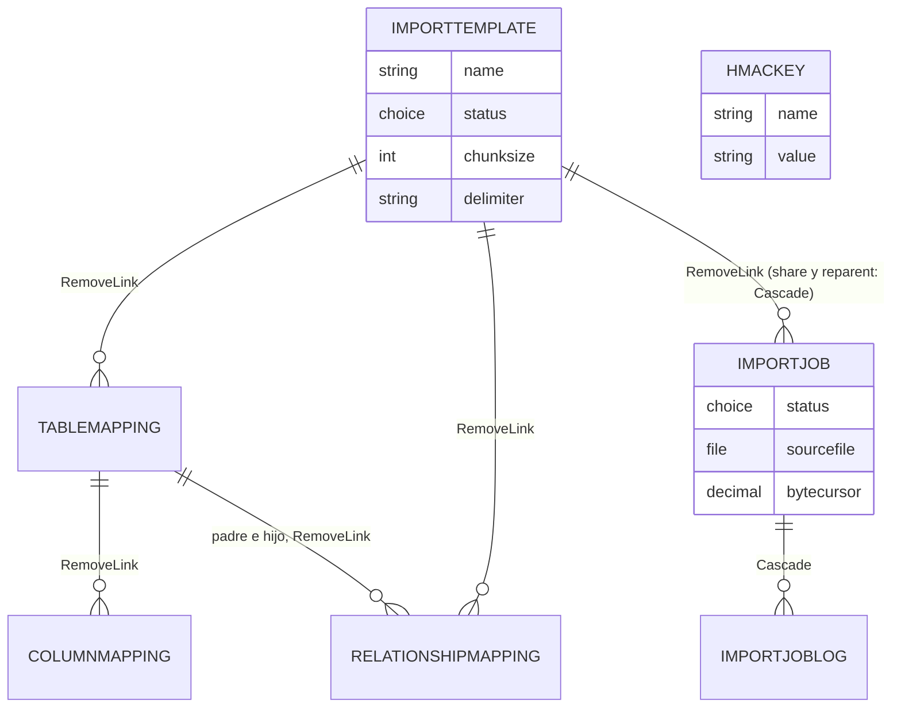

# Modelo de datos

Este documento describe las siete tablas de Dataverse de Smelter: para qué sirve cada una, sus columnas con nombre lógico, tipo y rango, sus *choices*, sus relaciones y qué pasa en cada una al borrar, compartir o reasignar. Está pensado para quien tiene que modificar el esquema, escribir un plugin o diagnosticar un dato raro en otro ambiente.

Los plugins que leen y escriben estas columnas se describen en [Plugins y Custom APIs](04-plugins-y-custom-apis.md); quién puede leer o escribir cada tabla, en [Seguridad](03-seguridad.md); y cómo se interpretan los valores de configuración, en [Motor y DSL](05-motor-y-dsl.md).

> [!NOTE]
> Los nombres, tipos y rangos de este documento salen del código de `tools/Smelter.Deploy` (las specs declarativas, que son la fuente de verdad del ambiente de desarrollo) y de `src/`. Donde hace falta metadata que solo existe en el XML de la solución (largos máximos, comportamiento de cascada), se toma de [`solutions/unpacked/`](../../solutions/unpacked/), que es un **espejo de la versión 1.3.0.0** y puede ir por detrás del ambiente. Cada vez que el espejo y el código discrepan, manda el código y se indica.

## Cómo funciona

El modelo tiene cuatro zonas:

| Zona | Tablas | Quién escribe |
|---|---|---|
| **Configuración** (qué archivo se espera y cómo se reparte) | `importtemplate`, `tablemapping`, `columnmapping`, `relationshipmapping` | El Configurador, desde la app o importando un JSON |
| **Ejecución** (una corrida concreta) | `importjob` | El usuario crea el job; el motor y el flow actualizan estado, contadores y cursor |
| **Diagnóstico** | `importjoblog` | **Solo el motor**, y solo para filas que fallan. Ningún rol puede crear logs |
| **Secreto** | `hmackey` | Un administrador, a mano, en cada ambiente |

Todas las tablas usan el prefijo `sanic_tbl_smlt_` y sus columnas, `sanic_smlt_<siglas>_`: `it` (Import Template), `tm` (Table Mapping), `cm` (Column Mapping), `rm` (Relationship Mapping), `ij` (Import Job), `ijl` (Import Job Log) y `hk` (HMAC Key). En este documento se abrevia `sanic_tbl_smlt_importjob` como `importjob`.

Los nombres visibles en inglés (LCID 1033, idioma base) llevan prefijos técnicos como `TBL | SMLT | Import Job` o `[IJ] Status` porque otras *canvas apps* los referencian en Power Fx, así que **no se pueden renombrar**. En español (LCID 3082) los nombres son legibles («Template de importación», «Estado»). Ver [App de configuración](06-app-de-configuracion.md#internacionalización-1033-y-3082).

### Diagrama de relaciones

Cada línea es un *lookup* y la etiqueta es el comportamiento al **borrar el padre**, según el espejo 1.3.0.0.

`hmackey` no tiene relaciones: el motor la lee por nombre con una consulta, y ningún rol de Smelter llega a ella.

### Estados de un template

`sanic_smlt_it_status`:

| Valor | Etiqueta (1033 / 3082) | ¿Ejecutable? |
|---|---|---|
| 0 | `Draft` / Borrador | No |
| 1 | `Active` / Activo | **Sí**, es el único estado ejecutable |
| 2 | `Archived` / Archivado | No |

`PrepareImport` y `ProcessChunk` rechazan un template que no esté `Active` con `Import Template '<nombre>' (<id>) is not Active (status=...)`. Un registro sin el atributo poblado (anterior a 1.3.0.0) se trata como `Active`.

## Las tablas

Todas son de propiedad de usuario o equipo (*UserOwned*), salvo `hmackey`, que es de la organización. La columna «Req.» refleja el nivel de requerimiento de metadata (`required` aplica a formularios y apps; el servidor no lo hace cumplir salvo donde se indica).

### `sanic_tbl_smlt_importtemplate` — «TBL | SMLT | Import Template»

La definición de **cómo leer un archivo**: formato (encabezado, delimitador), tamaño de chunk y estado. Cuelgan de ella los mappings.

| Columna | Tipo | Req. | Detalle |
|---|---|---|---|
| `sanic_smlt_it_name` | Texto (200) | Sí | Nombre principal. La importación de templates hace *upsert* por este nombre |
| `sanic_smlt_it_description` | Texto multilínea (2000) | No | Viaja en el export/import desde el formato 1.1 |
| `sanic_smlt_it_sourcetype` | Choice | Sí | Una sola opción, `CSV` (0). Por defecto CSV y **oculta en el formulario**. El importador siempre escribe 0 |
| `sanic_smlt_it_hasheaderrow` | Sí/No | Sí | Si el archivo trae fila de encabezados. Sin cabecera, las columnas se llaman `Column0`, `Column1`... |
| `sanic_smlt_it_delimiter` | Texto (5) | No | Ver [Delimitadores](#delimitadores) |
| `sanic_smlt_it_chunksize` | Número entero | No | **Entre 100 y 10.000**. Vacío usa el valor por defecto del sistema, **1000** |
| `sanic_smlt_it_status` | Choice | No | Ver [Estados de un template](#estados-de-un-template) |
| `ownerid` | Propietario | — | Usuario o *team*. Si es un team, los jobs creados contra el template nacen a nombre del team |

#### Delimitadores

El campo es texto libre y un tabulador no se puede teclear en un campo de texto, así que se aceptan alias. `CsvDelimiter.Resolve` normaliza así:

| Valor guardado | Delimitador efectivo |
|---|---|
| vacío | `,` (coma) |
| `\t` (dos caracteres), `TAB` (sin distinguir mayúsculas) o un tabulador real | tabulador |
| cualquier otro valor | ese valor, literal (por ejemplo `;` o `\|`) |

> [!WARNING]
> Un delimitador `;` o TAB solo funciona si el valor está bien escrito en el template: un error produce un archivo de «una sola columna» y `PrepareImport` falla con `CSV is missing mapped source column(s)`.

#### Chunk Size

La columna rechaza valores fuera de **100 a 10.000** (antes de 1.0.15 admitía desde 0 y el motor acotaba en silencio: un 50 se aceptaba y corría con 100). El import de templates también lo rechaza con un error de formato; allí `0` sigue siendo válido y significa «valor por defecto del sistema» (se guarda vacío). El motor, por defensa, vuelve a acotar al rango `[100, 10000]` y toma 1000 si no hay valor. La prioridad es: parámetro `ChunkSize` de la Custom API (si se pasa) > valor del template > 1000.

### `sanic_tbl_smlt_tablemapping` — «TBL | SMLT | Table Mapping»

Una fila de este tipo es **una tabla destino** que se alimenta con cada fila del CSV.

| Columna | Tipo | Req. | Detalle |
|---|---|---|---|
| `sanic_smlt_tm_name` | Texto (850) | Sí | Nombre principal. En el JSON de export se convierte en la `ref` del mapping |
| `sanic_smlt_tm_importtemplateid` | Lookup | Sí | Template dueño |
| `sanic_smlt_tm_targettable` | Texto (200) | Sí | Nombre lógico de la tabla destino (por ejemplo `contact`) |
| `sanic_smlt_tm_processingorder` | Número entero | Sí | Desempate entre tablas sin dependencia; el grafo de relaciones manda sobre él |
| `sanic_smlt_tm_dedupcolumns` | Texto (500) | Condicional | Columnas destino que forman la alternate key, separadas por coma. Cada nombre se recorta y se ignoran los vacíos. **Obligatorio** salvo «Solo inserción» |
| `sanic_smlt_tm_createifnotexists` | Sí/No | Sí | Ver la [tabla de indicadores](01-arquitectura.md#gate-de-idempotencia-y-solo-inserción) |
| `sanic_smlt_tm_updateifexists` | Sí/No | Sí | **Por defecto Sí** en registros nuevos (antes No). Los registros existentes conservan su valor |
| `sanic_smlt_tm_insertonly` | Sí/No | No | «Solo inserción (permite duplicados)». Por defecto No |

Se eliminó `sanic_smlt_tm_isjunctiontable` (placeholder de una relación N:M que nunca se implementó) y, antes, `sanic_smlt_tm_sourcesheet` (residuo de Excel).

### `sanic_tbl_smlt_columnmapping` — «TBL | SMLT | Column Mapping»

Cómo se calcula **una columna** de la tabla destino.

| Columna | Tipo | Req. | Detalle |
|---|---|---|---|
| `sanic_smlt_cm_name` | Texto (850) | Sí | Nombre principal |
| `sanic_smlt_cm_tablemappingid` | Lookup | Sí | Table Mapping dueño |
| `sanic_smlt_cm_sourcecolumn` | Texto (200) | No | Encabezado del CSV (sin distinguir mayúsculas; se recorta) |
| `sanic_smlt_cm_targetcolumn` | Texto (200) | Sí | Nombre lógico de la columna destino |
| `sanic_smlt_cm_datatype` | Choice | Sí | Ver [Tipos de dato](#tipos-de-dato) |
| `sanic_smlt_cm_isrequired` | Sí/No | No | Si la celda queda vacía (después del valor por defecto), la fila falla con `ValidationError` |
| `sanic_smlt_cm_defaultvalue` | Texto (500) | No | Se aplica antes de comprobar «obligatoria» |
| `sanic_smlt_cm_lookuptable` | Texto (200) | Condicional | Obligatorio si el tipo es `Lookup` |
| `sanic_smlt_cm_lookupmatchcolumn` | Texto (200) | No | Columna (alternate key) para resolver un lookup por valor de negocio |
| `sanic_smlt_cm_optionsetmapping` | Texto multilínea (2000) | No | JSON `{"valor origen": número}` para tipo `OptionSet` |
| `sanic_smlt_cm_transformexpression` | Texto (1000) | No | Expresión del DSL; tiene prioridad sobre `sourcecolumn` |

#### Tipos de dato

`sanic_smlt_cm_datatype`:

| Valor | Etiqueta | Tipo destino |
|---|---|---|
| 0 | `String` / Texto | Texto |
| 1 | `Integer` / Entero | Entero de 32 bits |
| 2 | `Decimal` | Decimal |
| 3 | `DateTime` / Fecha y hora | Fecha y hora |
| 4 | `Boolean` / Booleano | Sí/No |
| 5 | `Lookup` | Referencia a otra tabla |
| 6 | `OptionSet` / Conjunto de opciones | Choice |
| 7 | `Money` / Moneda | Moneda |
| 8 | `GUID` | Identificador único |

### `sanic_tbl_smlt_relationshipmapping` — «TBL | SMLT | Relationship Mapping»

Declara que una tabla destino es **hija** de otra dentro del mismo template, para que el motor resuelva el lookup del hijo contra el padre.

| Columna | Tipo | Req. | Detalle |
|---|---|---|---|
| `sanic_smlt_rm_name` | Texto (850) | Sí | Nombre principal |
| `sanic_smlt_rm_importtemplateid` | Lookup | Sí | Template dueño. Filtra los lookups de padre e hijo en el formulario |
| `sanic_smlt_rm_parenttablemappingid` | Lookup | Sí | Table Mapping padre (debe tener Dedup Columns) |
| `sanic_smlt_rm_childtablemappingid` | Lookup | Sí | Table Mapping hijo |
| `sanic_smlt_rm_relationshiptype` | Choice | Sí | Una sola opción, `OneToMany` (0) / Uno a muchos |
| `sanic_smlt_rm_lookupcolumnonchild` | Texto (200) | Sí en la práctica | Columna lookup de la tabla hija. `PrepareImport` la exige |
| `sanic_smlt_rm_parentdedupcolumns` | Texto (500) | Sí | Columnas **del CSV** que identifican al padre. Tienen que ser tantas como Dedup Columns tiene el padre, una por una y en el mismo orden |

`ManyToMany` se **eliminó del choice**: nunca estuvo implementado y el motor lo ignoraba en silencio. Un JSON de export que lo traiga se rechaza al importar, y un template ya guardado con esa relación falla en `PrepareImport` con `ManyToMany is not supported; use OneToMany`. También se eliminaron `sanic_smlt_rm_intersecttable` y `sanic_smlt_tm_isjunctiontable`.

### `sanic_tbl_smlt_importjob` — «TBL | SMLT | Import Job»

Una **ejecución**: qué archivo, con qué template, en qué estado y con qué resultado.

| Columna | Tipo | Req. | Escribe | Detalle |
|---|---|---|---|---|
| `sanic_smlt_ij_name` | Texto (850) | Sí | Usuario | Nombre principal |
| `sanic_smlt_ij_importtemplateid` | Lookup | Sí | Usuario | El formulario solo ofrece templates `Active` |
| `sanic_smlt_ij_sourcefile` | Archivo (File) | Sí | Usuario | El CSV. El espejo 1.3.0.0 declara un máximo de 131.072 KB; ver [Preguntas abiertas](#preguntas-abiertas) |
| `sanic_smlt_ij_isdryrun` | Sí/No | No | Usuario | Ver [Dry run](01-arquitectura.md#dry-run) |
| `sanic_smlt_ij_status` | Choice | No | Botones, flow, motor | Ver [Estados del job](#estados-del-job). **Vacío = el job nunca corrió** (la columna no tiene valor por defecto) |
| `sanic_smlt_ij_totalrows` | Número entero | No | `PrepareImport` | Filas de datos del archivo (cabecera excluida) |
| `sanic_smlt_ij_processedrows` | Número entero | No | `ProcessChunk` | Filas del archivo leídas hasta ahora |
| `sanic_smlt_ij_successcount` | Número entero | No | `ProcessChunk` | Resultados creados o actualizados. **Por par (fila, tabla)** |
| `sanic_smlt_ij_failedcount` | Número entero | No | `ProcessChunk` | Resultados fallidos. **Por par (fila, tabla)** |
| `sanic_smlt_ij_skippedcount` | Número entero | No | `ProcessChunk` | Resultados omitidos por *Create/Update If* en No. **Por par (fila, tabla)** |
| `sanic_smlt_ij_processingbatch` | Número entero | No | `ProcessChunk` | Offset: filas de datos ya consumidas |
| `sanic_smlt_ij_bytecursor` | Decimal (precisión 0) | No | `PrepareImport`, `ProcessChunk` | Byte del próximo registro sin leer. Rango 0 a 100.000.000.000. Se eligió Decimal y no entero porque un Whole Number de Dataverse es de 32 bits (~2,1 GB) |
| `sanic_smlt_ij_starttime` | Fecha y hora | No | `PrepareImport` | Inicio de la corrida |
| `sanic_smlt_ij_endtime` | Fecha y hora | No | `ProcessChunk` | Fin de la corrida. **Se limpia al reintentar** |
| `sanic_smlt_ij_failurereason` | Texto multilínea (4000) | No | Flow (handler Failed) | Ver [Motivo de la falla](#motivo-de-la-falla) |
| `sanic_smlt_ij_claimlock` | Fecha y hora (sin zona horaria) | No | `PrepareImport` | Columna **técnica**: solo sirve para tomar el lock de fila. Nadie la lee ni la edita; no está en ningún formulario |
| `sanic_smlt_ij_progress` | Entero (fórmula) | — | Dataverse | `RoundDown(processedrows / totalrows * 100, 0)` |
| `ownerid` | Propietario | — | Plataforma / `AssignJobOwner` | Usuario creador o *team* dueño del template |

En el formulario, los campos que produce el motor (estado, totales, contadores, offset, horas) son de **solo lectura**; quedan editables nombre, template, archivo y dry run. Esto es una ayuda de UX, no una medida de seguridad: el motor y el flow escriben por API.

Se eliminaron del esquema `sanic_smlt_ij_isretry`, `sanic_smlt_ij_totalbatches` y `sanic_smlt_ij_errorsummary`.

#### Estados del job

`sanic_smlt_ij_status`:

| Valor | Etiqueta (1033 / 3082) | Significado |
|---|---|---|
| (vacío) | — | El job nunca fue ejecutado |
| 0 | `Queued` / En cola | Esperando al flow |
| 1 | `Processing` / Procesando | `PrepareImport` lo reclamó y `ProcessChunk` está en curso |
| 2 | `Completed` / Completado | Terminó sin filas fallidas |
| 3 | `CompletedWithErrors` / Completado con errores | Terminó con al menos un resultado fallido |
| 4 | `Failed` / Fallido | Falló el pipeline (no una fila). Ver `failurereason` |

La máquina de estados completa está en [Ciclo de vida](07-ciclo-de-vida.md).

#### Motivo de la falla

`sanic_smlt_ij_failurereason` (4000 caracteres) lo escribe **solo** el handler *Failed* del flow, junto con `status = 4`. Contiene el mensaje de error de la acción que falló (`PrepareImport` o `ProcessChunk`), truncado a 4000 caracteres; si el cuerpo de la respuesta no trae mensaje, el flow usa un texto genérico de respaldo.

- **Se limpia al reintentar.** El reset de `PrepareImport` pone la columna en `null` (junto con `endtime`). Sin eso, un job `Failed` que se reintentaba y terminaba `Completed` seguía mostrando el motivo viejo.
- **No contiene valores de filas.** Los mensajes del motor nombran mapping, tabla y columna, nunca datos (ver [Motor y DSL](05-motor-y-dsl.md#errores-y-categorías)).
- Es el motivo de un fallo del **pipeline**. El detalle por fila vive en el Import Job Log.

### `sanic_tbl_smlt_importjoblog` — «TBL | SMLT | Import Job Log»

Una fila por cada **resultado fallido**. Los éxitos no se registran: solo alimentan los contadores del job.

| Columna | Tipo | Req. | Detalle |
|---|---|---|---|
| `sanic_smlt_ijl_id` | Autonumérico (`IJL-{SEQNUM:4}`) | — | Es el **nombre principal**, no un lookup |
| `sanic_smlt_ijl_importjobid` | Lookup | Sí | El job. Es el FK real; confundirlo con `ijl_id` rompió toda la escritura de logs en 1.2.1.0 |
| `sanic_smlt_ijl_rownumber` | Número entero | Sí | Fila **física** del archivo: la cabecera es la fila 1 y los datos empiezan en la 2 |
| `sanic_smlt_ijl_targettable` | Texto (255) | Sí | Tabla destino que falló. Un mismo número de fila puede tener un log por tabla |
| `sanic_smlt_ijl_status` | Choice | Sí | Solo `Failed` (3). `Created`, `Updated` y `Skipped` se eliminaron del choice |
| `sanic_smlt_ijl_errorcategory` | Choice | No | Ver [Categorías de error](#categorías-de-error) |
| `sanic_smlt_ijl_errormessage` | Texto multilínea (20000) | No | Mensaje sin valores de fila |

**Alternate key `sanic_smlt_ijl_key_logidempotente`** (*KEY \| IJL \| Log Idempotente*): `importjobid` + `rownumber` + `targettable`. Permite escribir los logs con *upsert*, así que reprocesar el mismo chunk no duplica logs. La key original incluía el autonumérico por error; `KeyProvisioner` detecta la composición incorrecta y la recrea.

#### Categorías de error

`sanic_smlt_ijl_errorcategory`:

| Valor | Etiqueta | Qué significa |
|---|---|---|
| 0 | `SourceError` / Error de origen | Fila mal formada o error inesperado al construir el registro |
| 1 | `TransformError` / Error de transformación | Falló el DSL (función desconocida, sintaxis, clave HMAC) |
| 2 | `TypeError` / Error de tipo | La celda no se pudo convertir al tipo destino |
| 3 | `ValidationError` / Error de validación | Campo obligatorio vacío |
| 4 | `LookupUnresolved` / Lookup sin resolver | El lookup no es GUID y no hay `lookupmatchcolumn` |
| 5 | `TargetData` / Datos de destino | Dataverse rechazó la escritura (restricción, privilegio, duplicado) |

La opción `Transient` (6) se eliminó: nunca se escribía.

### `sanic_tbl_smlt_hmackey` — «TBL | SMLT | HMAC Key»

Guarda las claves que usa la función `HMAC()` del DSL. **El esquema viaja en la solución; el valor nunca.** Detalle de seguridad en [Seguridad](03-seguridad.md#clave-hmac).

| Columna | Tipo | Req. | Detalle |
|---|---|---|---|
| `sanic_smlt_hk_name` | Texto (100) | Sí | Nombre principal: la **etiqueta** que escriben los templates (por ejemplo `cm-pan`) |
| `sanic_smlt_hk_value` | Texto (128) | Sí | La clave en hexadecimal (64 caracteres para 32 bytes). **Con seguridad de columna** (`IsSecured`), sin auditoría y fuera de Advanced Find |

Es una tabla de la organización (no de usuario), con auditoría de tabla activada (se ve quién creó, rotó o borró una clave, no su valor), sin notas ni actividades, fuera de todos los roles de Smelter, y **no forma parte de la app ni del sitemap**.

## Cómo se modifica

**Agregar una columna a una tabla de Smelter.** Se declara en una spec de `Smelter.Deploy` (la que corresponda, normalmente [`SchemaAdditionsSpec.cs`](../../tools/Smelter.Deploy/SchemaAdditionsSpec.cs)) con tipo, descripción y, si debe verse, su ubicación en el formulario. El provisioner la crea dentro de `smlt_core_smelter` y la agrega a la solución. Hay que sumar además: su descripción bilingüe ([`ColumnDescriptionsSpec.cs`](../../tools/Smelter.Deploy/ColumnDescriptionsSpec.cs)), su nombre en español ([`TableLabelsSpec.cs`](../../tools/Smelter.Deploy/TableLabelsSpec.cs)) y su aserción en `Smelter.Verify`. Los tests de contrato fallan si una columna viva no tiene descripción o nombre 3082.

**Eliminar una columna.** Va en [`SchemaCleanupSpec.cs`](../../tools/Smelter.Deploy/SchemaCleanupSpec.cs), requiere `--allow-destructive` y `Smelter.Verify` comprueba que ya no exista. Antes de quitar una opción de un choice, el provisioner se niega si alguna fila usa el valor (salvo los logs, que son datos de diagnóstico descartables).

**Cambiar un rango o un valor por defecto.** Va en [`SchemaTuningSpec.cs`](../../tools/Smelter.Deploy/SchemaTuningSpec.cs). Un valor por defecto solo afecta a registros **nuevos**.

**Agregar un valor a un choice del motor** (por ejemplo un tipo de dato). Además del esquema hay que tocar el enum de `Smelter.Core` (`ColumnDataType`, `ImportJobStatus`, `ErrorCategory`...) y `ChoicesContractTests`, que ata cada enum a los valores reales de la metadata.

## Trampas y errores conocidos

- **`sanic_smlt_ijl_id` no es un lookup.** Es el nombre autonumérico. El lookup al job es `sanic_smlt_ijl_importjobid`.
- **Los contadores del job no cuentan filas del CSV**, sino pares (fila, tabla destino). Ver [Arquitectura](01-arquitectura.md#trampas-y-errores-conocidos).
- **Borrar un template no borra sus mappings.** Según el espejo, las relaciones Template → Table Mapping, Template → Relationship Mapping y Table Mapping → Column Mapping usan `RemoveLink` al borrar: los hijos quedan huérfanos con el lookup vacío. La importación de templates sí los borra explícitamente al reemplazar un template existente (relaciones primero, luego columnas, luego tablas).
- **Borrar un job borra sus logs** (cascada total en Import Job → Import Job Log).
- **Los valores por defecto cambian solo registros nuevos.** `Update If Exists = Sí` nació como default en 1.0.10; los mappings anteriores conservan lo que tenían.

## Preguntas abiertas

- **Tamaño máximo del archivo.** El espejo 1.3.0.0 declara 131.072 KB (128 MB) como máximo de la columna `sanic_smlt_ij_sourcefile`, mientras que el diseño del cursor de bytes parte de que «un File column llega a 10 GB». No hay en el repositorio una verificación del valor vigente en Dev ni una prueba con archivos de ese tamaño. Antes de prometer un tamaño máximo a un cliente, hay que leer la propiedad *Maximum file size* de la columna en el ambiente real.
