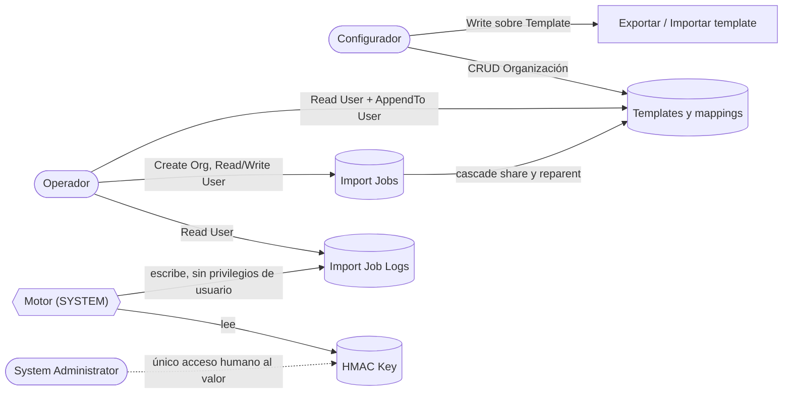

# Seguridad

Este documento explica quién puede hacer qué en Smelter, cómo se protege el acceso a los templates y a los jobs, por qué ningún rol puede crear logs y cómo se custodia la clave de la función `HMAC()`. Está pensado para quien instala la solución, asigna roles o revisa el modelo de acceso.

El aprovisionamiento de roles, cascadas y privilegios de las Custom APIs vive en [`SecuritySpec.cs`](../../tools/Smelter.Deploy/SecuritySpec.cs) y [`SecurityProvisioner.cs`](../../tools/Smelter.Deploy/SecurityProvisioner.cs); este documento describe el **resultado**. Cómo se instala en otro tenant está en [Instalación en otro tenant](09-instalacion-en-otro-tenant.md).

## Cómo funciona

El modelo separa dos perfiles de personas y una identidad técnica:

| Perfil | Rol de seguridad | Qué hace | ¿Ve la app de configuración? |
|---|---|---|---|
| **Configurador** | `Smelter Configurador` | Crea y edita templates y mappings, exporta e importa templates, ve todos los jobs y logs. Son los usuarios de la *model-driven app* (MDA) | **Sí** |
| **Operador** | `Smelter Operador` | Usa una aplicación propia del cliente (por ejemplo una *canvas app*) para crear Import Jobs contra los templates de su equipo, encolarlos y ver su resultado. **No** configura | **No** |
| **Motor** | (ninguno) | Los plugins corren como SYSTEM | — |

Los administradores del ambiente (System Administrator) ven la MDA y la tabla de claves por la naturaleza de su rol, no por el modelo de Smelter.

### Matriz de privilegios

Cada celda es el nivel de acceso de **todos los privilegios CRUD y de Append** salvo donde se indica. *Organización* = `Global`: ve y opera cualquier registro. *Usuario* = `Basic`: registros propios **y los de los teams a los que pertenece el usuario**.

| Tabla | `Smelter Configurador` | `Smelter Operador` |
|---|---|---|
| Import Template | Create, Read, Write, Delete, Append, AppendTo: Organización | Read: Usuario. AppendTo: Usuario |
| Table Mapping | CRUD + Append/AppendTo: Organización | Read: Organización |
| Column Mapping | CRUD + Append/AppendTo: Organización | Read: Organización |
| Relationship Mapping | CRUD + Append/AppendTo: Organización | Read: Organización |
| Import Job | CRUD + Append/AppendTo: Organización | Create: Organización. Read y Write: Usuario |
| Import Job Log | Read, Write, Delete, Append, AppendTo: Organización. **Sin Create** | Read: Usuario. **Sin Create** |
| HMAC Key | **Ninguno** | **Ninguno** |

> [!IMPORTANT]
> **Ningún rol puede crear Import Job Logs.** Los logs los escribe únicamente el motor (`ProcessChunkPlugin`, con un `IOrganizationService` de SYSTEM, que ignora los privilegios del usuario). Quitar `prvCreatesanic_tbl_smlt_importjoblog` hace que la plataforma esconda por sí sola los botones «Nuevo Log de importación» (en el subgrid del job, en la lista y en el formulario) sin tocar la barra de comandos. Como `AddPrivilegesRole` solo suma, el provisioner declara el privilegio como **prohibido** (`RoleSpec.Denied`), lo quita con `RemovePrivilegeRole` si está presente, y `Smelter.Verify` exige que esté ausente en ambos roles.

El Operador **no** tiene Write, Create ni Delete sobre templates ni mappings: no puede cambiar cómo se interpreta un archivo. Tampoco puede exportar ni importar templates (ver más abajo).

### Cómo se evita saltarse el control

Hay varias capas, cada una cubriendo un hueco de la anterior:

| Capa | Dónde | Qué impide |
|---|---|---|
| Privilegios del rol | Dataverse | Que alguien sin Write sobre el job lo modifique |
| `ExecutePrivilegeName` de cada Custom API | `customapi.executeprivilegename` | Que un Operador exporte o importe templates; que alguien sin Create sobre jobs prepare o procese uno |
| Botón **Ejecutar**/**Reintentar** | `sanic_smlt_importjob_actions.js`, bajo el usuario | Que se encole un job sin archivo, sin template o con un template que el usuario no puede leer (HTTP 403 al leerlo) |
| [`ValidateQueueAccessPlugin`](../../src/Smelter.Plugins/ValidateQueueAccessPlugin.cs) | Pre-operación síncrona en `Create` y `Update` del job | Que cualquiera con Write sobre un job lo ponga en `Queued` por API sin poder leer su template |
| [`PrepareImportPlugin`](../../src/Smelter.Plugins/PrepareImportPlugin.cs) | Primera llamada del flow | Que se ejecute un job cuyo template la identidad del flow no puede leer |
| [`AssignJobOwnerPlugin`](../../src/Smelter.Plugins/AssignJobOwnerPlugin.cs) | Pre-operación síncrona en `Create` del job | Que los jobs de un equipo queden aislados en su creador |

**`ExecutePrivilegeName` por Custom API:**

| Custom API | Privilegio requerido | ¿Quién lo tiene? |
|---|---|---|
| `sanic_capi_smelter_exporttemplate` | Write sobre Import Template | Solo el Configurador |
| `sanic_capi_smelter_importtemplate` | Write sobre Import Template | Solo el Configurador |
| `sanic_capi_smelter_prepareimport` | Create sobre Import Job | Configurador y Operador |
| `sanic_capi_smelter_processchunk` | Create sobre Import Job | Configurador y Operador |

> [!WARNING]
> **Lo que el flow valida es al flow, no a la persona.** El Cloud Flow corre con la identidad de su conexión, así que dentro de `PrepareImport` el `InitiatingUserId` es esa identidad. La verificación «¿puede esta **persona** leer el template?» solo se puede hacer al **encolar**, y por eso existe `ValidateQueueAccessPlugin`: usa el `InitiatingUserId` de la escritura que pone el job en `Queued`, que sí es la persona (o la aplicación) que lo hace. Consecuencia práctica: la cuenta dueña de la conexión del flow necesita leer **todos** los templates, así que debe tener el rol `Smelter Configurador` (o System Administrator). Un Operador como dueño de la conexión haría fallar cualquier job de otro equipo con `User <id> does not have Read access to the Import Template`.

### Propiedad de templates y jobs por equipo

La visibilidad del Operador sale de ser miembro de un **team que es dueño del template**.

1. Los templates son de usuario o equipo (*UserOwned*). Se **asigna** el template al team (campo *Owner*): el Operador tiene Read y AppendTo a nivel *Usuario*, que cubre los registros propios y los de sus teams.
2. Al crear un job contra ese template, `AssignJobOwnerPlugin` lo deja a nombre del **mismo team**, y gana a cualquier `ownerid` explícito del payload (la regla es determinista). Con Read/Write de nivel *Usuario* sobre el job, todos los miembros del team ven y operan los jobs de cualquiera de ellos, sin tocar la matriz de privilegios.
3. Si el template es de un **usuario**, o el job no tiene template, el dueño queda en el default de la plataforma (el creador).
4. Para dar acceso a **teams adicionales** sin cambiar el dueño se usa *Share* con Read y AppendTo. La relación Template → Import Job tiene `CascadeShare = Cascade` y `CascadeReparent = Cascade`, así que el acceso se propaga a los jobs.
5. El team necesita tener un rol de seguridad (el de Operador) para poder ser dueño de registros.

`AssignJobOwnerPlugin` lee el dueño del template como SYSTEM, para que esa lectura no dependa de los privilegios de quien crea el job. El derecho a **usar** el template lo valida aparte `ValidateQueueAccess`.

### Acceso a la app de configuración

La MDA queda asociada solo a `Smelter Configurador` (relación `appmoduleroles`), más `System Administrator` y `System Customizer`, que la plataforma asocia a toda app model-driven y no se pueden quitar. El Operador no la ve en su selector.

> [!NOTE]
> Los botones **Ejecutar** y **Reintentar** viven en la MDA. Un Operador que trabaje desde su propia aplicación no los usa: pone el job en `Queued` por su cuenta y `ValidateQueueAccess` aplica igual. Ver [App de configuración](06-app-de-configuracion.md#botones-de-la-barra-de-comandos).

## Clave HMAC

La función `HMAC(valor, "nombreKey")` del DSL calcula un HMAC-SHA256 con una clave que el motor busca **por nombre** en la tabla `sanic_tbl_smlt_hmackey`. El segundo argumento es una **etiqueta**, nunca el material de la clave: la expresión se guarda en Dataverse, se exporta en el JSON del template y se ve en el job.

| Propiedad | Valor |
|---|---|
| Esquema (tabla y columnas) | Viaja en la solución `smlt_core_smelter` |
| **Valor de la clave** | **Se carga a mano en cada ambiente.** Nunca por CI, nunca en el repositorio, nunca en un GitHub secret |
| Quién lee el valor | El motor (SYSTEM) y los System Administrator. Ningún rol de Smelter tiene privilegios sobre la tabla |
| Seguridad de columna | `IsSecured = true` sobre `sanic_smlt_hk_value`. El formulario muestra el valor enmascarado |
| Perfil de seguridad de columna (*field security profile*) | **No se crea ninguno** por código. Sin perfil, solo SYSTEM y System Administrator acceden |
| Auditoría | Activada en la **tabla** (se ve quién creó, modificó o borró una clave); desactivada en la **columna del valor** |
| Advanced Find | La columna del valor no es válida para búsquedas avanzadas |
| Propiedad | Tabla de la organización; no está en la app ni en el sitemap |
| Formato | Hexadecimal, de largo par, de **al menos 32 bytes** (64 caracteres) |
| Lectura | Consulta con `statecode = 0` y nombre exacto. Más de una fila activa con el mismo nombre es un error |

### Por qué se carga a mano

El valor de la clave es el único secreto de Smelter. Si viajara en la solución, quedaría en el repositorio y en los zips de cada Release; si viajara por CI, pasaría por GitHub secrets que cualquier administrador del repositorio puede reconfigurar. Cargarla a mano, **una vez por ambiente**, deja el secreto fuera de todo artefacto versionado. La clave que usa `Smelter.Verify` en Dev es una clave **temporal** (`smoke-verify`) generada en memoria, que no se imprime y se borra al terminar.

### Riesgo aceptado

La clave vive en Dataverse. Por eso:

- Cualquier System Administrator del ambiente puede leerla; la seguridad de columna **no** se la oculta.
- Las copias y los backups del ambiente la arrastran. Al copiar un ambiente hacia uno inferior hay que reemplazarla.
- La columna del valor no se audita, así que no queda rastro de quién la leyó.

La alternativa evaluada es una implementación de `IHmacKeyProvider` basada en identidad administrada y Azure Key Vault. Produciría **los mismos hashes** con la misma clave, así que migrar no rompería nada. No se adoptó porque un plugin de Custom API no puede recibir *secure configuration* y los secretos de variables de entorno respaldados por Key Vault no llegan a los plugins. Ver [D-10](12-decisiones.md#d-10-la-tabla-de-claves-hmac-viaja-en-la-solución-el-valor-no).

### Reglas de custodia

- Una clave **distinta por ambiente**, salvo que los hashes deban coincidir entre ambientes (en ese caso, el ambiente inferior hereda la custodia del superior).
- La clave se genera con un generador criptográfico (por ejemplo `openssl rand -hex 32`) y se guarda en el gestor de contraseñas de la organización.
- **Rotar no es un cambio en caliente.** Cambiar la clave cambia todos los hashes: si un template hace upsert por una columna HMAC, los registros existentes dejan de coincidir y la siguiente carga **crea duplicados**. Rotar exige una migración planificada que recalcule los hashes existentes.
- El procedimiento paso a paso está en [Instalación en otro tenant](09-instalacion-en-otro-tenant.md#7-clave-hmac).

### Cómo falla el motor sin clave

Cada caso produce una fila fallida con categoría `TransformError`; el resto del chunk sigue. El mensaje nunca incluye el valor de entrada ni la clave.

| Causa | Mensaje |
|---|---|
| La tabla no existe en el ambiente | `HMAC: key store not available in this environment ('<nombre>').` |
| No hay fila activa, o la clave mide menos de 32 bytes | `HMAC: key '<nombre>' missing or shorter than 32 bytes.` |
| Valor que no es hexadecimal válido o de largo impar | `HMAC: key '<nombre>' is not valid hex.` |
| Más de una fila activa con ese nombre | `HMAC: more than one active key named '<nombre>'.` |
| El nombre de clave no es un literal con forma de etiqueta | `HMAC: the key name must be a string literal label (a letter, then letters, digits, '-' or '_').` |

El nombre de la clave tiene que ser un literal (`^[A-Za-z][A-Za-z0-9_-]{0,49}$`) y se valida **antes** de evaluar los argumentos. Así, `HMAC(Pan, Pan)` falla sin que el valor de la columna llegue al mensaje de error ni a la consulta de la clave.

## Datos sensibles en mensajes y trazas

Un CSV puede traer documentos de identidad o números de tarjeta. El motor sigue estas reglas para que nada de eso llegue al Import Job Log, al `failurereason` ni al Plugin Trace Log:

- `TypeCoercer` informa el **tipo destino y el largo** del valor, nunca el valor. La columna la agrega `NormalizationEngine`: `Column '<destino>' (source '<fuente>'): Cannot convert value (<n> chars) to <tipo>.`
- Un fallo de escritura de Dataverse se registra solo con su código: `Dataverse rejected the write (ErrorCode 0x<código>).` El mensaje original suele traer el valor de la clave duplicada.
- Un lookup sin resolver informa la columna, no el valor.
- Los gates de configuración nombran mapping, tabla y columna, nunca filas.
- Los marcadores de build de cada plugin identifican la versión en el trace, no datos.

## Cómo se modifica

**Cambiar los privilegios de un rol.** Se edita [`SecuritySpec.cs`](../../tools/Smelter.Deploy/SecuritySpec.cs) (matriz declarativa) y se vuelve a correr `Smelter.Deploy`; `Smelter.Verify` (`[SEC]`) comprueba que el rol del ambiente contiene cada privilegio de la spec con su profundidad y que los prohibidos están ausentes. Para **quitar** un privilegio hay que declararlo en `DeniedPrivileges`, porque el provisioner solo suma.

**Agregar un rol o una Custom API.** Una Custom API nueva necesita su `ExecutePrivilegeName` en [`ApiSpec.cs`](../../tools/Smelter.Deploy/ApiSpec.cs), reutilizando un privilegio existente.

**Dar a un Operador acceso a la MDA.** No se hace desde la solución: hay que compartir la app con el rol o el usuario a mano. Coordínalo con el equipo de desarrollo, porque no está verificado qué ocurre con ese ajuste en un *upgrade* de la solución.

## Trampas y errores conocidos

- **Roles con la cuenta equivocada.** Si el dueño de la conexión del flow solo tiene `Smelter Operador`, los jobs de otros equipos fallan en `PrepareImport` con `does not have Read access to the Import Template`.
- **Team sin rol.** Dataverse rechaza asignar un template a un team que no tiene ningún rol de seguridad.
- **Operador sin la app.** Es el comportamiento diseñado: la app es del Configurador.
- **La vista «My Import Jobs» de la plataforma no muestra los jobs de un equipo**, porque filtra por dueño igual al usuario. Se usan las vistas de Smelter (`Active jobs`, `All jobs`...).
- **Auditoría del ambiente apagada.** La auditoría de la tabla de claves viaja con la solución, pero no registra nada si el ambiente tiene la auditoría apagada.
- **Mensajes de rechazo en español rioplatense.** `ValidateQueueAccessPlugin` devuelve `No tenés acceso al Import Template de este job: no se puede poner en cola.` al usuario. Es el mensaje real del código; la documentación de producto no usa ese registro.

## Preguntas abiertas

- **Privilegios más allá de la spec.** El rol `Smelter Operador` exportado en el espejo 1.3.0.0 incluye `Append` y `AppendTo` sobre Import Job y sobre Import Job Log, además de lecturas de plugin assembly, plugin type, steps de mensaje y datos de SharePoint, que **no** figuran en `SecuritySpec`. `Smelter.Verify` comprueba que existan los privilegios de la spec, no que no haya otros. Si el rol se recreara solo desde la spec en un ambiente nuevo, quedaría sin esos extras; no hay en el repositorio una prueba de que un Operador pueda crear un job sin `Append` sobre Import Job.
- **Dueño de los logs.** Los crea SYSTEM; el repositorio no verifica a quién quedan asignados, y de eso depende que un Operador (Read nivel *Usuario*) los vea. La relación Import Job → Import Job Log es de cascada total (asignación, compartido, reparent), lo que sugiere que siguen al job, pero no hay una prueba E2E que lo confirme.
- **Escritura del valor por un System Administrator.** Los comentarios del código afirman que el System Administrator accede a la columna asegurada sin perfil. No hay una prueba en el repositorio de que pueda *guardar* el valor desde el formulario sin ser miembro de un perfil de seguridad de columna. Si no pudiera, hay que crear un perfil con permiso de lectura y actualización sobre `sanic_smlt_hk_value` y agregarlo a las personas autorizadas; ese perfil no viaja en la solución.
