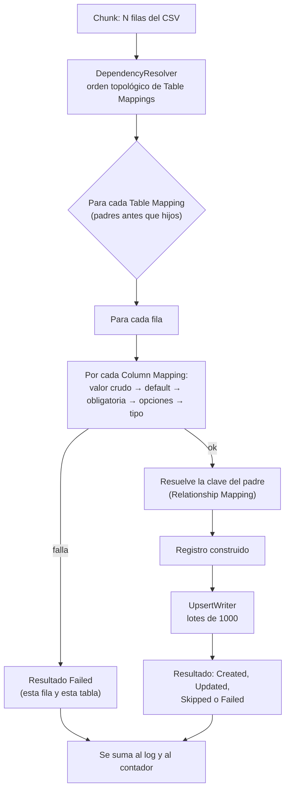

# Motor y DSL

Este documento explica cómo el motor convierte una fila de CSV en registros de Dataverse: el orden en que resuelve cada celda, cómo interpreta cada tipo de dato, cómo se escribe una expresión de transformación, cómo se calcula la clave del padre en una relación y qué errores puede producir cada etapa. Está pensado para quien configura templates complejos o modifica el motor.

Los plugins que ejecutan este pipeline se describen en [Plugins y Custom APIs](04-plugins-y-custom-apis.md); las columnas de configuración, en [Modelo de datos](02-modelo-de-datos.md).

## Cómo funciona

### El pipeline por fila

`NormalizationEngine.ProcessBatch` recibe las filas de **un chunk** y produce un resultado por cada par (fila, tabla destino).



Cada tabla es independiente: si una fila falla al construir el registro de una tabla, las demás tablas de esa misma fila **siguen procesándose**. Si el padre falla al escribirse, el hijo que lo referencia fallará en Dataverse (la referencia por alternate key no resuelve) y se registrará como `TargetData`.

No hay deduplicación en memoria ni estado entre chunks: cada fila vuelve a hacer el upsert de su padre, y la idempotencia sale de la alternate key.

### Lectura del CSV

`CsvParserService` usa CsvHelper 30 con estas decisiones:

| Aspecto | Comportamiento |
|---|---|
| Recorte | Todos los campos se recortan (`TrimOptions.Trim`): `"  Ana "` llega como `Ana`; una celda solo de espacios llega vacía |
| Campos faltantes | Una fila con menos campos que encabezados completa con vacío; una con más ignora el exceso |
| Datos mal formados | `BadDataFound` y `MissingFieldFound` están desactivados: el parser no lanza, devuelve lo que puede |
| Comillas | Se respetan campos entrecomillados con delimitadores y saltos de línea |
| Cabecera | Con `HasHeaderRow`, los nombres se recortan; sin cabecera, las columnas se llaman `Column0`, `Column1`... y el mapping usa esos nombres |
| Encabezados repetidos | El último valor pisa al anterior (los valores van a un diccionario) |
| Mayúsculas | Los nombres de columna se comparan **sin distinguir mayúsculas** de punta a punta, también dentro de las expresiones |
| Codificación | UTF-8 con o sin BOM para el recorrido por cursor de bytes. UTF-16/32 o UTF-8 inválido: camino alterno de descarga completa |
| Delimitador | Ver [Modelo de datos](02-modelo-de-datos.md#delimitadores) |

### Resolución de cada celda

`NormalizationEngine.ApplyColumnMappings` aplica este orden **por Column Mapping**:

1. **Valor crudo.** Si hay `TransformExpression`, se evalúa (tiene prioridad). Si no, se toma la celda de `SourceColumn` (recortada, sin distinguir mayúsculas). Sin ninguno de los dos, no hay valor.
2. **Valor por defecto.** Si el valor está vacío y hay `DefaultValue`, se usa.
3. **Obligatoria.** Si `IsRequired` y sigue vacío: la fila falla con `ValidationError` y el mensaje `Required field '<destino>' (Source: '<origen>') is empty.` El valor por defecto se aplica **antes** de esta comprobación, así que satisface una columna obligatoria.
3b. **Clave de dedup vacía** (1.0.16). Una vez armada la fila, si el Table Mapping **no** es «Solo inserción» y alguna de sus Dedup Columns quedó vacía (sin valor, o solo espacios), la fila falla con `ValidationError` y no se escribe: `Dedup key '<destino>' is empty (Source: '<origen>').` (sin la parte del origen si la columna es una expresión sin `SourceColumn`). Antes, un upsert con la clave vacía no podía coincidir con nadie y creaba un registro nuevo en cada corrida. El valor por defecto y las transformaciones se aplican antes, así que pueden satisfacer la clave. Con «Solo inserción» no hay búsqueda por clave y la fila se escribe como siempre.
4. **Vacío no obligatorio.** Se omite la columna (no se envía a Dataverse; no se pisa con vacío).
5. **Mapeo de opciones y conversión de tipo** (ver abajo).
6. **Lookup.** Si el tipo es `Lookup`, se envuelve en una `EntityReference`.

> [!WARNING]
> Una celda vacía **no limpia** el valor existente en Dataverse: la columna simplemente no se envía. Hoy no hay forma de «borrar» un valor desde un CSV.

### Tipos de dato

`TypeCoercer` convierte el texto ya recortado según el tipo del Column Mapping. Un valor vacío siempre da «sin valor». Los errores son `TypeError` y **nunca incluyen el valor**, solo el tipo destino y el largo.

| Tipo | Regla de conversión | Notas |
|---|---|---|
| `String` | El texto recortado | Dataverse rechaza el exceso de largo (`TargetData`) |
| `Integer` | `int.TryParse`, cultura invariante, solo signo y dígitos | 32 bits. Sin separador de miles |
| `Decimal` | `decimal.TryParse` con `NumberStyles.Number`, cultura invariante | Punto decimal; la coma se interpreta como separador de miles: `1,234.50` es 1234.5 |
| `Money` | Igual que `Decimal`, envuelto en `Money` | |
| `DateTime` | `DateTime.TryParse`, cultura invariante. Si falla, número de serie de Excel entre 2 y 73415 (aprox. años 1900 a 2100) | Fuera de ese rango, un número no se toma como fecha. No hay conversión de zona horaria |
| `Boolean` | `true`, `1`, `yes` → verdadero; `false`, `0`, `no` → falso (sin distinguir mayúsculas) | Cualquier otro valor da `TypeError` |
| `GUID` | `Guid.TryParse` | |
| `OptionSet` | Si hay `OptionSetMapping`, se busca el valor en el JSON; si no hay coincidencia, el valor debe ser un entero | Ver abajo |
| `Lookup` | Se conserva el texto; el motor arma la referencia | Ver abajo |

**Opciones.** `OptionSetMapping` es un JSON plano `{"Activo": 1, "Inactivo": 2}`. El motor busca `"<valor>": <entero>` con una expresión regular (el valor se escapa). Si no hay coincidencia, intenta tomar el valor como entero; si tampoco lo es, falla con `TypeError` y el aviso `Use MAP transform if mapping is required`. También puede resolverse con la función `MAP` del DSL.

**Lookups.** Con tipo `Lookup`:

| El valor de la celda es... | Resultado |
|---|---|
| Un GUID | `EntityReference(LookupTable, guid)` |
| Otro texto y hay `LookupMatchColumn` | Referencia por alternate key sobre esa columna: Dataverse la resuelve al escribir, sin buscar el GUID antes |
| Otro texto y no hay `LookupMatchColumn` | La fila falla con `LookupUnresolved`: `Lookup '<destino>' value is not a GUID and no LookupMatchColumn is configured.` |

Un `Lookup` sin `LookupTable` ni siquiera pasa `PrepareImport`.

### Tablas hijas y claves del padre

Una *Relationship Mapping* `OneToMany` dice «la tabla hija tiene un lookup al padre». El motor no busca el GUID del padre: manda una referencia **por alternate key** y deja que Dataverse la resuelva al escribir. Eso exige que:

- el padre haya sido escrito antes (el grafo de relaciones garantiza el orden: se ordena con el algoritmo de Kahn, y `ProcessingOrder` solo desempata entre tablas sin dependencia);
- el padre tenga Dedup Columns, y la alternate key de su tabla destino las incluya;
- `Parent Dedup Columns` liste, **en el mismo orden**, las columnas **del CSV** que identifican al padre: la primera corresponde a la primera Dedup Column del padre, y así sucesivamente.

**El valor de cada columna de la clave se calcula con el mismo pipeline que el Table Mapping padre aplica a esa columna destino**: transformación, valor por defecto, mapeo de opciones y conversión de tipo. Antes el hijo mandaba el valor crudo del CSV, y un padre con clave `HMAC(Pan, "k")` (o con un tipo convertido o con un valor por defecto) nunca resolvía para sus hijos. Si el padre no tiene transformación para esa columna, se usa la columna del CSV que nombra `Parent Dedup Columns` (así funcionan templates donde los nombres difieren). Si el padre no tiene Column Mapping para la columna de clave, se usa el valor crudo (y `PrepareImport` lo rechaza antes por coherencia).

Si hay un ciclo (`A` hijo de `B` y `B` hijo de `A`), o una tabla referida a sí misma, el motor lo detecta con `Circular dependency detected...`. Esa comprobación ocurre al procesar el **primer chunk**, no en `PrepareImport`.

### Claves de deduplicación

Las Dedup Columns determinan la identidad de un registro: forman la alternate key con la que se hace el upsert. Tres reglas prácticas:

- **Cada Dedup Column debe ser la Target Column de un Column Mapping del mismo mapping.** `PrepareImport` lo comprueba.
- **El valor de la clave sale de los valores ya convertidos.** Si es una columna calculada (por ejemplo un HMAC), la clave es el resultado.
- **Una clave incompleta no deduplica.** Si alguna columna de la clave queda vacía en una fila, el registro se envía sin esa parte de la clave y no hay con qué reconocerlo: el código parte de que Dataverse lo trata como una creación (comentario de `UpsertWriter`; el repositorio no lo prueba), así que cada ejecución podría crear un registro nuevo. Marca como **obligatorias** (`Is Required`) todas las columnas que forman la clave.

> [!WARNING]
> Ver [Arquitectura](01-arquitectura.md#gate-de-idempotencia-y-solo-inserción) para el gate que rechaza un mapping sin Dedup Columns y para el opt-in «Solo inserción».

## El DSL de transformaciones

Es un lenguaje mínimo guardado como texto en `sanic_smlt_cm_transformexpression` (máximo 1000 caracteres). Lo evalúa `TransformEngine`, que es puro (sin Dataverse) y sin estado.

### Sintaxis

Una expresión es **una** de estas formas, y los argumentos pueden ser a su vez expresiones:

| Forma | Ejemplo | Valor |
|---|---|---|
| Literal de texto, entre comillas dobles; `""` representa una comilla | `"Hola ""mundo"""` | `Hola "mundo"` |
| Literal numérico | `3`, `-1`, `0.5` | El número, como texto |
| Referencia a una columna del CSV | `FirstName` | El valor de la celda; vacío si no existe |
| Llamada a función | `UPPER(TRIM(Name))` | El resultado |

Reglas:

- Los nombres de función **no distinguen mayúsculas** (`concat`, `CONCAT` y `Concat` son iguales).
- Las referencias a columnas **tampoco** distinguen mayúsculas.
- Una referencia a columna es un identificador: empieza con letra o `_` y sigue con letras, dígitos o `_`. **Un encabezado con espacios, guiones o que empiece con un dígito no se puede referenciar dentro de una expresión.** Sí funciona en `Source Column` sin transformación.
- Todo el resultado de una expresión es texto; después pasa por el mismo `TypeCoercer` del tipo destino.
- Una expresión vacía o en blanco devuelve «sin valor».

### Funciones

| Función | Firma | Qué hace | Ejemplo |
|---|---|---|---|
| `CONCAT` | `CONCAT(a, b, ...)` | Une los valores | `CONCAT(First, "-", Last)` |
| `UPPER` | `UPPER(v)` | Mayúsculas (cultura invariante) | `UPPER(Country)` |
| `LOWER` | `LOWER(v)` | Minúsculas (cultura invariante) | `LOWER(Email)` |
| `TRIM` | `TRIM(v)` | Quita espacios de los extremos | `TRIM(Name)` |
| `LEFT` | `LEFT(v, n)` | Los primeros `n` caracteres; si `v` es más corto devuelve `v`; si `n` no es entero devuelve vacío | `LEFT(Code, 3)` |
| `RIGHT` | `RIGHT(v, n)` | Los últimos `n` caracteres | `RIGHT(Phone, 10)` |
| `DATEPARSE` | `DATEPARSE(v, formato)` | Interpreta `v` con `DateTime.ParseExact` (cultura invariante) y devuelve una fecha ISO 8601; si no coincide devuelve vacío | `DATEPARSE(Dt, "dd/MM/yyyy")` |
| `REPLACE` | `REPLACE(v, buscar, reemplazo)` | Reemplaza todas las apariciones (comparación ordinal) | `REPLACE(Phone, "-", "")` |
| `SPLIT` | `SPLIT(v, separador, índice)` | Divide y toma la parte `índice` (base 0); fuera de rango devuelve vacío | `SPLIT(Full, "\|", 1)` |
| `IF` | `IF(v, igual_a, entonces, sino)` | Compara `v` con `igual_a` (igualdad exacta, sensible a mayúsculas) | `IF(Code, "A", "is-a", "not-a")` |
| `COALESCE` | `COALESCE(a, b, ...)` | El primer valor no vacío | `COALESCE(Mobile, Phone)` |
| `STATIC` | `STATIC(v)` | Un valor fijo | `STATIC("Importado")` |
| `MAP` | `MAP(clave, json)` | Traduce `clave` con un JSON plano; sin coincidencia devuelve vacío | `MAP(Code, "{""A"":""Alpha""}")` |
| `HMAC` | `HMAC(v, "nombreKey")` | HMAC-SHA256 en hexadecimal minúsculas | `HMAC(CardNumber, "cm-pan")` |

Una función a la que le faltan argumentos devuelve vacío en vez de fallar, salvo `HMAC`, que exige exactamente dos. `MAP` admite valores de texto (`"A":"Alpha"`) y numéricos (`"A":1`); la búsqueda no es un parseo JSON completo, así que no admite anidamiento. Dentro de un campo de Dataverse, las comillas dobles del JSON se escriben duplicadas: `MAP(Code, "{""A"":""Alpha"",""B"":""Beta""}")`.

### `HMAC`

`HMAC(valor, "nombreKey")` calcula **HMAC-SHA256** del valor con la clave registrada con ese nombre y devuelve 64 caracteres hexadecimales en minúsculas. Sirve para derivar un identificador buscable de un dato sensible (por ejemplo el número de una tarjeta) sin guardar el dato: el mismo valor y la misma clave dan siempre el mismo hash, así que sirve como alternate key.

- **Solo se recortan los extremos.** `" 4111 "` y `"4111"` dan el mismo hash. Cualquier otra normalización (espacios o guiones internos) la hace la expresión: `HMAC(REPLACE(REPLACE(Pan, " ", ""), "-", ""), "cm-pan")`.
- **Valor vacío da vacío.** Ni siquiera se resuelve la clave.
- **Exactamente dos argumentos.** El segundo es un **literal de texto con forma de etiqueta**: empieza con una letra y sigue con letras, dígitos, `-` o `_` (hasta 50 caracteres). Se valida **antes** de evaluar el primer argumento, para que un valor sensible no termine en un mensaje de error.
- **El segundo argumento es una etiqueta, no la clave.** La clave se busca en la tabla `sanic_tbl_smlt_hmackey` y se carga a mano por ambiente. Ver [Seguridad](03-seguridad.md#clave-hmac).
- El hash se calcula sobre los bytes UTF-8 del valor. La clave debe tener al menos 32 bytes.
- La implementación mantiene paridad con el script de re-key de Cobranza Móvil (`paso3_backfill.py`), según el comentario del código.

### Ejemplos

```text
UPPER(TRIM(CONCAT(FirstName, " ", LastName)))
```
Une nombre y apellido, quita espacios y pasa a mayúsculas.

```text
DATEPARSE(Fecha, "dd/MM/yyyy")
```
Convierte una fecha latina a ISO 8601. Usar con tipo destino `DateTime`.

```text
COALESCE(Celular, Telefono)
```
Usa el celular, y si está vacío, el teléfono fijo.

```text
CONCAT(HMAC(Pan, "cm-pan"), "@ejemplo.test")
```
Composición: un HMAC dentro de un `CONCAT`.

## Errores y categorías

Cada fila que falla produce un registro en el Import Job Log con una categoría. La clasificación sale del **tipo de la excepción** que se lanzó al construir el registro:

| Excepción | Categoría | Origen |
|---|---|---|
| `FormatException` | `TypeError` | `TypeCoercer`. El mensaje agrega la columna: `Column '<destino>' (source '<origen>'): Cannot convert value (<n> chars) to <tipo>.` |
| `InvalidOperationException` | `TransformError` | `TransformEngine` (función desconocida, sintaxis, `HMAC`) y claves HMAC |
| Cualquier otra | `SourceError` | Fila mal formada o condición inesperada |
| (comprobación explícita) | `ValidationError` | Campo obligatorio vacío, o clave de dedup vacía |
| (comprobación explícita) | `LookupUnresolved` | Lookup que no es GUID y sin `LookupMatchColumn` |
| Fault de Dataverse | `TargetData` | `Dataverse rejected the write (ErrorCode 0x<código>).` |

Mensajes del DSL que conviene reconocer:

| Mensaje | Causa |
|---|---|
| `Unknown function: <NOMBRE>` | Función inexistente (o paquete de plugins viejo en el sandbox, para una función nueva) |
| `Expected EOF` | Sobran tokens después de una expresión completa; suele ser un encabezado con guion o espacio usado como referencia |
| `Expected ')' after arguments for <función>` | Paréntesis sin cerrar |
| `Unexpected character at position <n>: <c>` | Carácter fuera del lenguaje |
| `HMAC: ...` | Ver [Seguridad](03-seguridad.md#cómo-falla-el-motor-sin-clave) |

## Cómo se modifica

**Agregar una función.** Un `case` en `TransformEngine.EvaluateFunction` y su caso en `TransformEngineTests`; subir `<Version>` de `Smelter.Plugins.csproj`. Es la única pieza que hay que tocar: el lexer y el parser son genéricos. Documentarla en la tabla de este archivo.

**Agregar un tipo de dato.** Un valor nuevo en el choice `sanic_smlt_cm_datatype` (spec de `Smelter.Deploy`), el enum `ColumnDataType`, un `case` en `TypeCoercer` y una prueba que ate el enum a la metadata (`ChoicesContractTests`).

**Cambiar cómo se escribe.** `UpsertWriter` concentra todas las llamadas a Dataverse: la clasificación de faults, el tamaño de lote (1000) y el dry run viven ahí.

## Trampas y errores conocidos

- **Las referencias a columna de las expresiones no admiten espacios ni guiones.** Si un encabezado los trae, no se puede usar dentro de una función; no hay escape. Renombra el encabezado en el archivo de origen.
- **Una celda vacía no pisa el valor existente**, y una clave incompleta impide deduplicar (ver arriba).
- **`DateTime` sin zona horaria.** El motor entrega un `DateTime` sin conversión; cómo lo interpreta Dataverse depende del comportamiento de la columna destino (zona de usuario, independiente de zona, solo fecha). No hay en el repositorio una prueba de esa interacción.
- **Fechas ambiguas.** Con cultura invariante, `01/02/2024` se lee como 2 de enero. Para fechas con día primero, usa `DATEPARSE` con formato explícito.
- **`Decimal` y `Money` con coma decimal fallan o se leen mal.** `1.234,50` no es un decimal válido en cultura invariante.
- **Los ciclos de dependencia se detectan tarde**, en el primer chunk y no en `PrepareImport`.
- **`MAP` y `OptionSetMapping` no son JSON completo.** Usa objetos planos de un nivel.

## Preguntas abiertas

- **Fechas y zonas horarias.** El repositorio no documenta ni prueba cómo queda un `DateTime` según el comportamiento de la columna destino.
- **Comparación de `IF`.** Es ordinal y sensible a mayúsculas por la implementación; no hay prueba que fije si es una decisión o un descuido.
