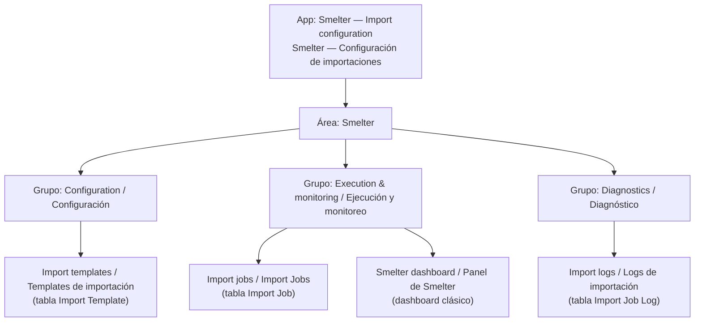
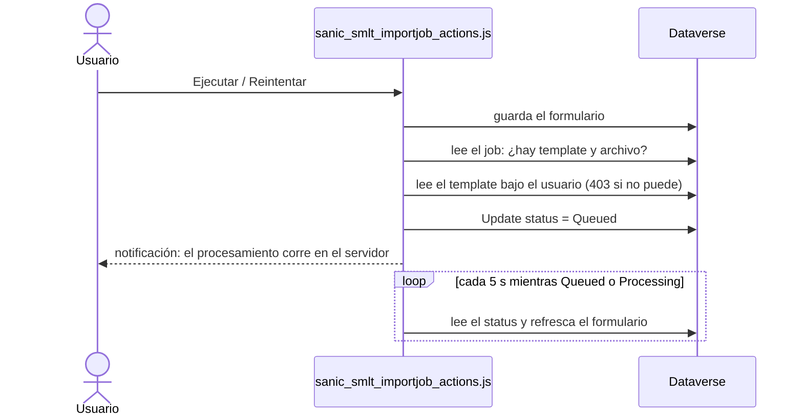

# App de configuración

Smelter se configura y se monitorea desde una *model-driven app* (MDA) llamada «Smelter — Import configuration» en inglés y «Smelter — Configuración de importaciones» en español. Este documento describe su estructura (sitemap, formularios, vistas, panel, botones, íconos) y, sobre todo, **cómo se aprovisiona cada parte y en dos idiomas**, porque es donde están las decisiones menos obvias. Está pensado para quien modifica la interfaz o la lleva a otro ambiente.

Los roles que ven la app están en [Seguridad](03-seguridad.md); las columnas que muestran los formularios, en [Modelo de datos](02-modelo-de-datos.md).

## Cómo funciona

La app se identifica por su *unique name* `sanic_MDASMLTImportConfigurationdandMoni`. El nombre conserva una errata histórica («Configurationd») porque el unique name de una app no se puede cambiar; el nombre **visible** sí se corrigió y `Smelter.Verify` rechaza que vuelva a traer la errata, un prefijo técnico o esté vacío.

Los Table, Column y Relationship Mapping **no** tienen entrada en el sitemap: se abren desde el template, en las pestañas de su formulario. La tabla de claves HMAC tampoco está en la app ni en el sitemap (`Smelter.Verify` lo exige).

### Sitemap

| Id | Nivel | Título 1033 (inglés) | Título 3082 (español) | Destino |
|---|---|---|---|---|
| `area_a3db6788` | Área | Smelter | Smelter | — |
| `group_f9abc8da` | Grupo | Configuration | Configuración | — |
| `subarea_a5465f8e` | SubArea | Import templates | Templates de importación | Tabla `importtemplate` |
| `group_d07a1763` | Grupo | Execution & monitoring | Ejecución y monitoreo | — |
| `subarea_6569ce1a` | SubArea | Import jobs | Import Jobs | Tabla `importjob` |
| `subarea_smlt_dashboard` | SubArea | Smelter dashboard | Panel de Smelter | URL `/main.aspx?pagetype=dashboard&id={0aaf3a0c-...}` |
| `group_308470d1` | Grupo | Diagnostics | Diagnóstico | — |
| `subarea_a2da1554` | SubArea | Import logs | Logs de importación | Tabla `importjoblog` |

Los títulos no llevan prefijos técnicos (`TBL |`, `SMLT |`). Un `SubArea` sin `Title` explícito mostraría el nombre técnico de la tabla («TBL \| SMLT \| Import Templates»), por eso todos lo declaran. Cada `SubArea` lleva un `VectorIcon` que apunta a un web resource SVG.

### Formularios

Cada tabla tiene un *main form* activo llamado `Information`, fijado en la app. Las ediciones declaradas en [`FormPolishSpec.cs`](../../tools/Smelter.Deploy/FormPolishSpec.cs) son:

| Tabla | Qué muestra o cambia |
|---|---|
| **Import Template** | Nombre, tiene fila de encabezados, delimitador, tamaño de chunk, descripción, estado y propietario. **Source Type está oculto** (siempre CSV). Pestañas «Table mappings» y «Relationship mappings» con subgrids |
| **Table Mapping** | Nombre, tabla destino, orden, Dedup Columns, Create If Not Exists, Update If Exists y **Solo inserción** (justo después de *Update If Exists*). Subgrid de Column Mappings |
| **Column Mapping** | Todos los campos de configuración del mapping |
| **Relationship Mapping** | Se agrega **Import Template**, y los lookups de Parent y Child Table Mapping se filtran por ese template (*related records filtering*), de modo que solo ofrecen mappings del mismo template |
| **Import Job** | Los campos de **salida** del motor son de solo lectura: estado, total, procesadas, exitosas, fallidas, omitidas, offset, hora de inicio y de fin. Quedan editables nombre, template, archivo y *Is Dry Run*. **Failure Reason** aparece en solo lectura bajo Status. Pestaña **Import logs** con un subgrid del log. El lookup de template solo ofrece templates **Active** |
| **Import Job Log** | Solo lectura: job, fila, tabla, estado, categoría y mensaje |

El lookup de template del Import Job usa una vista dedicada (`Active templates` / `Templates activos`, ver abajo) y el control recibe `DefaultViewId`, `AvailableViewIds`, `DisableViewPicker` y `DisableMru`: sin selector de vistas ni recientes. Se usa `AvailableViewIds` y no `ViewIds` porque este último **no pasa el esquema del formxml**. El rechazo del lado del servidor de un template que no está `Active` no cambia: la vista solo evita que el usuario elija uno inútil.

> [!NOTE]
> La vista global de lookup del template no se tocó: la comparten los lookups de los mappings, que sí deben poder apuntar a un template en `Draft` mientras se configura.

### Vistas

Las vistas del sistema `Active TBL | SMLT | ...` no se renombran. Smelter agrega o modifica estas:

| Tabla | Vista | Tipo | Filtro | Cambios |
|---|---|---|---|---|
| Import Job | `Active TBL \| SMLT \| Import Jobs` | Por defecto | — | Se agrega la columna **Estado** tras el nombre |
| Import Job | `Active jobs` / `Jobs activos` | Pública | Estado `Queued` o `Processing` | Columnas: nombre, estado, éxitos, fallos, creado. Orden: `createdon` descendente |
| Import Job | `Completed with errors` / `Completados con errores` | Pública | `failedcount > 0` | Ídem |
| Import Job | `All jobs` / `Todos los jobs` | Pública | — | Ídem |
| Import Template | `Active templates` / `Templates activos` | Pública, solo para el lookup | `statecode = 0` y `status = Active` | Orden por nombre. Columnas: nombre, estado, creado |
| Import Job Log | `Active TBL \| SMLT \| Import Job Logs` (por defecto) | Por defecto | — | Se agrega **Error Category** tras el estado; orden `createdon` descendente (**más nuevo primero**) |
| Import Job Log | Vista asociada | Asociada | — | Orden `createdon` descendente |

Los logs se ordenan por fecha de creación y no por el autonumérico porque este es **texto**: se ordena lexicográficamente y el más viejo quedaba arriba. La vista de búsqueda rápida del log **no se reordena**: Dataverse falla con un `NullReferenceException` al actualizar su fetchxml, y sus resultados se ven en la vista por defecto.

> [!NOTE]
> La vista «Completed with errors» filtra por `failedcount > 0`, no por estado. Un job `Failed` que alcanzó a registrar filas fallidas también aparece.

### App: componentes fijados

Sin forms y vistas referenciados, `ValidateApp` avisa «App users will see all forms and views» por cada tabla, y la app mostraría **todas** las vistas, incluso las ajenas a Smelter. [`MdaComponentsSpec.cs`](../../tools/Smelter.Deploy/MdaComponentsSpec.cs) declara los **34 componentes** que Smelter diseñó y los fija con `AddAppComponents`: el main form, la vista por defecto, las vistas propias, la de lookup (`querytype 64`), la asociada (`2`) y la de búsqueda rápida (`4`) de cada tabla. No fija las «Inactive...», Advanced Find ni las «My...». Los ids son estables entre ambientes porque la solución los transporta.

### Panel de Smelter

Es un dashboard **clásico** (`systemform` de tipo 0, id `0aaf3a0c-c3a8-4f67-a7b8-a1cfd5a5dfbd`) con una fila de dos gráficos del Import Job («Import Jobs by status» e «Import Jobs by template») y, debajo, el listado de la vista por defecto del Import Job a todo el ancho.

La solución original traía un dashboard *interaction-centric* (tipo 10). En la MDA ese tipo no aparece en el selector y el sitemap terminaba renderizando el *overview* genérico de «Dynamics 365 Social». Por eso [`DashboardProvisioner`](../../tools/Smelter.Deploy/DashboardProvisioner.cs) lo reemplaza: crea el clásico por código con un formxml determinístico (ids fijos de tab, sección y celdas), lo agrega como componente de la app, apunta el `SubArea` del sitemap a su id y, por último, saca el viejo de la app y lo borra (esto último solo con `--allow-destructive`). Un primer intento falló por meter un hijo `<dashboard>` dentro de `<form>`; el formxml de un dashboard clásico es `<form><tabs>...</tabs></form>`.

El nombre 1033 es «Smelter Dashboard» y el 3082, «Panel de Smelter».

### Botones de la barra de comandos

Hay **un solo camino de ejecución**: los botones no procesan nada, solo ponen el job en `Queued` y el Cloud Flow hace el resto.

| Botón | Dónde | Cuándo se habilita | Qué hace |
|---|---|---|---|
| **Ejecutar** (*Run*) | Formulario del Import Job, `MainTab.Actions` | Registro ya guardado y **status vacío** (el job nunca corrió) | Encola el job |
| **Reintentar** (*Retry*) | Formulario del Import Job, `MainTab.Actions` | Registro guardado y status `Completed`, `CompletedWithErrors` o `Failed` | Encola el job (el reset de `PrepareImport` lo reprocesa desde cero) |
| **Exportar template** (*Export template*) | Grilla de Import Template | Al menos un registro seleccionado | Descarga `smelter-template.json` |
| **Importar template** (*Import template*) | Grilla de Import Template | Siempre | Abre un selector de archivo `.json` y recrea el template |

Los botones Ejecutar y Reintentar están siempre visibles y se habilitan según el estado; quedan **deshabilitados** en `Queued`, en `Processing` y en registros nuevos sin guardar (`FormStateRule Create` invertida). El estado se evalúa con una `CustomRule` de JavaScript (`canExecuteImportJob`, `canRetryImportJob`) porque `ValueRule` no puede expresar «vacío» ni «uno de varios valores» (las reglas se combinan con AND).

Si falla cualquier paso, se muestra un diálogo de error con el motivo. La verificación de lectura del template bajo el usuario es necesaria porque el plugin de preparación ya no ve a la persona (ve la identidad del flow); ver [Seguridad](03-seguridad.md).

Los cuatro botones se aprovisionan por código con el mismo mecanismo (paso `[6]`, `UpsertRibbon`): `Smelter.Deploy` importa en UNA mini-solución los dos `RibbonDiffXml` versionados en `Assets/` (Import Job: Ejecutar y Reintentar; Import Template: Exportar e Importar template), declarados en [`RibbonSpec.cs`](../../tools/Smelter.Deploy/RibbonSpec.cs). Los JS de exportar e importar (`sanic_smlt_exporttemplate.js`, `sanic_smlt_importtemplate.js`) siguen viajando como web resources de la solución; el ribbon se importa sin tocar sus comandos, reglas ni JS.

> [!IMPORTANT]
> **Cada `LocLabel` del ribbon debe llevar UN título 1033 y UN título 3082, y cada botón un `ModernImage`.** En un ambiente cuyo idioma BASE es español, un `LocLabel` que solo trae 1033 no tiene traducción para el idioma del usuario y la interfaz muestra el literal «LabelText»; un `Button` sin `ModernImage` muestra el ícono genérico (puzzle). Textos: Run / Ejecutar, Retry / Reintentar, Export template / Exportar template, Import template / Importar template (etiqueta, título y descripción del tooltip). Lo garantizan los tests de contrato (`RibbonLocalizationContractTests`) y `Smelter.Verify` `[ICONS]`, que lee el ribbon publicado (`RetrieveEntityRibbonRequest`: es el mismo XML compilado que usa la interfaz) y comprueba `ModernImage` y los títulos 1033/3082 de los cuatro botones.

### Íconos

Trece SVG de estilo Fluent (nueve de tablas, sitemap y app, y cuatro de los botones: `export`, `import`, `run`, `retry`), 24×24 y un solo color (`#2F6FB3`), versionados en [`tools/Smelter.Deploy/Assets/icons/`](../../tools/Smelter.Deploy/Assets/icons/) y embebidos en el ensamblado. Se crean como *web resources* de tipo SVG (`webresourcetype 11`) dentro de `smlt_core_smelter`, con nombre `sanic_/smelter/icons/<clave>.svg` y nombre visible `Icon | SMLT | <nombre>`.

| Clave | Para qué |
|---|---|
| `template`, `job`, `joblog`, `tablemapping`, `columnmapping`, `relationshipmapping`, `hmackey` | `IconVectorName` de la tabla correspondiente (grilla, formulario y lookups) |
| `template`, `job`, `dashboard`, `joblog` | `VectorIcon="$webresource:..."` del `SubArea` del sitemap (reemplaza al gif transparente con el que nació) |
| `app` | El ícono de la app (`appmodule.webresourceid`) |
| `run`, `retry`, `export`, `import` | `ModernImage="$webresource:sanic_/smelter/icons/<clave>.svg"` de los botones Ejecutar, Reintentar, Exportar template e Importar template |

### Internacionalización: 1033 y 3082

El inglés va bajo **LCID 1033**, que es el idioma base de la organización y el que leen las demás *canvas apps*. El español va bajo **LCID 3082** (es-ES). Antes, el español estaba escrito bajo 1033. Cada usuario ve el idioma de su interfaz: 3082 si lo eligió, 1033 si no.

> [!IMPORTANT]
> **El 1033 de tablas y columnas no se puede tocar.** Sus nombres (`TBL | SMLT | Import Job`, `[IJ] Status`) los referencian otras *canvas apps* en Power Fx. Por eso todo el trabajo de localización agrega o actualiza **solo el 3082**.

Cada tipo de componente se localiza con un mecanismo distinto. Todos parten de un `record Bilingual(En, Es)` y de un `LabelEditor`, que modifica únicamente el idioma pedido de un `Label` sin tocar los demás:

| Componente | Spec | Cómo se escribe el 3082 | Por qué así |
|---|---|---|---|
| Títulos del sitemap y SubArea | [`SiteMapSpec.cs`](../../tools/Smelter.Deploy/SiteMapSpec.cs) | Directo en el `sitemapxml`: un `<Title LCID="..." Title="..."/>` por idioma | Es XML; el SubArea sin `Titles` caería al nombre de la tabla |
| Nombre de la app | `SiteMapSpec.cs` | 1033 con `Update` normal; 3082 con **`SetLocLabels`** sobre `appmodule.name` | `appmodule.name` es `IsLocalizable = True` según Microsoft Learn |
| Nombre y descripción de vistas, nombre del dashboard | [`ViewLabelsSpec.cs`](../../tools/Smelter.Deploy/ViewLabelsSpec.cs) | 1033 con `Update`; 3082 con **`SetLocLabels`** (`savedquery.name`/`description`, `systemform.name`) | Al actualizar el valor base, las traducciones no cambian |
| Nombre de tablas y columnas | [`TableLabelsSpec.cs`](../../tools/Smelter.Deploy/TableLabelsSpec.cs) | `UpdateEntity`/`UpdateAttribute` con **`MergeLabels = true`**, reenviando el 1033 tal cual se leyó | Sin `MergeLabels`, el update reemplaza todos los idiomas |
| Opciones de choices (incluido Sí/No) | `TableLabelsSpec.cs` | **`UpdateOptionValue`** con `MergeLabels = true` | `UpdateAttribute` **ignora** los cambios de opciones, incluso en columnas Sí/No (verificado en Dev) |
| Descripciones de columnas (tooltips) | [`ColumnDescriptionsSpec.cs`](../../tools/Smelter.Deploy/ColumnDescriptionsSpec.cs) | `UpdateAttribute` con `MergeLabels = true` tocando solo la `Description` | Evita pisar los *display names* |
| Etiquetas de pestañas y secciones de los formularios | `FormPolishSpec.cs` | `<label languagecode>` dentro del formxml (`FormXmlEditor.TrySetLabels`) | Viven en el formxml |
| Nombre de la solución | [`SolutionNameSpec.cs`](../../tools/Smelter.Deploy/SolutionNameSpec.cs) | No es localizable | El mismo texto, «SMLT \| Core \| Smelter», sirve en ambos |

**El truco de `FormLabelsReader`.** Dataverse devuelve el formxml **solo con las etiquetas del idioma de interfaz de quien lo lee**: el mismo formulario leído en 1033 trae solo `label` 1033 y leído en 3082, solo 3082, aunque ambos estén guardados. Sin tratamiento, `FormPolish` nunca «vería» el 3082, lo reescribiría en cada corrida y `Verify` lo daría por faltante. [`FormLabelsReader`](../../tools/Smelter.Deploy/FormLabelsReader.cs) lee el formulario en el idioma actual, **cambia temporalmente** `usersettings.uilanguageid` del usuario conectado a 3082 (obtenido con `WhoAmIRequest`), lo relee, restaura el valor original en un `finally` y fusiona los `label` 3082 en el documento 1033, emparejando `tab`, `section` y `cell` por su atributo `id`.

Los mensajes que guardan los plugins y el flow en registros (motivos de falla, validaciones, logs) **no** pasan por este mecanismo y siguen en inglés. Las excepciones son los dos mensajes de `ValidateQueueAccess` y los textos de respaldo del `failurereason` del flow, que están en español rioplatense (ver [Plugins y Custom APIs](04-plugins-y-custom-apis.md#validatequeueaccessplugin)).

> [!NOTE]
> Los textos en español que lleva la interfaz usan el término de producto **Import Job** sin traducir, y «Log de importación», «Template de importación», «Mapping de tabla» como nombres de tabla.

## Piezas y archivos

| Pieza | Dónde está |
|---|---|
| Sitemap, nombre de la app | [`SiteMapSpec.cs`](../../tools/Smelter.Deploy/SiteMapSpec.cs), [`SiteMapProvisioner.cs`](../../tools/Smelter.Deploy/SiteMapProvisioner.cs) |
| Formularios, lookup filtrado, subgrids, vistas del log | [`FormPolishSpec.cs`](../../tools/Smelter.Deploy/FormPolishSpec.cs), `FormXmlEditor.cs`, `ViewXmlEditor.cs`, `LookupViewsProvisioner.cs` |
| Vistas del Import Job, botones, panel (roles incluidos) | [`SecuritySpec.cs`](../../tools/Smelter.Deploy/SecuritySpec.cs), [`SecurityProvisioner.cs`](../../tools/Smelter.Deploy/SecurityProvisioner.cs) |
| Componentes fijados en la app | [`MdaComponentsSpec.cs`](../../tools/Smelter.Deploy/MdaComponentsSpec.cs) |
| Panel clásico | [`DashboardSpec.cs`](../../tools/Smelter.Deploy/DashboardSpec.cs), `DashboardProvisioner.cs` |
| Botones de Ejecutar, Reintentar, Exportar e Importar template | [`RibbonSpec.cs`](../../tools/Smelter.Deploy/RibbonSpec.cs), [`Assets/sanic_smlt_importjob_actions.js`](../../tools/Smelter.Deploy/Assets/sanic_smlt_importjob_actions.js), [`Assets/sanic_tbl_smlt_importjob.RibbonDiffXml.xml`](../../tools/Smelter.Deploy/Assets/sanic_tbl_smlt_importjob.RibbonDiffXml.xml), [`Assets/sanic_tbl_smlt_importtemplate.RibbonDiffXml.xml`](../../tools/Smelter.Deploy/Assets/sanic_tbl_smlt_importtemplate.RibbonDiffXml.xml), [`SolutionZipBuilder.cs`](../../tools/Smelter.Deploy/SolutionZipBuilder.cs); JS de exportar/importar en [`solutions/unpacked/WebResources/`](../../solutions/unpacked/WebResources/) |
| Íconos | [`IconsSpec.cs`](../../tools/Smelter.Deploy/IconsSpec.cs), [`Assets/icons/`](../../tools/Smelter.Deploy/Assets/icons/) |
| Bilingüe | [`Bilingual.cs`](../../tools/Smelter.Deploy/Bilingual.cs), [`LocLabels.cs`](../../tools/Smelter.Deploy/LocLabels.cs), [`FormLabelsReader.cs`](../../tools/Smelter.Deploy/FormLabelsReader.cs) |
| Verificación | `Smelter.Verify`: `[SITEMAP]`, `[POLISH]`, `[MDA]`, `[ICONS]`, `[LABELS]`, `[VIEWS]`, `[DESC]`, `[SOLNAME]` |

## Cómo se modifica

**Todo se hace en la spec, no a mano en el portal.** Cada spec es declarativa, y su método `Apply` es **puro e idempotente**: opera sobre el XML en memoria, devuelve la lista de cambios aplicados y la lista vacía si el componente ya estaba al día. `Smelter.Verify` reutiliza ese mismo `Apply` como aserción («aplicar otra vez no cambia nada»).

**Agregar un campo, una pestaña o un cambio de solo lectura a un formulario.** Una entrada en `FormPolishSpec.cs` (`AddedFields`, `ReadOnlyFields`, `Subgrids`, `LookupFilters`, `Labels`...). Cada etiqueta nueva es bilingüe.

**Agregar una vista.** Una `ViewSpec` en `SecuritySpec.cs` (con `FetchXml` y `LayoutXml`; el `object` del layout es un placeholder que se resuelve en tiempo de ejecución con el `ObjectTypeCode` real de la org), su nombre 3082 en `ViewLabelsSpec.cs` y su entrada en `MdaComponentsSpec.cs` para fijarla. Si es la default, no la crees: edítala con `ViewColumns` u `ViewOrders`.

**Agregar un botón.** Un `CustomAction` y su `CommandDefinition` en el `RibbonDiffXml` del asset, más la función en el JS. Las reglas combinadas con AND no expresan «vacío»: usa una `CustomRule`.

**Agregar un ícono.** El SVG en `Assets/icons/` (24×24, un solo color), una entrada en `IconsCatalogo` y dónde se usa (tabla, SubArea o app).

**Traducir algo nuevo.** El mecanismo depende del componente (tabla anterior). Si es un componente de otro tipo, usa `LocLabels.Ensure` solo si el atributo es localizable según Microsoft Learn.

## Trampas y errores conocidos

- **El formxml depende del idioma de quien lo lee.** Nunca reescribas un formulario leído en un solo idioma: perderías las etiquetas del otro. Usa `FormLabelsReader`.
- **`ViewIds` no pasa el schema del formxml.** Para limitar un lookup a una vista usa `AvailableViewIds`.
- **El dashboard *interaction-centric* no se ve en la MDA.** Usa un dashboard clásico.
- **El quick find del log no se reordena.** Dataverse falla al actualizar su fetchxml.
- **`System Administrator` y `System Customizer` quedan asociados a toda MDA** y no se pueden quitar; no afecta al modelo porque los operadores no los tienen.
- **Dos nombres en inglés para el dashboard.** El dashboard se llama «Smelter Dashboard» y la entrada del sitemap «Smelter dashboard».
- **El espejo `solutions/unpacked/` no refleja esta interfaz todavía.** Muestra el sitemap con títulos en español bajo 1033, el título «Area1», el nombre «MDA - SMLT - Import Configurationd and Monitoring» y el ribbon antiguo de los botones (sin 3082 ni ícono hasta el Release 1.4.1.0). Se actualiza al publicar el próximo Release. Ver [ALM](08-alm-y-despliegue.md#versionado-y-releases).
- **Los nombres de las vistas custom de Import Job nacieron en español bajo 1033** (`Jobs Activos`...). Dev las renombra por su nombre legado en vez de duplicarlas; en `MdaComponentsSpec` siguen con el nombre legado como descripción interna.
