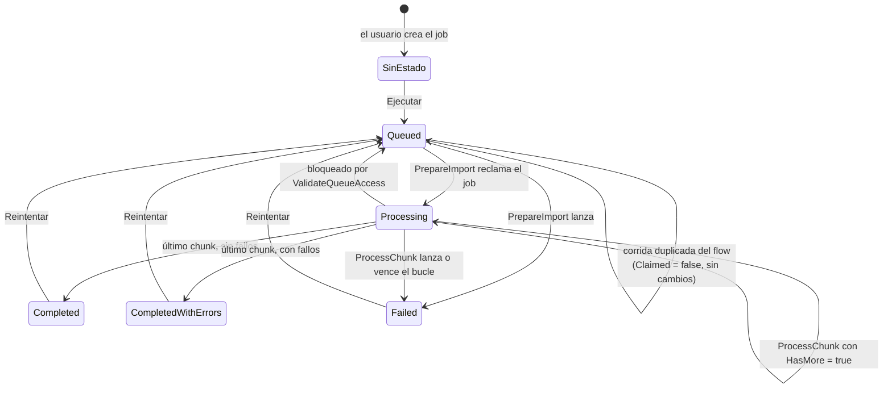

# Ciclo de vida de un Import Job

Este documento describe los estados por los que pasa un Import Job, quién produce cada transición, qué escribe en cada una y qué pasa cuando algo falla o se reintenta. Está pensado para quien diagnostica un job «trabado», interpreta sus contadores o decide si un reintento es seguro.

La arquitectura general está en [Arquitectura](01-arquitectura.md); las columnas, en [Modelo de datos](02-modelo-de-datos.md).

## Cómo funciona

### Máquina de estados

`SinEstado` es el status vacío (la columna no tiene valor por defecto). Los valores numéricos están en [Modelo de datos](02-modelo-de-datos.md#estados-del-job).

| Estado | Lo produce | Qué se escribe en esa transición |
|---|---|---|
| (vacío) | Alta del job | Nada: el job nunca corrió |
| `Queued` (0) | Botón **Ejecutar**/**Reintentar**, o una escritura por API | Solo el status. Antes pasa `ValidateQueueAccess` |
| `Processing` (1) | `PrepareImport` (el **claim**) | `bytecursor` al primer byte de datos, `totalrows`, contadores y offset en 0, `starttime` = ahora, `endtime` y `failurereason` en vacío |
| `Processing` (1), de nuevo | Cada `ProcessChunk` con `HasMore = true` | `processingbatch`, `processedrows`, `successcount`, `failedcount`, `skippedcount`, `bytecursor` |
| `Completed` (2) | `ProcessChunk` en el último tramo, con `failedcount = 0` | Lo mismo y `endtime` = ahora |
| `CompletedWithErrors` (3) | `ProcessChunk` en el último tramo, con `failedcount > 0` | Lo mismo y `endtime` = ahora |
| `Failed` (4) | El handler del flow | `status = 4` y `failurereason`. **No** escribe `endtime` ni toca contadores |

El estado final depende del acumulado `failedcount`, que cuenta pares (fila, tabla) fallidos. Ver [Arquitectura](01-arquitectura.md#trampas-y-errores-conocidos).

### Qué dispara cada transición

**Del vacío a `Queued`.** El botón **Ejecutar** se habilita solo con el status vacío. Guarda, valida y escribe `status = Queued`. La escritura pasa por [`ValidateQueueAccessPlugin`](04-plugins-y-custom-apis.md#validatequeueaccessplugin).

**De `Queued` a `Processing`.** Lo dispara el trigger del flow (`status eq 0`). La primera acción del flow es `PrepareImport`. Si varias corridas del flow compiten por el mismo job, solo la primera lo reclama; las demás reciben `Claimed = false` y terminan sin hacer nada. Ver [el claim con lock de fila](01-arquitectura.md#el-claim-con-lock-de-fila).

**Dentro de `Processing`.** El flow itera `ProcessChunk` mientras `HasMore` sea verdadero. En cada vuelta, el job se actualiza una vez al final del chunk, **después** de escribir en las tablas destino y en el log.

**A un estado final.** `HasMore` es `filasLeídas >= tamañoDeChunk`. Un tramo parcial es el último. Si el archivo tiene un múltiplo exacto del tamaño de chunk, hay una llamada más con cero filas, que solo cierra el job.

**A `Failed`.** El handler *Update a row* del flow corre cuando falla o se omite la condición `Condition_claimed` (es decir, `PrepareImport` lanzó), o cuando el bucle falla o vence. Escribe `status = 4` y el mensaje de la acción que falló (de `PrepareImport` si fue esa; si no, de `ProcessChunk`), truncado a 4000 caracteres. Si el cuerpo de la respuesta no trae mensaje, usa un texto genérico de respaldo, que está en español. Los mensajes del motor no contienen valores de filas.

**De un estado final a `Queued`.** El botón **Reintentar** se habilita en `Completed`, `CompletedWithErrors` y `Failed`. Encola el job de nuevo y `PrepareImport` lo resetea.

**Bloqueo de re-encolado.** Poner `Queued` sobre un job `Processing` se rechaza con `El Import Job se está procesando: no se puede volver a poner en cola hasta que termine.` Sin esa guarda, un `Update` por API durante la corrida dispararía otra corrida del flow cuyo claim vería `Queued` y reseteaba el job a mitad de camino.

### Un caso por estado terminal

| Resultado | Cuándo | Qué mirar |
|---|---|---|
| `Completed` | Todas las filas y tablas se escribieron (o se omitieron) sin fallo | `successcount`, `skippedcount` |
| `CompletedWithErrors` | Hubo al menos un par fila-tabla fallido | Pestaña **Import logs** del job: una fila por par fallido, con categoría y mensaje |
| `Failed` | Se cortó el pipeline entero | `failurereason`. Si es `...is not Active`, se trata de un template en Draft o Archived |

Un job `Failed` puede tener contadores parciales: los chunks que se completaron antes de la falla ya escribieron en las tablas destino y actualizaron el job.

## Reintentos

Hay tres niveles, con alcances distintos.

| Nivel | Qué reintenta | Cómo |
|---|---|---|
| **Dentro del flow** | La llamada a `ProcessChunk` | Política exponencial, 4 reintentos, intervalo `PT5M`, según el JSON versionado del flow |
| **Dentro del chunk** | La escritura de los logs | Upsert por `(importjobid, rownumber, targettable)`: reescribir un log no lo duplica |
| **Por el usuario** | El job completo | **Reintentar** vuelve a `Queued`; `PrepareImport` resetea y la corrida **arranca desde cero** |

Por qué reintentar es seguro en general:

- El offset (`processingbatch`) y el cursor de bytes avanzan **después** de procesar el chunk. Si el chunk muere, el reintento reprocesa el mismo tramo.
- Con alternate key, reprocesar no duplica: es un upsert.
- El reset de `PrepareImport` limpia `endtime` y `failurereason`, así que un reintento exitoso no muestra el fin ni el motivo de la corrida anterior.

> [!WARNING]
> **Reintentar no limpia los logs anteriores.** El reset no toca el Import Job Log, y los logs nuevos se escriben por upsert sobre `(job, fila, tabla)`. Si una fila falló en la primera corrida y en el reintento ya entra, su log viejo **sigue ahí**. Después de un reintento, el job muestra los contadores nuevos y la pestaña de logs puede mostrar entradas de la corrida anterior. Compara `failedcount` con la cantidad de logs antes de concluir.

> [!WARNING]
> **Con «Solo inserción», reintentar duplica.** Reprocesar vuelve a hacer `Create` de las mismas filas. Ver [Arquitectura](01-arquitectura.md#gate-de-idempotencia-y-solo-inserción).

### Un job que se queda en `Processing`

Si el flow se apaga o se cancela una corrida a mitad de camino, el job queda en `Processing`: **Reintentar** no está disponible en ese estado y `ValidateQueueAccess` rechaza poner `Queued`. El repositorio no define un procedimiento oficial de recuperación. El único camino que usa el código (`Smelter.Verify` lo hace entre corridas directas) es **devolver el status a vacío** con una escritura por API: así el botón **Ejecutar** vuelve a habilitarse. No lo hagas sobre un job que el flow aún esté procesando.

## Piezas y archivos

| Pieza | Dónde está |
|---|---|
| Enum de estados | [`ImportJobStatus.cs`](../../src/Smelter.Core/Models/ImportJobStatus.cs) |
| Claim y reset | [`PrepareImportPlugin.cs`](../../src/Smelter.Plugins/PrepareImportPlugin.cs) |
| Avance, cierre y logs | [`ProcessChunkPlugin.cs`](../../src/Smelter.Plugins/ProcessChunkPlugin.cs) |
| Guarda de re-encolado | [`ValidateQueueAccessPlugin.cs`](../../src/Smelter.Plugins/ValidateQueueAccessPlugin.cs) |
| Cloud Flow | [`solutions/unpacked/Workflows/`](../../solutions/unpacked/Workflows/) |
| Pruebas | `PrepareImportHandlerTests`, `ProcessChunkHandlerTests`, `ValidateQueueAccessHandlerTests` y los pasos `[E2E-7a]` a `[E2E-7d]` de `Smelter.Verify` |

## Cómo se modifica

**Agregar un estado.** Un valor nuevo en el choice (spec de `Smelter.Deploy`), el enum `ImportJobStatus`, `ChoicesContractTests`, las reglas de habilitación del ribbon (`canExecuteImportJob`, `canRetryImportJob`) y las etiquetas 3082. Revisa también los gates de `ProcessChunk` (`ValidateJobStatus`) y de `ValidateQueueAccess`.

**Cambiar la política de reintentos del flow.** Se edita el JSON del flow y se refleja en el transformer correspondiente de `Smelter.Deploy`, que lo reaplica en cada deploy. Ver [ALM](08-alm-y-despliegue.md#los-transformers-del-cloud-flow).

## Trampas y errores conocidos

- **El auto-refresco del formulario se activa al encolar.** El formulario consulta el estado cada 5 segundos después de pulsar **Ejecutar** o **Reintentar** en esa misma sesión. Si abres un job que ya está `Processing`, no se refresca solo.
- **`Failed` no pone `endtime`.** Un job fallido muestra la hora de inicio de la corrida (si `PrepareImport` llegó a su reset) pero no la de fin.
- **Una falla de validación en un reintento deja los datos de la corrida anterior.** El reset ocurre al final de `PrepareImport`; si una validación lanza antes, los contadores y la hora de fin anteriores quedan visibles junto al nuevo motivo.
- **Múltiples corridas del flow sobre el mismo job** son esperables (triggers *at-least-once*). El claim las neutraliza; en el historial del flow aparecen como corridas que terminan sin procesar.
- **Un template `Draft` o `Archived` hace fallar el job**, no lo deja en cola.
- **Dry run.** Un job en dry run recorre los mismos estados, pero no escribe en las tablas destino.
