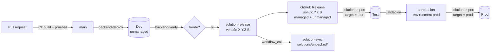

# ALM y despliegue

Este documento explica cómo viaja un cambio de Smelter desde un commit hasta Producción en **este tenant**: los workflows de GitHub, los pasos de `Smelter.Deploy` en su orden real, qué verifica `Smelter.Verify`, cómo se versiona la solución y cómo se publican los Releases. Está pensado para quien mantiene el repositorio. Para instalar Smelter en **otro** tenant, donde nada de esto aplica, ver [Instalación en otro tenant](09-instalacion-en-otro-tenant.md).

## Cómo funciona

### Ambientes y principio general

| Ambiente | Para qué | Cómo recibe los cambios |
|---|---|---|
| **Dev** (URL en el secret `DATAVERSE_URL`) | Donde se desarrolla. La solución `smlt_core_smelter` está **sin administrar** | `Smelter.Deploy` por SDK (workflow `backend-deploy`) |
| **Test** | Validación | La solución **administrada** de un Release (workflow `solution-import`) |
| **Prod** | Producción | El **mismo zip** que pasó por Test, con aprobación del environment |

> [!NOTE]
> La URL de Dev no figura en el repositorio: en CI llega por el secret `DATAVERSE_URL`. Se documenta aquí por indicación del equipo.

El principio: **todo cambio de esquema, de seguridad o de interfaz se hace en Dev por SDK, de forma declarativa e idempotente**, y llega a Test y Prod solo como parte de la solución administrada de un Release. `Smelter.Deploy` es una herramienta de **Dev** y se niega a correr en otro lado.



### Workflows

| Workflow | Disparador | Qué hace | Environment / secretos |
|---|---|---|---|
| `ci` | Pull request, push a `main`, manual | Compila toda la solución (Linux), corre las pruebas del núcleo y de contrato (Linux, net8) y las de plugins (Windows, net462) | Ninguno |
| `backend-deploy` | Manual (`package_only` opcional) | Compila el plugin package en un runner limpio y corre `Smelter.Deploy --allow-destructive` contra Dev | `dev`: `DATAVERSE_URL`, `PP_CLIENT_ID`, `PP_CLIENT_SECRET` |
| `backend-verify` | Manual (`dev_access`, `bench`) | Opcionalmente aprovisiona o retira el acceso de prueba (`Smelter.DevAccess`); corre `Smelter.Verify`; opcionalmente el benchmark de 100.000 filas | `dev` |
| `solution-release` | Manual (versión `X.Y.Z.B`) | Exporta managed y unmanaged de Dev, crea el GitHub Release `sol-v<versión>` y llama a `solution-sync` | Secretos de organización: `DATAVERSE_URL`, `PP_CLIENT_ID`, `PP_TENANT_ID`, `PP_CLIENT_SECRET` |
| `solution-sync` | `workflow_call` desde `solution-release`, `release: published` o manual con el tag | Desempaqueta el zip unmanaged en `solutions/unpacked/` y commitea el diff a `main` | Ninguno (usa `GITHUB_TOKEN`) |
| `solution-import` | Manual (`version`, `target = test\|prod`) | Importa el managed de un Release al entorno elegido | Environment `test` o `prod`: `DATAVERSE_URL`, `PP_CLIENT_ID`, `PP_CLIENT_SECRET`, `PP_TENANT_ID` y la variable `DATAVERSE_CONNECTION_ID` |

Detalles que importan:

- **Versión de .NET.** El CI y los workflows de Dev usan el SDK `10.0.x`, alineado con [`global.json`](../../global.json) (`10.0.202`, `rollForward: latestFeature`). Los workflows de `pac` usan .NET 8 para el runtime del CLI.
- **Runner limpio.** `backend-deploy` compila en un runner nuevo para que el `.nupkg` no empaquete DLLs viejos de un `bin/Release` incremental (se vio con `ExcelDataReader` tras eliminarlo).
- **`solution-release` llama a `solution-sync` explícitamente** porque los Releases creados con `GITHUB_TOKEN` no disparan el evento `release published` (protección anti-recursión de GitHub).
- **`concurrency`** serializa cada workflow para evitar dos corridas simultáneas contra el mismo ambiente.
- **La branch policy** (solo `main` puede desplegar a `dev`) no vive en el repositorio: se configura como *deployment branch policy* del environment en GitHub.
- **`backend-deploy` siempre pasa `--allow-destructive`.** Cada corrida ejecuta los pasos que borran metadata listada en las specs de limpieza (columnas y opciones muertas, la Custom API vieja).

### Pasos de `Smelter.Deploy`, en orden

Se invoca así (solo Dev):

```bash
SMELTER_ENV=dev DATAVERSE_URL=https://<org>.crm.dynamics.com \
  dotnet run --project tools/Smelter.Deploy -c Release -- [--interactive] [--package-only] [--allow-destructive] [ruta.nupkg]
```

| Argumento | Efecto |
|---|---|
| `--package-only` | Solo sube el package y espera los plugin types |
| `--interactive` | Login interactivo en vez del service principal |
| `--allow-destructive` (o `SMELTER_ALLOW_DESTRUCTIVE=true`) | Habilita los pasos que borran metadata o datos |

La autenticación usa service principal si hay `PP_CLIENT_ID` y `PP_CLIENT_SECRET`; si no, abre un navegador. `DATAVERSE_URL` es siempre obligatoria. Sin `SMELTER_ENV=dev` aborta con código 2.

| Paso | Qué hace | Spec / provisioner | Destructivo |
|---|---|---|---|
| 1 | Conecta | — | — |
| 2 | Sube el plugin package (solo `content`; la versión sale del `.nuspec`) | `Program.cs` | — |
| 3 | Espera hasta 120 s a que aparezcan los plugin types | `Program.cs` | — |
| 4 | Upsert de las 4 Custom APIs, con parámetros y propiedades de respuesta | `ApiSpec` | — |
| 4b | Upsert de los 3 message steps | `StepSpec`, `StepProvisioner` | — |
| 4c | Alternate key del Import Job Log: si la composición es incorrecta la elimina, la recrea y espera el índice `Active`; si queda `Failed` por duplicados, deduplica y reactiva | `KeySpec`, `KeyProvisioner` | Sí |
| 4d | Elimina columnas y opciones muertas (purga antes los logs que usan una opción a quitar) | `SchemaCleanupSpec` | Sí |
| 4e | Crea la tabla de claves HMAC, asegura la columna del valor y la agrega a la solución | `HmacKeyTableSpec`, `HmacKeyTableProvisioner` | — |
| 4f | Crea `bytecursor`, `insertonly`, `failurereason` y `claimlock` | `SchemaAdditionsSpec` | — |
| 4f2 | Crea la vista pública «Active templates» del lookup | `FormPolishSpec`, `LookupViewsProvisioner` | — |
| 4g | Fija formularios y vistas Smelter en la app (34 componentes) | `MdaComponentsSpec` | — |
| 4h | Ajusta columnas y formularios existentes: Source Type, default de Update If Exists, rango de Chunk Size | `SchemaTuningSpec` | — |
| 4i | Descripción bilingüe de todas las columnas custom | `ColumnDescriptionsSpec` | — |
| 4j | Formularios y vistas: solo lectura, subgrid de logs, lookups filtrados, columnas y orden | `FormPolishSpec` | — |
| 4k | Sitemap bilingüe, íconos y nombre de la app | `SiteMapSpec` | — |
| 4l | Nombre visible de la solución | `SolutionNameSpec` | — |
| 4m | Web resources SVG, `IconVectorName` de las tablas, ícono de la app | `IconsSpec` | — |
| 4n | Nombres 3082 de tablas, columnas y opciones | `TableLabelsSpec` | — |
| 5 | `PublishAllXml` (refresca la metadata del Web API) | `Program.cs` | — |
| 6 | Roles y privilegios, cascade, `ExecutePrivilegeName`, vistas del Import Job, ribbon, asociación de la app a los roles | `SecuritySpec`, `SecurityProvisioner` | — |
| 6b | Dashboard clásico (retira el viejo) | `DashboardSpec` | Sí |
| 6a | Nombres 1033 y 3082 de las vistas custom y del dashboard (corre **después** del 6) | `ViewLabelsSpec` | — |
| 7 | Reescribe el Cloud Flow: rename de `processchunk`, claim gate, handler Failed, motivo de falla | `CloudFlowUpdater` | — |
| 8 | Borra la Custom API legada `anic_capi_smelter_processchunk` | `Program.cs` | Sí |

El orden tiene dependencias que no se pueden alterar:

- **4f2 antes de 4g y 4j**: la vista de lookup se fija en la app y el formulario la referencia.
- **4e antes de 4m**: el ícono de la tabla de claves solo se aplica si la tabla existe.
- **6 antes de 6b y 6a**: el 6 crea y renombra las vistas y enlaza el dashboard; los nombres 3082 se escriben por nombre sobre lo que crearon.
- **7 después de 4**: el flow debe encontrar la Custom API con el nombre nuevo.
- **El package (paso 2) se sube antes de que el paso 4f cree las columnas que el código nuevo escribe** (`claimlock`, desde el plugin 1.0.14): si un job se ejecuta durante el deploy, `PrepareImport` puede fallar por la columna inexistente. No ejecutes jobs mientras corre el deploy.

### Los transformers del Cloud Flow

El flow es JSON de ejecución en la columna `clientdata` del registro `workflow`, no una pieza de metadata que se pueda declarar. `CloudFlowUpdater` lo localiza por SDK y aplica **transformaciones puras e idempotentes** sobre el texto, que devuelven `Changed = false` cuando el flow ya está al día:

| Transformer | Qué garantiza |
|---|---|
| `ClientDataProcessChunkRenamer` | Reemplazo por **token exacto** de `anic_capi_smelter_processchunk` a `sanic_...` (un `string.Replace` ingenuo corrompía un flow ya migrado en el segundo deploy) |
| `ClientDataClaimGate` | Columna filtro `sanic_smlt_ij_status` en el trigger; quita cualquier `concurrency`; envuelve el `Scope` del bucle en `Condition_claimed` |
| `ClientDataFailedHandlerFixer` | El handler que marca `Failed` corre si el bloque falla, se omite o vence (`Failed`, `Skipped`, `TimedOut`) |
| `ClientDataFailureReasonWriter` | El handler escribe también `failurereason` |

Se aplican en **un solo ciclo** Draft → Update → Activate. Si la escritura falla, `ApplyWithRestore` intenta devolver el flow al estado activo que tenía. Si no hay nada que cambiar, no toca el estado del flow. El JSON ya transformado también está versionado en `solutions/unpacked/Workflows/`.

### `Smelter.Verify`

Corre contra Dev con las mismas credenciales. Falla con código 1 y el detalle del assert (con el `OrganizationServiceFault` completo y la cadena de `InnerFault`). Orden:

1. **Aserciones de metadata, solo lectura:** `[SEC]`, `[STEP]`, `[KEY]`, `[CLEAN]`, `[ADD]`, `[TUNE]`, `[DESC]`, `[POLISH]`, `[SITEMAP]`, `[SOLNAME]`, `[ICONS]`, `[LABELS]`, `[VIEWS]`, `[HMAC]`, `[MDA]`.
2. **Smoke funcional** contra la tabla `contact` (5 filas, idempotencia, fila fallida al log, `UpdateIfExists = No`, gates, HMAC con clave temporal).
3. **`[CHUNK]`**: 250 filas por el cursor de bytes en tres chunks.
4. **Los pasos `[E2E-n]`**: la cobertura de cada campo de la MDA.
5. **Limpieza** de todo lo creado.

El detalle de cada aserción y de los 20 pasos E2E está en [Pruebas](10-pruebas.md). `Verify` no ejecuta Test ni Prod: el smoke posterior a `solution-import` está pendiente de cablear (comentario `TODO` del workflow).

### Versionado y Releases

| Qué | Formato | Dónde |
|---|---|---|
| **Solución** | `X.Y.Z.B` (cuatro partes) | Tag `sol-vX.Y.Z.B`. Título del Release: «Solución Smelter vX.Y.Z.B». Assets: `smlt_core_smelter_managed.zip` y `smlt_core_smelter_unmanaged.zip` |
| **Plugin package** | `X.Y.Z` | `<Version>` en `Smelter.Plugins.csproj` (hoy `1.0.16`). Es independiente de la versión de la solución |
| **Formato de export de templates** | `1.1` | `TemplateExporter.FormatVersion` |
| **Changelog** | Keep a Changelog | [`CHANGELOG.md`](../../CHANGELOG.md) |

**Cómo publicar una versión.**

1. En GitHub, *Actions* → `solution-release` → *Run workflow* → versión (por ejemplo `1.4.0.0`). El workflow valida el formato, fija la versión en Dev (best effort: si el service principal no puede escribir la solución, sigue), exporta los dos zips, crea el Release y llama a `solution-sync`.
2. `solution-sync` baja el unmanaged, lo desempaqueta con `pac solution unpack --packagetype Unmanaged --allowDelete`, poda los `.dll` y `.nupkg` (el código vive en `src/`) y commitea `chore(solution): sync metadata (<tag>)`.
3. Mover lo de `[Unreleased]` del `CHANGELOG.md` a la nueva versión, enlazando el Release.

**Releases publicados:** `sol-v1.0.0.0`, `1.1.0.0`, `1.2.0.0`, `1.2.1.0` y `1.3.0.0` (el último). Todo lo posterior está en `[Unreleased]` y llegará a Test y Prod con el próximo Release.

### Despliegue a Test y Prod

`solution-import` sigue este procedimiento:

1. Valida el formato de la versión, el destino y que existan todos los secretos y la variable del environment.
2. Instala el CLI `pac` y baja `smlt_core_smelter_managed.zip` del Release.
3. Genera los *deployment settings* a partir de [`deploy/settings/test.json`](../../deploy/settings/test.json) o `prod.json`, reemplazando con `jq` el marcador `__DATAVERSE_CONNECTION_ID__` de las **dos connection references** (`sanic_conn_wfe_dataverse` y `wf_sharedcommondataserviceforapps_3bc81`) y falla si queda algún `__`. No hay variables de entorno de solución. El id de la conexión es una **variable** y no un secret porque no es sensible.
4. Se autentica con el service principal e importa con `pac solution import --stage-and-upgrade --activate-plugins --async`. *Upgrade* deja la versión nueva y **borra** los componentes que ya no están (columnas retiradas, por ejemplo).
5. Obtiene un token por *client credentials*, **comprueba que la versión instalada coincida con la pedida** y enciende los Cloud Flows de la solución (categoría 5) que no estén activos.

**Setup único por environment** (resumen; el detalle está en [`deploy/README.md`](../../deploy/README.md)): crear los environments `test` y `prod` en GitHub (reviewers requeridos en `prod`); cargar sus cuatro secretos; registrar un *application user* con rol *System Customizer* (o System Administrator si el import lo requiere) en cada ambiente; crear en cada ambiente una conexión Dataverse **propiedad del service principal**, que será la dueña del flow, y guardar su id como `DATAVERSE_CONNECTION_ID`.

> [!WARNING]
> **Después de importar en cada ambiente hay que cargar la clave HMAC a mano.** No la trae la solución ni la carga ningún workflow. Ver [Seguridad](03-seguridad.md#clave-hmac).

### `Smelter.DevAccess`

Herramienta de Dev que aprovisiona un entorno para probar el modelo de seguridad: cuatro usuarios de prueba (un Configurador, dos Operadores de equipos distintos y un control negativo sin rol), dos *teams* `Smelter QA · Equipo A` y `Equipo B` con el rol Operador, y dos templates `QA · Template A` y `B` dueños de cada team. Se dispara con el input `dev_access` de `backend-verify` (`provision` o `remove`). Los ids de usuario son de cuentas de prueba de Dev y no son secretos.

## Piezas y archivos

| Pieza | Dónde está |
|---|---|
| Workflows | [`.github/workflows/`](../../.github/workflows/) |
| Aprovisionador de Dev | [`tools/Smelter.Deploy/`](../../tools/Smelter.Deploy/) (punto de entrada `Program.cs`) |
| Verificación | [`tools/Smelter.Verify/`](../../tools/Smelter.Verify/) |
| Acceso de prueba | [`tools/Smelter.DevAccess/`](../../tools/Smelter.DevAccess/) |
| Deployment settings | [`deploy/settings/`](../../deploy/settings/), [`deploy/README.md`](../../deploy/README.md) |
| Espejo de la solución | [`solutions/unpacked/`](../../solutions/unpacked/), [`solutions/README.md`](../../solutions/README.md) |
| Guardas de entorno | [`DeployGuards.cs`](../../tools/Smelter.Deploy/DeployGuards.cs) |

## Cómo se modifica

**Hacer un cambio de esquema, seguridad o interfaz.**

1. Declararlo en la spec correspondiente de `Smelter.Deploy` (o crear una nueva siguiendo el patrón spec → provisioner → aserción).
2. Escribir la aserción en `Smelter.Verify` y el test de contrato en `tests/Smelter.Contract.Tests/`.
3. Si cambia código de un plugin, subir `<Version>` del csproj.
4. Abrir el pull request: el CI valida compilación y pruebas.
5. Tras el merge a `main`: `backend-deploy`, luego `backend-verify`.
6. Cuando esté verde, publicar un Release.

**Agregar un paso al Deploy.** Va en `Program.cs` con la numeración existente y respetando el orden de dependencias de arriba. Todo lo que sea destructivo debe quedar detrás de `DeployOptions.AllowDestructive`.

**Cambiar el flow.** Con un transformer nuevo y puro en `Smelter.Deploy`, con su prueba de contrato y su aplicación dentro de `CloudFlowUpdater`.

## Trampas y errores conocidos

- **Sin subir `<Version>` no se recarga el código.** Dataverse cachea el package por versión.
- **El espejo `solutions/unpacked/` es posterior a un Release, no al deploy.** Hasta el próximo `solution-sync` está atrasado respecto de Dev: no trae la tabla de claves, ni las columnas nuevas, ni la interfaz bilingüe. Los tests de contrato lo leen, así que una spec nueva falla en rojo hasta que el Release lo actualice. Es el estado esperado de esa ventana.
- **El `RootComponent` del plugin package en `Solution.xml` muestra una versión vieja** (`Smelter.Plugins, Version=1.0.5.0`), efecto del mismo atraso.
- **`Smelter.Deploy` no es el camino de Test ni de Prod.** Si lo corres contra otro ambiente, se niega (`SMELTER_ENV`).
- **Un Release puede quedar sin los cambios de Dev si no se corre el deploy antes.** El Release exporta lo que hay en Dev; si un cambio se hizo en el repositorio pero no se desplegó, no viaja.
- **El owner del flow tras una importación** no está verificado en el repositorio; revísalo después de cada import y, si hace falta, cámbialo a la cuenta de servicio.
- **No hay rollback de una solución administrada.** La salida es corregir hacia adelante con un Release nuevo, o restaurar un backup del ambiente tomado antes de importar.
- **El smoke posterior al import en Test/Prod no existe todavía.** `Smelter.Verify` solo conoce Dev.
