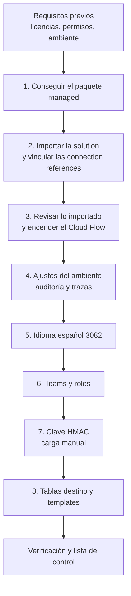

# Instalación en otro tenant

Este documento explica cómo instalar Smelter en un ambiente de Dataverse de **otro tenant** y cómo actualizarlo después. Está pensado para el administrador de Power Platform de ese tenant, que recibe el `.zip` de la solución sin contexto previo.

En el tenant donde se desarrolla Smelter, Dev se aprovisiona con `tools/Smelter.Deploy` (una consola SDK que solo corre con `SMELTER_ENV=dev`) y Test y Prod se actualizan con el workflow `solution-import`. **Nada de eso aplica aquí**: para otro tenant no hay script, y todo se hace **a mano, desde interfaces gráficas** (`make.powerapps.com`, el *Power Platform admin center* y las pantallas de Smelter). Las razones de diseño están en [Arquitectura](01-arquitectura.md), [Seguridad](03-seguridad.md) y [Decisiones de diseño](12-decisiones.md).

Los nombres de menús y botones se escriben como aparecen en la interfaz en inglés, con su traducción la primera vez. Si el portal está en español, la etiqueta es la traducción.

## Cómo funciona

La instalación tiene dos mitades:

- **Lo que viaja en la *solution*.** Una *solution* es el paquete de Dataverse que agrupa componentes para moverlos entre ambientes. La de Smelter se llama `smlt_core_smelter` (nombre visible «SMLT | Core | Smelter»; *publisher* `Sistemas_Abiertos_Nicaragua`, prefijo `sanic`). Al importar el *managed* se instalan solos las tablas con sus columnas, relaciones y la alternate key del log; el plugin package con sus 4 Custom APIs y los message steps; los dos roles; el Cloud Flow; la app model-driven con sus formularios, vistas, panel, botones e íconos; y la tabla de claves HMAC (con la seguridad de columna sobre su valor).
- **Lo que no viaja.** Las conexiones, los teams, la asignación de roles a personas, el **valor de la clave HMAC**, los templates, las tablas de negocio donde se va a cargar y los ajustes del ambiente. Eso se hace a mano, en el orden de este documento.



## Qué viaja en la solution y qué no

| Componente | ¿Viaja en el managed? | Paso |
|---|---|---|
| 6 tablas `sanic_tbl_smlt_*` con sus columnas, relaciones y cascadas | Sí | 3 |
| Columnas técnicas `bytecursor`, `claimlock`, `failurereason` y `insertonly`, y las columnas retiradas (ya no existen) | Sí, en versiones que las incluyan | 3 |
| Alternate key `sanic_smlt_ijl_key_logidempotente` (Import Job Log) | Sí | 3 |
| Tabla `sanic_tbl_smlt_hmackey`, con seguridad de columna sobre el valor, auditoría de tabla y sin auditoría del valor | Sí, **solo en versiones que la incluyan** | 3 |
| **Valor de la clave HMAC** | **No, nunca** | 7 |
| Plugin package `sanic_Smelter.Plugins` y sus 6 plugin types | Sí | 3 |
| 4 Custom APIs con sus parámetros y `executeprivilegename` | Sí | 3 |
| 3 message steps (`AssignJobOwner`, `ValidateQueueAccess` en Create y en Update) | Sí | 3 |
| Roles `Smelter Configurador` y `Smelter Operador` | Sí | 3 y 6 |
| Cloud Flow «Smelter orchestrator» | Sí (estado según cómo se importe) | 3 |
| App model-driven, formularios, vistas, panel, sitemap bilingüe, íconos SVG y botones Ejecutar y Reintentar | Sí | 3 |
| Botones Exportar e Importar template y sus web resources (los cuatro botones bilingües 1033+3082, con ícono) | Sí | 3 |
| Nombres en español (3082) de tablas, columnas, opciones, vistas y app | Sí, pero **solo se ven si el idioma 3082 está habilitado** | 5 |
| Conexión Dataverse y su vínculo a las connection references | **No** | 2 |
| Teams, membresías y rol a personas | **No** | 6 |
| Propietario (team) de cada template | **No** | 8 |
| Templates | **No** (son registros) | 8 |
| Tablas destino del negocio y sus alternate keys | **No** (no son de Smelter) | 8 |
| Auditoría del ambiente, nivel de trazas de plugins, DLP | **No** | 4 |

> [!WARNING]
> **La versión a instalar tiene que ser posterior a `sol-v1.3.0.0`.** El último Release publicado al escribir este documento es `sol-v1.3.0.0`, que **no** incluye la tabla de claves HMAC, las columnas técnicas del claim, el gate de idempotencia con «Solo inserción», la interfaz bilingüe ni los íconos; todo eso está en `[Unreleased]` del [`CHANGELOG.md`](../../CHANGELOG.md). Instala un Release posterior. El paso 3 explica cómo comprobarlo.

## Requisitos previos

### Plataforma y licencias

| Requisito | Para qué | Notas |
|---|---|---|
| Ambiente de Power Platform con base de datos Dataverse | Datos, plugins, app y flow | Sandbox o producción; evita el ambiente *Default* |
| Licencias de Power Apps o Dynamics 365 para quienes usan la app de configuración | La app es model-driven sobre Dataverse | A confirmar el plan concreto según el licenciamiento del cliente |
| Derechos de Power Automate para la cuenta dueña del Cloud Flow | El flow usa el conector Microsoft Dataverse | A confirmar: depende de la licencia del dueño de la conexión |
| Idioma base del ambiente: inglés (1033) | La solución se exportó con `languagecode=1033` | No está verificado si otro idioma base bloquea la importación; ante la duda, usa inglés |
| Dependencias de plataforma | `Solution.xml` declara `AppModuleWebResources (2.5)` y `msdyn_AppFrameworkInfraExtensions` | Vienen con cualquier ambiente con Dataverse y apps. Si la importación las reclama, el ambiente está desactualizado |

### Permisos de quien instala

| Permiso | Para qué |
|---|---|
| Rol **System Administrator** en el ambiente | Importar una solución con un plugin package, asignar roles y escribir en la tabla protegida de la clave |
| Acceso al repositorio `breaking-bytes-dev/smelter`, o que el equipo de desarrollo te pase los zips | Bajar el Release |
| Poder crear conexiones en el ambiente | Paso 2 |
| `openssl` o un gestor de contraseñas con generador | Paso 7 |
| Permiso para crear grupos en Microsoft Entra ID (o alguien que lo tenga) | Solo si los teams se alimentan de un grupo de Entra ID (paso 6) |

## 1. Conseguir el paquete

La solución se publica como **GitHub Release** con tag `sol-vX.Y.Z.B` y dos archivos: `smlt_core_smelter_managed.zip` y `smlt_core_smelter_unmanaged.zip`.

1. Abre la página de Releases del repositorio y elige la versión acordada con el equipo de desarrollo.
2. Descarga **`smlt_core_smelter_managed.zip`**. Con la CLI: `gh release download sol-vX.Y.Z.B --repo breaking-bytes-dev/smelter --pattern smlt_core_smelter_managed.zip`.
3. Usa **managed** en cualquier ambiente que no sea de desarrollo. El unmanaged solo sirve donde se vaya a modificar la solución.

## 2. Importar la solution

1. En `make.powerapps.com`, elige el ambiente **de destino** y abre **Solutions** (Soluciones).
2. **Import solution** (Importar solución), **Browse** (Examinar), elige el `.zip` y **Next**.
3. Si aparece una lista de **dependencias faltantes**, cancela y revisa la tabla de requisitos.
4. En **Connection References** (Referencias de conexión) la solución trae dos, ambas del conector Microsoft Dataverse:

   | Nombre lógico | Nombre visible |
   |---|---|
   | `sanic_conn_wfe_dataverse` | CONN \| WFE \| Dataverse |
   | `wf_sharedcommondataserviceforapps_3bc81` | Microsoft Dataverse WFEngineEvaluation-3bc81 |

   Para **cada una**, elige una conexión existente o crea una con **+ New connection**. Vincula las dos a la **misma** conexión.
5. **Import**. Corre en segundo plano y puede tardar varios minutos. Si falla, la página de soluciones muestra una notificación con **Download Log File** (un XML).
6. Un *managed* se importa ya publicado: **no hace falta «Publish all customizations»**.

### Quién tiene que ser dueño de la conexión

El flow corre con la identidad de la conexión. Esa identidad llama a `prepareimport`, y el plugin verifica que **quien llama (`InitiatingUserId`) tenga Read sobre el template del job**. Por eso:

- Usa una **cuenta de servicio dedicada** (usuario licenciado, o service principal con conexión Dataverse) con el rol **`Smelter Configurador`**, que da lectura y escritura a nivel Organización sobre las 6 tablas, o con System Administrator.
- No uses la cuenta personal de quien instala: se rompe si esa persona se va o cambia la contraseña.
- No uses una cuenta con solo `Smelter Operador`: su lectura es a nivel *Usuario* (propios y de sus teams) y no vería los templates de otros equipos. El job terminaría `Failed` con `does not have Read access to the Import Template`.

El propietario (*owner*) del flow tras la importación no está verificado en el repositorio. Revísalo en el paso 3 y, si hace falta, usa **Change owner** hasta que lo sea la cuenta de servicio.

## 3. Revisar lo importado y encender el flow

Abre `smlt_core_smelter` en **Solutions** y revisa el panel **Objects**:

| Qué | Dónde | Resultado esperado |
|---|---|---|
| Tablas | **Tables** | 6 tablas `sanic_tbl_smlt_*` (Import Template, Table Mapping, Column Mapping, Relationship Mapping, Import Job, Import Job Log) |
| Tabla de claves | **Tables** | `TBL \| SMLT \| HMAC Key` (`sanic_tbl_smlt_hmackey`). **Si no está, el Release es anterior: instala uno posterior** |
| Columnas del Import Job | Tabla Import Job → **Columns** | Existen `sanic_smlt_ij_claimlock`, `_bytecursor` y `_failurereason`. Si no están, el Release es anterior |
| Plugin package | **Plug-in packages** | `sanic_Smelter.Plugins` |
| Message steps | **Plug-in steps** | Los 3 steps de `Smelter.Plugins.AssignJobOwnerPlugin` y `ValidateQueueAccessPlugin`, en estado **On**, pre-operación, sincrónicos |
| Custom APIs | **Custom APIs** | Las 4: `sanic_capi_smelter_prepareimport`, `_processchunk`, `_exporttemplate`, `_importtemplate`. **No** debe existir ninguna `anic_...` |
| Roles | **Security roles** | `Smelter Configurador`, `Smelter Operador` |
| App | **Apps** | «Smelter — Import configuration» |
| Cloud Flow | **Cloud flows** | `Cloud Flow \| Smelter \| Smelter orchestrator` |
| Íconos | **Web resources** | 9 SVG `sanic_/smelter/icons/*.svg` |
| Llave de la tabla de log | Tabla Import Job Log → **Keys** | `KEY \| IJL \| Log Idempotente`, estado **Active** |

Después **enciende el flow**:

1. **Solutions** → `smlt_core_smelter` → **Cloud flows** → abre el flow.
2. Si está **Off**, **Turn on**. Si pide una conexión, falta vincular una connection reference (paso 2).
3. Comprueba que el *owner* sea la cuenta de servicio.

El flow se dispara cuando un Import Job queda con `sanic_smlt_ij_status = 0` (`Queued`), llama a `sanic_capi_smelter_prepareimport` y, si el job fue reclamado, itera `sanic_capi_smelter_processchunk` hasta `HasMore = false`. Si el bloque falla, se omite o vence, marca el job `Failed` (status 4) y escribe el motivo en `sanic_smlt_ij_failurereason`.

### Qué no necesita acción

Roles, `executeprivilegename`, cascade, vistas, botones, panel, sitemap, íconos, alternate key y la asociación de la app al rol Configurador llegan ya configurados. La app queda asociada a `Smelter Configurador` (más `System Administrator` y `System Customizer`, que la plataforma asocia a toda app model-driven y no se pueden quitar).

> [!NOTE]
> **Los operadores no ven la app en su selector.** Es el diseño: la app es del Configurador, y los operadores crean y encolan sus jobs desde la aplicación propia del cliente. Si se les quiere dar la app, hay que compartirla a mano; ese ajuste no está en la solución y no está verificado qué pasa con él en un upgrade. Coordínalo con el equipo de desarrollo.

## 4. Ajustes del ambiente

| Ajuste | Dónde | Valor |
|---|---|---|
| Auditoría del ambiente | Admin center → ambiente → **Settings** → **Audit and logs** → **Audit settings** → **Start Auditing** | Encendida. La auditoría de la tabla de claves viaja en la solución pero **no registra nada** si el ambiente la tiene apagada |
| Nivel de trazas de plugins | Admin center → ambiente → **Settings** → **Resources** → **All legacy settings** → **Settings** → **Administration** → **System Settings** → pestaña **Customization** → **Enable logging to plug-in trace log** | **Exception** en operación normal; **All** solo para diagnosticar |
| DLP y grupo de seguridad del ambiente | Admin center | Dependen del tenant. La política DLP tiene que permitir el conector Microsoft Dataverse |

## 5. Idioma español (3082)

La interfaz de Smelter es bilingüe: el inglés va bajo LCID 1033 (idioma base) y el español bajo LCID 3082 (es-ES). Cada usuario ve el idioma de su interfaz si está habilitado, y si no, el inglés.

1. Admin center → ambiente → **Settings** → **Product** → **Languages** → habilita **Spanish (Spain)** (español, España). La ruta exacta depende de la versión del portal.
2. Cada persona que quiera la interfaz en español la elige en sus opciones personales (**Personal settings** → **Languages**).

No está verificado qué pasa con las etiquetas 3082 de la solución si el idioma no está habilitado al importar; ante la duda, habilítalo **antes** del paso 2. Los **mensajes** que guardan los plugins y el flow en los registros (motivos de falla, validaciones, logs) están en inglés, salvo dos mensajes de rechazo de `ValidateQueueAccess` y los textos de respaldo del `failurereason` del flow, que están en español rioplatense. Los **botones** Ejecutar y Reintentar y los de exportar e importar templates están en español para todos los idiomas.

## 6. Teams y roles

Smelter tiene dos roles, ambos importados con la solución:

| Rol | Qué puede |
|---|---|
| `Smelter Configurador` | CRUD a nivel Organización en las 6 tablas (sin crear logs): crea y edita templates y mappings, exporta e importa templates, ve todo. Es el único rol que ve la app |
| `Smelter Operador` | No configura. Lee templates de sus teams (Read nivel Usuario), crea Import Jobs, lee y edita jobs de sus teams y lee los logs. **Ningún rol puede crear logs**: los escribe el motor |

> [!IMPORTANT]
> Los roles de Smelter tienen **solo** los privilegios sobre las tablas de Smelter, sin ningún privilegio de plataforma. Toda persona que use Smelter necesita además el rol estándar **Basic User** (asignado a la persona o a uno de sus teams). Es el que aporta los privilegios básicos de plataforma (ajustes de usuario y similares) que los roles de Smelter, a propósito, no traen. Smelter solo está probado con esa combinación.

La visibilidad del operador sale de que el **team sea dueño del template**: los jobs nuevos nacen a nombre del team del template (`AssignJobOwnerPlugin`) y todos los miembros los ven.

### 6.1. Configuradores

Asígnales `Smelter Configurador` directo: Admin center → ambiente → **Settings** → **Users + permissions** → **Users** → persona → **Manage security roles**.

### 6.2. Team de operadores

1. Admin center → ambiente → **Teams** → **+ Create team**.
2. **Team type**: **Owner** (o *Microsoft Entra ID Security group* si los miembros salen de un grupo). **Business unit**: la raíz. Nombre libre, por ejemplo `Cobranza - Operadores`.
3. Guarda. **⋮** → **Manage security roles** → marca **`Smelter Operador`**. Sin rol, Dataverse rechaza asignarle templates.
4. **Manage team members** → agrega a los operadores.

### 6.3. Dueño de cada template

Se hace después de crear o importar los templates (paso 8): abre el template → **Assign** → elige el team. Para dar acceso a **teams adicionales** sin cambiar el dueño, usa **Share** con permisos Read y Append To; el cascade propaga el acceso a los jobs.

## 7. Clave HMAC

La función `HMAC(valor, "nombreKey")` del DSL calcula un HMAC-SHA256 (hex minúsculas, 64 caracteres) con una clave que se busca **por nombre** en la tabla `sanic_tbl_smlt_hmackey`. La tabla viaja con la solución; **el valor lo cargas tú, a mano, en cada ambiente**. Nunca por CI, nunca en el repositorio, nunca en un GitHub secret.

Si ningún template de tu instalación usa `HMAC()`, igual conviene tener este paso presente: sin la clave, cualquier template que la use falla fila por fila.

1. **Genera la clave** (32 bytes en hex = 64 caracteres):
   ```bash
   openssl rand -hex 32
   ```
   o el generador de tu gestor de contraseñas, con alfabeto `0-9a-f` y largo 64.
2. **Guárdala en el gestor de contraseñas** de la organización, con el nombre de la clave y el ambiente.
3. En `make.powerapps.com`, ambiente destino, **como System Administrator**: **Tables** → filtro **All** → **TBL \| SMLT \| HMAC Key** → editar datos.
4. Crea **una** fila activa:
   - **Name** (`[HK] Name`, `sanic_smlt_hk_name`): la etiqueta que usan los templates, por ejemplo `cm-pan`. Debe empezar con una letra y seguir con letras, dígitos, `-` o `_` (hasta 50 caracteres).
   - **Value** (`[HK] Value (hex)`, `sanic_smlt_hk_value`): el hex generado.
5. Guarda y comprueba que haya **una sola** fila activa con ese nombre.

### Seguridad de columna

La columna del valor tiene **seguridad de columna** (`IsSecured`): el formulario muestra el valor enmascarado. La solución **no** crea ningún *column security profile*. Según los comentarios del código, sin perfil solo acceden a la columna SYSTEM (el motor) y los System Administrator. Verifica antes de cargar la clave que tu usuario puede **guardar** el valor. Si no puede, crea un perfil en **Settings** → **Users + permissions** → **Column security profiles** con permiso de lectura y actualización sobre `sanic_smlt_hk_value` y agrégate; ese perfil no viaja en la solución.

### Reglas de custodia

- **Una clave distinta por ambiente.** Reutilízala solo si los hashes deben coincidir entre ambientes (por ejemplo, datos de Prod que se vuelven a importar en Test); en ese caso aplica a Test la custodia de Prod.
- Nunca pegues la clave en chats, tickets, correos ni en el repositorio.
- Dos filas activas con el mismo nombre hacen fallar al motor (`HMAC: more than one active key named '<nombre>'`).
- El valor tiene que ser hex válido, de largo par y de al menos 32 bytes.
- **Rotar no es un cambio en caliente.** Cambiar la clave cambia todos los hashes: si un template hace upsert por una columna HMAC, los registros existentes dejan de coincidir y la siguiente carga crea duplicados. Rotar exige una migración planificada.
- Un backup o una copia del ambiente arrastra la clave: trátalo con la misma sensibilidad que Prod, y reemplázala al copiar hacia un ambiente inferior.
- La auditoría de la tabla registra quién creó, modificó o borró una clave (no su valor), y solo si el ambiente tiene la auditoría encendida (paso 4).

## 8. Tablas destino y templates

Smelter instalado no trae ningún template. Necesitas dos cosas:

1. **Las tablas destino con sus alternate keys en estado Active.** No son de Smelter: vienen de la solución del negocio. Una key en `Pending` o `Failed` produce el mismo error que una key inexistente. La key de cada tabla tiene que tener **exactamente** las columnas que el template declara como Dedup Columns.
2. **El template**, de una de dos formas:
   - **Importarlo** desde un JSON exportado de otro ambiente: en la app, **Import templates** → botón **Importar template** → elige el `.json`. Es la Custom API `sanic_capi_smelter_importtemplate`; el template importado nace **Active** si el JSON no trae estado. Si la tabla destino no existe en este ambiente, aparece una advertencia, no un error.
   - **Crearlo a mano** desde la app (**Import templates** → **New**). Un template nuevo nace sin estado `Active` garantizado: ábrelo y pasa su **Status** a **Active** (en español, «Activo») antes de usarlo.

Puntos de configuración que fallan en `PrepareImport`, antes de procesar:

- **Cada Table Mapping necesita Dedup Columns**, salvo que se marque **Solo inserción (permite duplicados)**, que escribe siempre con `Create` y duplica al reprocesar.
- **Chunk Size**: entre 100 y 10.000; vacío usa 1000.
- **Delimiter**: coma por defecto. Para tabulador escribe `TAB` o `\t`; no se puede teclear un tabulador real.
- Una relación `Many to Many` ya no existe (se retiró del choice); solo `One to Many`.

Un template en `Draft` o `Archived` no se puede ejecutar. Después de crearlo o importarlo, asígnalo al team (6.3).

## Verificación y lista de control

Equivale a lo que hace `Smelter.Verify` contra Dev (que usa un service principal y la tabla `contact`; aquí se hace con un usuario real). Necesitas una tabla destino con alternate key `Active`; los ejemplos usan `contact` con key en `emailaddress1`.

### Chequeos de estructura

| Qué comprobar | Cómo | Resultado esperado |
|---|---|---|
| Roles | **Security roles** | `Smelter Configurador` y `Smelter Operador` |
| Custom APIs | Objetos de la solución | Las 4 `sanic_capi_smelter_*`; sin `anic_` |
| Message steps | **Plug-in steps** | Los 3, en **On** |
| Alternate key del log | Tabla Import Job Log → **Keys** | `KEY \| IJL \| Log Idempotente`, **Active** |
| Cloud Flow | **Cloud flows** | **On**, con la cuenta de servicio como dueña |
| Tabla de claves | **Tables** | Existe y tiene exactamente una fila activa por clave |
| App | **Apps** | «Smelter — Import configuration» abre con el sitemap Configuration, Execution & monitoring y Diagnostics |
| Íconos | La app | Cada entrada del sitemap muestra su ícono |
| Idioma | Opciones personales en español | Menús en español (paso 5) |
| Auditoría | Ver paso 4 | Encendida |
| Nadie puede crear logs | Import Job Log → barra de comandos | No hay botón «Nuevo» |

### Flujo funcional

1. **Crear un template mínimo** (como Configurador): `Name` = `Smelter Smoke Test`, Source Type CSV, Has Header Row Sí, Delimiter `,`, Status **Active**. Un Table Mapping a `contact` (Dedup Columns `emailaddress1`, Create If Not Exists Sí, Update If Exists Sí) y Column Mappings `Email`→`emailaddress1`, `FirstName`→`firstname`, `LastName`→`lastname`, `Children`→`numberofchildren` (Integer).
2. **Asignarlo al team** de operadores.
3. **Carga de 5 filas.** Archivo `smoke.csv`:
   ```csv
   Email,FirstName,LastName,Children
   smoke1@smelter-smoke.test,Smoke1,Verify,1
   smoke2@smelter-smoke.test,Smoke2,Verify,2
   smoke3@smelter-smoke.test,Smoke3,Verify,3
   smoke4@smelter-smoke.test,Smoke4,Verify,4
   smoke5@smelter-smoke.test,Smoke5,Verify,5
   ```
   **Import jobs** → **New** → elige el template → sube el CSV en **Source File** → **Save** → **Ejecutar**. El botón solo pone el job en cola: el estado pasa a `Queued`, luego `Processing` y por último `Completed`. Resultado: éxito 5, fallidas 0, y 5 contactos nuevos.
4. **Idempotencia.** Repite la ejecución con **Reintentar**. Resultado: `Completed`, éxito 5 y **siguen existiendo 5 contactos** (el upsert por alternate key no duplica).
5. **Fila mala al Import Job Log.** Con un job nuevo y `smoke-badrow.csv` (las 5 filas anteriores más `bad@smelter-smoke.test,Bad,Row,notanumber`): resultado `CompletedWithErrors`, éxito 5, fallidas 1. En la pestaña **Import logs** hay **un solo** registro: fila **7** (la fila física del archivo, con el encabezado como 1), categoría **TypeError**, y el mensaje nombra la columna: `Column 'numberofchildren' (source 'Children'): Cannot convert value (...) to Integer.` Vuelve a ejecutar: sigue habiendo un solo registro.
6. **Template en Draft rechazado.** Pasa el template a **Draft**, crea un job y ejecuta: el job tiene que terminar `Failed` con el motivo `Import Template '...' is not Active`. Devuelve el template a **Active**.
7. **Dry run.** Un job con **Is Dry Run** en Sí termina `Completed` con 5 éxitos y **no crea** contactos.
8. **Ownership por team** (si el template es del team): el job nuevo muestra como *Owner* al team, y un segundo operador del mismo team lo ve y puede operarlo. Búscalo en la vista **Active jobs** o **All jobs**; la vista de plataforma «My Import Jobs» filtra por dueño igual a ti y no lo muestra.
9. **Limpieza.** Borra los contactos `@smelter-smoke.test` y los jobs de prueba (los logs se borran con su job). El template de prueba puedes borrarlo o dejarlo en **Archived**.

### Lista de control posterior a la instalación

- [ ] Solución importada en la versión esperada (**Solutions** → versión).
- [ ] Flow **On**, dueño = cuenta de servicio.
- [ ] Fila de clave HMAC cargada y única (si algún template usa `HMAC()`).
- [ ] Auditoría y trazas de plugins configuradas.
- [ ] Idioma 3082 habilitado.
- [ ] Teams creados con el rol `Smelter Operador` y con sus miembros.
- [ ] Configuradores con el rol `Smelter Configurador`.
- [ ] Configuradores y operadores con **Basic User** además del rol de Smelter.
- [ ] Tablas destino con alternate keys `Active`.
- [ ] Templates `Active` y asignados a su team.
- [ ] Smoke test completo, con la limpieza hecha.

## Actualizar a una versión nueva

Cada versión nueva es un `.zip` *managed* con número mayor (`X.Y.Z.B`); los cambios están en [`CHANGELOG.md`](../../CHANGELOG.md).

1. **Elige el momento**: sin cargas en curso. Mientras dura la importación, los pasos de plugin pueden quedar apagados.
2. Avisa a quien edite en el ambiente que cierre cualquier personalización abierta.
3. `make.powerapps.com` → **Solutions** → **Import solution** → **Browse** → **Next**. Aparece el aviso de que el paquete es una actualización de una solución ya instalada.
4. En **Advanced settings** elige **Upgrade**: deja la versión nueva y **borra** los componentes que ya no están en ella (por ejemplo, columnas retiradas). **Update** no borra lo que se quitó y puede dejar el ambiente distinto del de origen. **Stage for Upgrade** es solo si hace falta migrar datos entre ambas versiones.
5. Vincula las connection references (las anteriores suelen aparecer ya vinculadas) e **Import**.
6. Repite el paso 3 (plugin steps **On**, flow **On**, Custom APIs) y la parte de estructura de la verificación.
7. Aplica a mano lo que el `CHANGELOG.md` indique que no viaja. Casos conocidos:
   - Primera versión con la tabla HMAC: carga la clave (paso 7).
   - Primera versión con interfaz bilingüe: habilita el idioma 3082 (paso 5).
   - Primera versión con el gate de idempotencia: **revisa antes tus templates**. Todo Table Mapping sin Dedup Columns deja de correr (`PrepareImport` lo rechaza) salvo que se marque «Solo inserción».
   - Versiones que cambian el comportamiento de los templates (por ejemplo 1.3.0.0, donde `Update If Exists = No` pasó a saltear filas existentes): revisa tus templates.
   - Versiones que limitan **Chunk Size** a 100–10.000: los valores ya guardados no se tocan, pero el formulario rechaza guardar uno fuera de rango.
   - Desde la **1.4.1.0**, los cuatro botones de la barra de comandos (Ejecutar/Run, Reintentar/Retry, Exportar template/Export template, Importar template/Import template) se ven con su texto e ícono también en un ambiente cuyo idioma base es español; antes aparecían como «LabelText» con el ícono genérico. Si en una versión anterior aplicaste el **workaround manual** (comandos modernos creados en el diseñador de comandos y los botones clásicos ocultos), tras actualizar **borra esos comandos modernos y vuelve a mostrar los clásicos**; si no, quedan los botones duplicados.
8. Corre el smoke test.

La importación no toca datos: teams, clave HMAC, templates y asignaciones quedan como estaban.

## Rollback y desinstalación

- **No hay rollback de una versión *managed*.** Importar un `.zip` de versión menor sobre uno mayor no está soportado. Si una versión nueva falla, la salida es corregir hacia adelante con un Release nuevo, o restaurar un backup del ambiente tomado antes de importar. **Haz un backup manual del ambiente antes de cada upgrade.**
- **Desinstalar** (**Solutions** → `smlt_core_smelter` → **Delete**) borra los componentes de la solución y, con ellos, **las tablas y todos sus datos**: templates, jobs, logs y las claves HMAC. Antes, exporta los templates a JSON y guarda las claves en el gestor de contraseñas.
- Los datos que Smelter cargó en tablas del negocio no se borran al desinstalar.
- Un restore o copia de ambiente arrastra la clave HMAC: trátalo con la misma sensibilidad que Prod.

## Trampas y errores conocidos

- **Release equivocado.** `sol-v1.3.0.0` no trae la tabla de claves ni varias columnas y funciones posteriores. Con ese Release, cualquier template con `HMAC()` falla con `HMAC: key store not available in this environment ('<nombre>')`.
- **Conexión con la cuenta personal.** Cuando esa persona se va, el flow deja de funcionar. Usa una cuenta de servicio.
- **Conexión con solo rol Operador.** El flow falla en `prepareimport` por falta de Read sobre el template.
- **Auditoría apagada.** El audit de la tabla de claves no registra nada si el ambiente no tiene la auditoría encendida.
- **Clave repetida o rotada.** Dos filas activas con el mismo nombre rompen la carga; cambiar el valor genera duplicados.
- **Plugin package desactualizado en el sandbox.** Si ves `Unknown function: HMAC` en un ambiente con la clave bien cargada, el sandbox sigue con una versión vieja del package (`Smelter.Plugins` 1.0.5 o anterior). Dataverse recarga por versión del package; la solución instalada tiene que traer `1.0.6` o superior (el repositorio está en `1.0.16`).
- **Team sin rol.** Dataverse rechaza asignar un template a un team que no tiene ningún rol de seguridad.
- **Operador sin la app.** Es el comportamiento diseñado (ver el paso 3).
- **Etiquetas en inglés.** Si el idioma 3082 no está habilitado, o el usuario no lo eligió, ve la interfaz en inglés.

| Síntoma | Causa probable | Solución |
|---|---|---|
| El job queda en **Queued** y no avanza | Cloud Flow apagado, conexión inválida o connection reference sin vincular | Paso 3: encender el flow y revisar la conexión |
| `Import Template '<nombre>' (<id>) is not Active (status=Draft). Activate the template before running imports.` | El template está en Draft o Archived | Pasarlo a **Active** |
| `User <id> does not have Read access to the Import Template (<id>) referenced by this Import Job. Prepare aborted.` | La cuenta del flow no tiene Read sobre el template | Dar rol `Smelter Configurador` a la cuenta del flow |
| `No tenés acceso al Import Template de este job: no se puede poner en cola.` | La persona que encola no puede leer el template | Asignar o compartir el template con su team |
| `El Import Job se está procesando: no se puede volver a poner en cola hasta que termine.` | Se intentó encolar un job `Processing` | Esperar a que termine |
| `Table Mapping '<nombre>' (<tabla>) has no dedup columns: ...` | El mapping no tiene Dedup Columns ni «Solo inserción» | Definir Dedup Columns (con alternate key en la tabla) o marcar «Solo inserción» |
| `Import Template '<nombre>' has configuration errors: ...` | Dedup Column que no es Target Column de ningún Column Mapping, `Lookup` sin Lookup Table, relación incompleta o con distinta cantidad de columnas | Corregir lo que nombra el mensaje |
| `CSV is missing mapped source column(s): <lista>.` | El encabezado del CSV no tiene columnas que el template mapea | Corregir el CSV o el template (el nombre no distingue mayúsculas); revisar el delimitador |
| `Import Job has no template reference.` | El job se creó sin template | Elegir el template y volver a ejecutar |
| `Import Job <id> is not in Processing state (status=...). Run PrepareImport first; finished or failed jobs cannot be reprocessed.` | Se llamó `processchunk` sobre un job que no está `Processing` | Usar **Reintentar** |
| `Circular dependency detected...` | Las Relationship Mappings forman un ciclo | Corregir las relaciones |
| `HMAC: key store not available in this environment ('<nombre>')` | La tabla de claves no existe (Release anterior) o hubo un fault al leerla | Instalar un Release con la tabla (paso 3) |
| Filas **TransformError** con `HMAC: key '<nombre>' missing or shorter than 32 bytes.` | No hay fila activa con ese nombre, o la clave es corta | Paso 7: cargar la clave con 64 caracteres hex |
| `HMAC: more than one active key named '<nombre>'.` | Dos filas activas con el mismo nombre | Dejar una sola |
| `HMAC: key '<nombre>' is not valid hex.` | El valor tiene caracteres fuera de `0-9a-f` o largo impar | Regenerar y cargar de nuevo, sin espacios ni saltos de línea |
| `Unknown function: HMAC` | Package de plugins viejo en el sandbox | Reimportar con *Upgrade* una versión con `Smelter.Plugins` 1.0.6 o superior |
| `Dataverse rejected the write (ErrorCode 0x...)` | Dataverse rechazó la escritura de una fila (restricción, privilegio, duplicado) | Buscar el código en el Plug-in Trace Log (nivel **All**) |
| Operador no ve ningún template | El template no es del team ni está compartido, o no es miembro | Paso 6.3 y revisar la membresía |
| Operador no ve los jobs de un compañero | El template no es del team (los jobs nacen a nombre del creador) o el message step está apagado | Asignar el template al team; encender `AssignJobOwnerPlugin` |
| Dataverse rechaza asignar un template a un team | El team no tiene rol de seguridad | Paso 6.2, punto 3 |
| La importación falla por una dependencia faltante | Ambiente sin Dataverse con apps o desactualizado | Revisar requisitos del ambiente |
| El botón **Ejecutar** está deshabilitado | Solo se habilita con el job guardado y con el status vacío | Guardar el job; para un job que ya corrió, usar **Reintentar** |
| El botón **Reintentar** está deshabilitado | Solo se habilita en `Completed`, `CompletedWithErrors` y `Failed` | Esperar a que el job termine |

Para diagnosticar un fallo dentro del motor, sube temporalmente el nivel de trazas a **All** (paso 4) y revisa el **Plug-in Trace Log**: cada plugin deja un marcador de build al empezar (por ejemplo `=== Smelter PrepareImport — BUILD ... ===`). Para el procedimiento completo, ver [Mantenimiento](11-mantenimiento.md).

## Piezas y archivos

| Pieza | Archivo |
|---|---|
| Roles, privilegios, vistas y panel | `tools/Smelter.Deploy/SecuritySpec.cs` |
| Custom APIs y `executeprivilegename` | `tools/Smelter.Deploy/ApiSpec.cs` |
| Message steps | `tools/Smelter.Deploy/StepSpec.cs` |
| Alternate key del log | `tools/Smelter.Deploy/KeySpec.cs` |
| Tabla de claves HMAC | `tools/Smelter.Deploy/HmacKeyTableSpec.cs` |
| Lectura de la clave | `src/Smelter.Plugins/Services/DataverseHmacKeyProvider.cs` |
| Gates de `PrepareImport` | `src/Smelter.Plugins/PrepareImportPlugin.cs` |
| Smoke automático que este documento replica a mano | `tools/Smelter.Verify/Program.cs` |
| Despliegue a Test y Prod del tenant propio (no aplica aquí) | `.github/workflows/solution-import.yml`, `deploy/README.md` |

## Preguntas abiertas

- **Estado inicial de un template creado a mano.** El repositorio no declara un valor por defecto para `sanic_smlt_it_status`; solo el import de templates fija `Active` al crear. Abre el template nuevo y comprueba su estado antes de ejecutar.
- **Idioma 3082 deshabilitado durante la importación.** No está verificado si las etiquetas 3082 de la solución se aplican, se ignoran o hacen fallar la importación.
- **Propietario del flow tras una importación manual.** Ver el paso 2.
- **Escritura de la clave con seguridad de columna.** Ver el paso 7.
