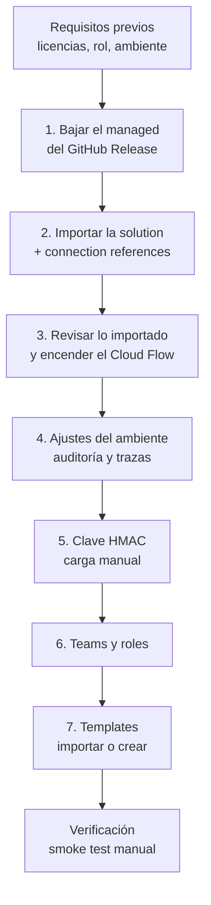

# Instalación en otro tenant

Este documento explica cómo instalar Smelter en un ambiente de Dataverse de **otro tenant**, y cómo actualizarlo después. Está pensado para el administrador de Power Platform de ese tenant, que recibe el `.zip` de la solución sin contexto previo. En el tenant donde se desarrolla Smelter, Dev se aprovisiona con `tools/Smelter.Deploy` (una consola SDK que solo corre con `SMELTER_ENV=dev`) y Test/Prod se actualizan con el workflow `solution-import`. **Nada de eso aplica acá**: para otro tenant no hay script, y todo se hace **a mano, desde interfaces gráficas** (`make.powerapps.com`, el *Power Platform admin center* y las pantallas de Smelter).

Los nombres de menús y botones se escriben como aparecen en la interfaz en inglés. Si el portal está en español, la etiqueta es la traducción.

## Cómo funciona

La instalación tiene dos mitades:

- **Lo que viaja en la *solution*.** Una *solution* es el paquete de Dataverse que agrupa componentes para moverlos entre ambientes. La de Smelter se llama `smlt_core_smelter` (prefijo de publisher `sanic`). Al importar el *managed* se instalan solos: las 6 tablas de configuración y ejecución, la alternate key del Import Job Log, el plugin package con sus Custom APIs y el message step, los dos roles, el Cloud Flow, la app model-driven con sus vistas, botones y dashboard, y (en las versiones que lo incluyen) la tabla de keys HMAC.
- **Lo que no viaja.** Conexiones, teams, asignación de roles a personas, la **clave HMAC**, los templates, las tablas de negocio donde se va a cargar y los ajustes del ambiente. Eso se hace a mano, en el orden de este documento.



## Qué viaja en la solution y qué no

Esta tabla es el resumen de todo lo que Dev tiene configurado (lo que `Smelter.Deploy` provisiona) contrastado con lo que efectivamente llega en el `.zip` *managed*. Se verificó contra `solutions/unpacked/` y `tools/Smelter.Deploy/*.cs`.

| Componente | Lo configura en Dev | ¿Viaja en el managed? | Paso |
|---|---|---|---|
| 6 tablas `sanic_tbl_smlt_*`, columnas, relaciones | Solución | Sí | 3 |
| Alternate key `sanic_smlt_ijl_key_logidempotente` (Import Job Log) | `KeyProvisioner` | Sí (`EntityKeys` en `Entity.xml`) | 3 |
| Columnas muertas eliminadas (audit 1.3.0.0) | `SchemaCleanupProvisioner` | No hace falta: el managed ya no las trae. En un **upgrade** se borran solas; con *Update* no | Upgrade |
| Cascade Template a Import Job (`Share=Cascade`, `Reparent=Cascade`) | `SecurityProvisioner` | Sí (`Relationships/sanic_tbl_smlt_importtemplate.xml`) | 3 |
| Plugin package `sanic_Smelter.Plugins` | `Smelter.Deploy` | Sí | 3 |
| 4 Custom APIs (`prepareimport`, `processchunk`, `exporttemplate`, `importtemplate`) con parámetros | `Smelter.Deploy` | Sí | 3 |
| `executeprivilegename` de cada Custom API | `SecurityProvisioner` | Sí (en cada `customapi.xml`) | 3 |
| Message step `AssignJobOwnerPlugin` (Create de Import Job, Pre-operation, sync) | `StepProvisioner` | Sí (`SdkMessageProcessingSteps`) | 3 |
| Roles `Smelter Configurador` y `Smelter Operador` con privilegios | `SecurityProvisioner` | Sí | 3 |
| App model-driven restringida al rol Configurador | `SecurityProvisioner` | Sí (`AppModuleRoleMaps`) | 3 |
| 3 vistas (Jobs Activos, Completados con Errores, Todos los Jobs) | `SecurityProvisioner` | Sí (`SavedQueries`) | 3 |
| Botones Ejecutar/Reintentar (RibbonDiff + web resource) | `SecurityProvisioner` | Sí | 3 |
| Dashboard "Smelter Dashboard" y su entrada en el sitemap | `SecurityProvisioner` | Sí | 3 |
| Cloud Flow orquestador, ya con `processchunk` renombrado y el handler Failed corregido | `CloudFlowUpdater` | Sí (el JSON del flow viaja corregido) | 2 y 3 |
| Tabla `sanic_tbl_smlt_hmackey` (schema, audit de tabla ON, columna del valor sin audit y fuera de Advanced Find) | `HmacKeyTableProvisioner` | Sí, **solo en la versión que la incluya** (ver abajo) | 3 |
| **Valor de la clave HMAC** (la fila) | A mano | **No, nunca** | 5 |
| **Conexión Dataverse** y su vínculo a las connection references | Dev | **No** | 2 |
| **Encendido del Cloud Flow** | Dev | Depende de cómo se importe; se verifica siempre | 3 |
| **Teams, membresías, rol Operador/Configurador a personas** | A mano | **No** | 6 |
| **Dueño (team) de cada template** | A mano | **No** | 7 |
| **Templates** | Datos en Dev | **No** (son registros) | 7 |
| Tablas destino del negocio y sus alternate keys | Otras soluciones | **No** (no son de Smelter) | 7 |
| Auditoría del ambiente, nivel de trazas de plugins | Admin center | **No** | 4 |

⚠️ **La versión a instalar tiene que traer la tabla de keys HMAC.** El último Release publicado al escribir este documento es `sol-v1.3.0.0`, y su `Solution.xml` **no** incluye `sanic_tbl_smlt_hmackey` (la función `HMAC()` y la tabla están en `[Unreleased]` del `CHANGELOG.md`). Instalá un Release posterior que la incluya; el paso 3 explica cómo comprobarlo.

## Requisitos previos

### Plataforma y licencias

| Requisito | Para qué | Notas |
|---|---|---|
| Ambiente de Power Platform con base de datos Dataverse | Datos, plugins, app y flow | Sandbox o producción; no uses el ambiente *Default* si podés evitarlo |
| Licencia de Power Apps o Dynamics 365 para quienes usan la app | La app es model-driven sobre Dataverse | ⚠️ A confirmar el plan concreto según el licenciamiento del cliente |
| Derechos de Power Automate para quien es dueño del Cloud Flow | El flow usa el conector Dataverse | ⚠️ A confirmar: depende de la licencia del dueño de la conexión |
| Idioma base del ambiente | La solución se exportó con `languagecode=1033` (inglés) | ⚠️ No verificado si otro idioma base bloquea la importación; ante la duda, ambiente con inglés |
| Dependencias de plataforma | `Solution.xml` declara `AppModuleWebResources (2.5)` y `msdyn_AppFrameworkInfraExtensions` | Vienen con cualquier ambiente con Dataverse y apps. Si la importación las reclama, el ambiente está desactualizado |

### Permisos de quien instala

| Permiso | Para qué |
|---|---|
| Rol **System Administrator** en el ambiente | Importar la solución (incluye un plugin package), asignar roles, editar la tabla de keys HMAC |
| Acceso al repositorio `breaking-bytes-dev/smelter` (o que el equipo de desarrollo te pase los zips) | Bajar el Release |
| Poder crear conexiones en el ambiente | Paso 2 |
| `openssl` o un gestor de contraseñas con generador | Paso 5 |

## 1. Conseguir el paquete

La solución se publica como **GitHub Release** con tag `sol-vX.Y.Z.B` y dos archivos: `smlt_core_smelter_managed.zip` y `smlt_core_smelter_unmanaged.zip`.

1. Abrí la página de Releases del repositorio y elegí la versión acordada con el equipo de desarrollo.
2. Descargá **`smlt_core_smelter_managed.zip`**. Con la CLI: `gh release download sol-vX.Y.Z.B --repo breaking-bytes-dev/smelter --pattern smlt_core_smelter_managed.zip`.
3. Usá **managed** en cualquier ambiente que no sea de desarrollo. El unmanaged solo sirve para un ambiente donde vayan a modificar la solución.


## 2. Importar la solution

1. En `make.powerapps.com`, elegí el ambiente **de destino** (selector arriba a la derecha) y abrí **Solutions**.
2. **Import solution** (Importar solución), **Browse** (Examinar), elegí el `.zip` y **Next**.
3. Si aparece una lista de **dependencias faltantes**, cancelá y revisá la tabla de requisitos.
4. En **Connection References** (Referencias de conexión) la solución trae dos, ambas del conector Microsoft Dataverse:

   | Nombre lógico | Nombre visible |
   |---|---|
   | `sanic_conn_wfe_dataverse` | CONN \| WFE \| Dataverse |
   | `wf_sharedcommondataserviceforapps_3bc81` | Microsoft Dataverse WFEngineEvaluation-3bc81 |

   Para **cada una**, elegí una conexión existente o creá una con **+ New connection**. Vinculá las dos a la **misma** conexión.
5. **Import**. Corre en segundo plano y puede tardar varios minutos. Si falla, la página de soluciones muestra una notificación con **Download Log File** (un XML).
6. Un *managed* se importa ya publicado: **no hace falta "Publish all customizations"**.


### Quién tiene que ser dueño de la conexión

El flow corre con la identidad de la conexión. Esa identidad llama a `prepareimport`, y el plugin verifica que **quien llama (`InitiatingUserId`) tenga Read sobre el template del job** (`PrepareImportPlugin`, `PrincipalAccessChecker`). Por eso:

- ✅ Usá una **cuenta de servicio dedicada** (usuario licenciado, o service principal con conexión Dataverse) con el rol **`Smelter Configurador`**, que da lectura/escritura a nivel Organización sobre las 6 tablas, o con System Administrator.
- ❌ No uses la cuenta personal de quien instala (se rompe si esa persona se va o rota la contraseña).
- ❌ No uses una cuenta con solo `Smelter Operador`: tiene Read en nivel *User* (propios y de sus teams) sobre jobs y templates, y no vería los jobs de otros teams. El job terminaría `Failed` con `does not have Read access to the Import Template`.

⚠️ Dónde queda exactamente el *owner* del flow tras la importación (quien importa, o quien lo enciende) no está verificado; revisalo en el paso 3 y, si hace falta, usá **Change owner** hasta que lo sea la cuenta de servicio.

## 3. Revisar lo importado y encender el flow

Abrí `smlt_core_smelter` en **Solutions** y revisá el panel **Objects**:

| Qué | Dónde | Resultado esperado |
|---|---|---|
| Tablas | **Tables** | 6 tablas `sanic_tbl_smlt_*` (Import Template, Table Mapping, Column Mapping, Relationship Mapping, Import Job, Import Job Log) |
| Tabla de keys HMAC | **Tables** | `TBL \| SMLT \| HMAC Key` (`sanic_tbl_smlt_hmackey`). **Si no está, el Release no la incluye: instalá uno posterior** |
| Plugin package | **Plug-in packages** | `sanic_Smelter.Plugins` |
| Message step | **Plug-in steps** | `Smelter.Plugins.AssignJobOwnerPlugin: Create of sanic_tbl_smlt_importjob`, estado **On**, Pre-operation, sincrónico |
| Custom APIs | **Custom APIs** | Las 4: `sanic_capi_smelter_prepareimport`, `_processchunk`, `_exporttemplate`, `_importtemplate`. No debe existir ninguna `anic_...` |
| Roles | **Security roles** | `Smelter Configurador`, `Smelter Operador` |
| App | **Apps** | `MDA - SMLT - Import Configurationd and Monitoring` |
| Cloud Flow | **Cloud flows** | `Cloud Flow \| Smelter \| Smelter orchestrator` |

Después **encendé el flow**:

1. **Solutions** → `smlt_core_smelter` → **Cloud flows** → abrí el flow.
2. Si está **Off**, **Turn on**. Si pide una conexión, falta vincular una connection reference (paso 2).
3. Comprobá que el *owner* sea la cuenta de servicio.

El flow se dispara cuando un Import Job queda con `sanic_smlt_ij_status = 0` (Queued), llama a `sanic_capi_smelter_prepareimport` y itera `sanic_capi_smelter_processchunk` hasta `HasMore = false`. Si el bloque falla, se omite o vence, marca el job `Failed` (status 4).


### Qué se verifica y no necesita acción

Roles, `executeprivilegename`, cascade, vistas, botones, dashboard, alternate key y asociación de la app al rol Configurador llegan ya configurados. La app queda asociada a `Smelter Configurador` (más `System Administrator` y `System Customizer`, que la plataforma asocia a toda app model-driven y no se pueden quitar).

⚠️ Consecuencia: **los operadores no ven la app en su selector**. Pueden operar un job por URL directa, pero para que la tengan a mano hay que agregarles acceso a la app. Ese ajuste no está en la solución, y no está verificado qué pasa con él en un upgrade; coordinalo con el equipo de desarrollo antes de hacerlo.

## 4. Ajustes del ambiente

| Ajuste | Dónde | Valor |
|---|---|---|
| Auditoría del ambiente | Admin center → ambiente → **Settings** → **Audit and logs** → **Audit settings** → **Start Auditing** | Encendida. El audit de la tabla de keys HMAC viaja en la solución pero **no registra nada** si el ambiente lo tiene apagado |
| Nivel de trazas de plugins | Admin center → ambiente → **Settings** → **Resources** → **All legacy settings** → **Settings** → **Administration** → **System Settings** → pestaña **Customization** → **Enable logging to plug-in trace log** | **Exception** en operación normal; **All** solo para diagnosticar |
| DLP y grupo de seguridad del ambiente | Admin center | ⚠️ Dependen del tenant. La política DLP tiene que permitir el conector Microsoft Dataverse |

## 5. Clave HMAC

La función `HMAC(valor, "nombreKey")` del Transform DSL calcula un HMAC-SHA256 (hex minúsculas, 64 caracteres) con una key que se busca **por nombre** en la tabla `sanic_tbl_smlt_hmackey`. La tabla viaja con la solución; **el valor lo cargás vos, a mano, en cada ambiente**. Nunca por CI, nunca en el repositorio, nunca en un secret.

Si ningún template de tu instalación usa `HMAC()`, igual conviene tener este paso presente: sin la key, cualquier template que la use falla.

1. **Generá la key** (32 bytes en hex = 64 caracteres):
   ```bash
   openssl rand -hex 32
   ```
   o el generador de tu gestor de contraseñas, con alfabeto `0-9a-f` y largo 64.
2. **Guardala en el gestor de contraseñas** de la organización, con el nombre de la key y el ambiente.
3. En `make.powerapps.com`, ambiente destino, **como System Administrator**: **Tables** → filtro **All** → **TBL \| SMLT \| HMAC Key** → editar datos.
4. Creá **una** fila activa:
   - **Name** (`[HK] Name`, `sanic_smlt_hk_name`): la etiqueta que usan los templates, por ejemplo `cm-pan`.
   - **Value** (`[HK] Value (hex)`, `sanic_smlt_hk_value`): el hex generado.
5. Guardá y comprobá que haya **una sola** fila activa con ese nombre.


### Reglas de custodia

- **Una key distinta por ambiente.** Reutilizala solo si los hashes tienen que coincidir entre ambientes (por ejemplo, datos de Prod que se vuelven a importar en Test); en ese caso aplicá a Test la custodia de Prod.
- Nunca pegues la key en chats, tickets, mails ni en el repositorio.
- Dos filas activas con el mismo nombre hacen fallar al motor (`HMAC: more than one active key named '<nombre>'`).
- El valor tiene que ser hex válido, con largo par y de al menos 32 bytes.

### Rotación: no es un cambio en caliente

Cambiar la key **cambia todos los hashes**. Si un template hace upsert por una columna HMAC, los registros existentes dejan de coincidir y la siguiente carga **crea duplicados**. Rotar exige una migración de re-key planificada (recalcular los hashes existentes con la key nueva) antes de volver a importar. No reemplaces el valor sin ese plan.

### Riesgo aceptado y seguridad de columna

La key vive en Dataverse. Cualquier System Administrator del ambiente puede leerla, y las copias y backups del ambiente la arrastran (al copiar a un ambiente inferior, reemplazá la key). La tabla está fuera de todo rol de Smelter: solo la lee el motor (SYSTEM) y los System Administrator. La columna del valor no se audita y no es válida para Advanced Find; la tabla sí se audita (ves quién creó, rotó o borró una key, no su valor).

📌 **Seguridad de columna.** Se está agregando *column security* sobre la columna del valor. Cuando el Release que instalás la incluya, el *field security profile* viaja en la solución, pero **la membresía al perfil no**: tenés que agregar a mano a quienes deban poder leer o cargar el valor. Verificá antes de cargar la key: **Settings** → **Users + permissions** → **Column security profiles**. ⚠️ No está verificado en este repositorio si System Administrator accede a una columna protegida sin pertenecer al perfil; si tu usuario no puede guardar el valor, agregalo al perfil.

## 6. Teams y roles

Smelter tiene dos roles, ambos importados con la solución:

| Rol | Qué puede |
|---|---|
| `Smelter Configurador` | CRUD a nivel Organización en las 6 tablas: crea y edita templates y mappings, ve todo. Es el único rol que ve la app |
| `Smelter Operador` | No configura. Lee templates de sus teams (Read nivel User), crea Import Jobs, lee y edita jobs de sus teams, lee los logs |

Los **templates son de usuario** (`UserOwned`) y la visibilidad del operador sale de que el **team sea dueño del template**: los jobs nuevos nacen a nombre del team del template (`AssignJobOwnerPlugin`), y todos los miembros los ven.

### 6.1. Configuradores

Asignales `Smelter Configurador` directo: Admin center → ambiente → **Settings** → **Users + permissions** → **Users** → persona → **Manage security roles**.

### 6.2. Team de operadores

1. Admin center → ambiente → **Teams** → **+ Create team**.
2. **Team type**: **Owner** (o *Microsoft Entra ID Security group* si los miembros salen de un grupo). **Business unit**: la raíz. Nombre libre, por ejemplo `Cobranza - Operadores`.
3. Guardá. **⋮** → **Manage security roles** → marcá **`Smelter Operador`**. ⚠️ Sin rol, Dataverse rechaza asignarle templates.
4. **Manage team members** → agregá a los operadores.


### 6.3. Dueño de cada template

Se hace después de crear o importar los templates (paso 7): abrí el template → **Assign** → elegí el team. Para dar acceso a **teams adicionales** sin cambiar el dueño, usá **Share** con permisos Read y Append To; el cascade propaga el acceso a los jobs.

## 7. Templates y tablas destino

Smelter instalado no trae ningún template. Necesitás dos cosas:

1. **Las tablas destino con sus alternate keys en estado Active.** No son de Smelter: vienen de la solución del negocio. Un key en `Pending` o `Failed` produce el mismo error que una key inexistente.
2. **El template**, de una de dos formas:
   - **Importarlo** desde un JSON exportado de otro ambiente: en la app, **Import Templates** → botón de importar → elegí el `.json`. Es la Custom API `sanic_capi_smelter_importtemplate`; los templates importados nacen **Active**.
   - **Crearlo a mano**: ver [Configurar un template](../04-admin-guide/configuring-a-template.md).

Un template en `Draft` o `Archived` no se puede ejecutar. Después de crearlo o importarlo, asignalo al team (6.3).

## Verificación: smoke test manual

Equivale a lo que hace `Smelter.Verify` contra Dev (que usa un service principal y la tabla `contact`; acá se hace con un usuario real). Necesitás una tabla destino con alternate key `Active`; los ejemplos usan `contact` con key en `emailaddress1`.

### Chequeos de estructura

| Qué comprobar | Cómo | Resultado esperado |
|---|---|---|
| Roles | **Security roles** | `Smelter Configurador` y `Smelter Operador` presentes |
| Custom APIs | Objetos de la solución | Las 4 `sanic_capi_smelter_*`; sin `anic_` |
| Message step | **Plug-in steps** | `AssignJobOwnerPlugin` en **On** |
| Alternate key del log | Tabla Import Job Log → **Keys** | `KEY \| IJL \| Log Idempotente`, **Active** |
| Cloud Flow | **Cloud flows** | **On** |
| Tabla HMAC | **Tables** | Existe y tiene exactamente una fila activa por key |
| Auditoría | Ver paso 4 | Encendida |

### Flujo funcional

1. **Crear un template mínimo** (como Configurador): `Name` = `Smelter Smoke Test`, Source Type CSV, Has Header Row Sí, Delimiter `,`, Status **Active**. Un Table Mapping a `contact` (Dedup Columns `emailaddress1`, Create If Not Exists Sí, Update If Exists Sí) y Column Mappings `Email`→`emailaddress1`, `FirstName`→`firstname`, `LastName`→`lastname`, `Children`→`numberofchildren` (Integer).
2. **Asignarlo al team** de operadores.
3. **Carga de 5 filas.** Archivo `smoke.csv`:
   ```csv
   Email,FirstName,LastName,Children
   smoke1@smelter-smoke.test,Smoke1,Verify,1
   smoke2@smelter-smoke.test,Smoke2,Verify,2
   smoke3@smelter-smoke.test,Smoke3,Verify,3
   smoke4@smelter-smoke.test,Smoke4,Verify,4
   smoke5@smelter-smoke.test,Smoke5,Verify,5
   ```
   **Import Jobs** → **Nuevo** → elegí el template → subí el CSV → **Guardar** → **Ejecutar**. Resultado: job `Completed`, éxito 5, fallidas 0, y 5 contactos nuevos.
4. **Idempotencia.** Repetí la ejecución del mismo job (o creá otro con el mismo archivo). Resultado: `Completed`, éxito 5 y **siguen existiendo 5 contactos** (el upsert por alternate key no duplica).
5. **Fila mala al Import Job Log.** Con un job nuevo y `smoke-badrow.csv` (las 5 filas anteriores más `bad@smelter-smoke.test,Bad,Row,notanumber`): resultado `CompletedWithErrors`, éxito 5, fallidas 1. En la pestaña **Errores** (o en **Import Job Logs**) hay **un solo** registro: fila **7** (la fila física del archivo, con el encabezado como 1), categoría **TypeError**, y el mensaje nombra la columna: `Column 'numberofchildren' (source 'Children'): Cannot convert ...`. Volvé a ejecutar: sigue habiendo un solo registro.
6. **Template en Draft rechazado.** Pasá el template a **Draft**, creá un job y ejecutá: tiene que fallar con `Import Template '...' is not Active`. Devolvé el template a **Active**.
7. **Ownership por team** (si el template es del team): el job nuevo muestra como *Owner* al team, y un segundo operador del mismo team lo ve y puede operarlo. Buscalo en **Jobs Activos** o **Todos los Jobs**; la vista de plataforma "My Import Jobs" filtra por dueño = vos y no lo muestra.
8. **Limpieza.** Borrá los contactos `@smelter-smoke.test` y los jobs de prueba. El template de prueba podés borrarlo o dejarlo en Archived.


⚠️ **Inconsistencia a confirmar con desarrollo.** La documentación de usuario dice que **Ejecutar** deja el job en *Queued* y que el flow lo procesa. El web resource `sanic_smlt_importjob_actions.js` hace otra cosa: **Ejecutar corre `prepareimport` y `processchunk` directamente desde el navegador**, sin pasar por el flow. El flow se dispara además por cualquier job que esté o vuelva a *Queued*. Durante el smoke observá cuál de los dos caminos procesó el job (el Cloud Flow muestra su historial de ejecuciones) y avisá si ves doble procesamiento.

## Actualizar a una versión nueva

Cada versión nueva es un `.zip` *managed* con número mayor (`X.Y.Z.B`); los cambios están en `CHANGELOG.md`.

1. **Elegí el momento**: sin cargas en curso. Mientras dura la importación, los pasos de plugin pueden quedar apagados.
2. Avisá a quien edite en el ambiente que cierre cualquier personalización abierta.
3. `make.powerapps.com` → **Solutions** → **Import solution** → **Browse** → **Next**. Aparece el aviso de que el paquete es una actualización de una solución ya instalada.
4. En **Advanced settings** elegí **Upgrade**: deja la versión nueva y **borra** los componentes que ya no están en ella (por ejemplo, columnas retiradas). **Update** no borra lo que se quitó y puede dejar el ambiente distinto del de origen. **Stage for Upgrade** es solo si hace falta migrar datos entre ambas versiones.
5. Vinculá las connection references (las anteriores suelen aparecer ya vinculadas) e **Import**.
6. Repetí el paso 3 (plugin step **On**, flow **On**, Custom APIs) y la parte de estructura de la verificación.
7. Aplicá a mano lo que el `CHANGELOG.md` indique que no viaja. Casos conocidos:
   - Primera versión con la tabla HMAC: cargá la key (paso 5).
   - Primera versión con seguridad de columna: sumá a los usuarios autorizados al perfil.
   - Versiones que cambian el comportamiento de los templates (por ejemplo 1.3.0.0, donde `Update If Exists = No` pasó a saltear filas existentes): revisá tus templates.
8. Corré el smoke test.

La importación no toca datos: teams, key HMAC, templates y asignaciones quedan como estaban.

## Rollback y desinstalación

- **No hay rollback de una versión *managed*.** Importar un `.zip` de versión menor sobre uno mayor no está soportado. Si una versión nueva falla, la salida es corregir hacia adelante con un Release nuevo, o restaurar un backup del ambiente tomado antes de importar. **Hacé un backup manual del ambiente antes de cada upgrade.**
- **Desinstalar** (**Solutions** → `smlt_core_smelter` → **Delete**) borra los componentes de la solución, y con ellos **las tablas y todos sus datos**: templates, jobs, logs y las keys HMAC. Antes, exportá los templates a JSON y guardá las keys en el gestor de contraseñas.
- Los datos que Smelter cargó en tablas del negocio no se borran al desinstalar.
- Un restore o copia de ambiente arrastra la key HMAC: tratalo con la misma sensibilidad que Prod.

## Trampas y errores conocidos

- ⚠️ **Release equivocado.** `sol-v1.3.0.0` no trae la tabla de keys HMAC. Con ese Release, cualquier template con `HMAC()` falla con `HMAC: key store not available in this environment ('<nombre>')`.
- ⚠️ **Conexión con la cuenta personal.** Cuando esa persona se va, el flow deja de funcionar. Usá una cuenta de servicio.
- ⚠️ **Conexión con solo rol Operador.** El flow falla en `prepareimport` por falta de Read sobre el template.
- ⚠️ **Auditoría apagada.** El audit de la tabla de keys no registra nada si el ambiente no tiene la auditoría encendida.
- ⚠️ **Key repetida o rotada.** Dos filas activas con el mismo nombre rompen la carga; cambiar el valor genera duplicados.
- ⚠️ **Plugin package desactualizado en el sandbox.** Si ves `Unknown function: HMAC` en un ambiente con la key bien cargada, el sandbox sigue con una versión vieja del package (`Smelter.Plugins` 1.0.5 o anterior). Dataverse recarga por versión del package: la solución instalada tiene que traer `1.0.6` o superior (el repositorio está en `1.0.7`).
- ⚠️ **Team sin rol.** Dataverse rechaza asignar un template a un team que no tiene ningún rol de seguridad.
- ⚠️ **Operador sin la app.** Es el comportamiento diseñado (la app es del Configurador); ver el paso 3.

| Síntoma | Causa probable | Solución |
|---|---|---|
| El job queda en **Queued** y no avanza | Cloud Flow apagado, conexión inválida o connection reference sin vincular | Paso 3: encender el flow y revisar la conexión. Probá **Ejecutar**, que corre sin el flow (ver la inconsistencia anotada arriba) |
| `Import Template '<nombre>' (<id>) is not Active (status=Draft). Activate the template before running imports.` | El template está en Draft o Archived | Pasalo a **Active** |
| `User <id> does not have Read access to the Import Template (<id>) referenced by this Import Job. Prepare aborted.` | Quien llama (la conexión del flow o el operador) no tiene Read sobre el template | Dar rol `Smelter Configurador` a la cuenta del flow; asignar o compartir el template con el team del operador |
| `CSV is missing mapped source column(s): <lista>.` | El encabezado del CSV no tiene columnas que el template mapea | Corregir el CSV o el template (el nombre es case-insensitive) |
| `Import Job has no template reference.` | El job se creó sin template | Elegir el template y volver a ejecutar |
| `Import Job <id> is not in Processing state (status=...). Run PrepareImport first; finished or failed jobs cannot be reprocessed.` | Se llamó `processchunk` con el job en Queued o terminado | Usar **Reintentar** (que vuelve a correr desde `prepareimport`) |
| `HMAC: key store not available in this environment ('<nombre>')` | La tabla de keys no existe (Release sin HMAC) o hubo un fault de Dataverse al leerla | Instalar un Release con la tabla (paso 3) |
| Filas con categoría **TransformError** y `HMAC: key '<nombre>' missing or shorter than 32 bytes.` | No hay fila activa con ese nombre, o la key es corta | Paso 5: cargar la key con 64 caracteres hex |
| `HMAC: more than one active key named '<nombre>'.` | Dos filas activas con el mismo nombre | Dejar una sola |
| `HMAC: key '<nombre>' is not valid hex.` | El valor tiene caracteres fuera de `0-9a-f` o largo impar | Regenerar y cargar de nuevo (sin espacios, saltos de línea ni comillas) |
| `Unknown function: HMAC` | Package de plugins viejo en el sandbox | Ver la trampa sobre el package; reimportar con upgrade una versión con `Smelter.Plugins` 1.0.6 o superior |
| Operador no ve ningún template | El template no es del team ni está compartido, o no es miembro | Paso 6.3 y revisar membresía |
| Operador no ve los jobs de un compañero | El template no es del team (los jobs nacen a nombre del creador) o el message step está apagado | Asignar el template al team; encender `AssignJobOwnerPlugin` |
| Dataverse rechaza asignar un template a un team | El team no tiene rol de seguridad | Paso 6.2, punto 3 |
| La importación falla por una dependencia faltante | Ambiente sin Dataverse con apps o desactualizado | Revisar requisitos del ambiente |
| El botón Ejecutar no aparece | Solo se muestra con el job en *Queued*, y Reintentar solo con el job en *Failed*; no aparecen en un registro nuevo sin guardar | Guardar el job; revisar su estado |
| Falla `Incorrect type of attribute value ... EntityReference` al escribir logs | Alternate key del log mal definida (versiones anteriores a 1.2.1.0) | Instalar 1.2.1.0 o posterior |

Para diagnosticar un fallo dentro del motor, subí temporalmente el nivel de trazas a **All** (paso 4) y revisá el **Plug-in Trace Log**: cada plugin deja un marcador de build al empezar (por ejemplo `=== Smelter PrepareImport — BUILD ... ===`).

## Piezas y archivos

| Pieza | Archivo |
|---|---|
| Spec de roles, privilegios, vistas y dashboard | `tools/Smelter.Deploy/SecuritySpec.cs` |
| Spec de Custom APIs y `executeprivilegename` | `tools/Smelter.Deploy/ApiSpec.cs` |
| Spec del message step | `tools/Smelter.Deploy/StepSpec.cs` |
| Spec de la alternate key del log | `tools/Smelter.Deploy/KeySpec.cs` |
| Spec de la tabla de keys HMAC | `tools/Smelter.Deploy/HmacKeyTableSpec.cs` |
| Lectura de la key HMAC | `src/Smelter.Plugins/Services/DataverseHmacKeyProvider.cs` |
| Gate de estado del template y check de Read | `src/Smelter.Plugins/PrepareImportPlugin.cs` |
| Smoke automático que este documento replica a mano | `tools/Smelter.Verify/Program.cs` |
| Despliegue a Test/Prod del tenant propio (no aplica acá) | `.github/workflows/solution-import.yml`, `deploy/README.md` |
| Gestión de la clave HMAC | [Seguridad y roles](../04-admin-guide/security-and-roles.md#clave-hmac) |

## Capturas pendientes

| Archivo | Qué tiene que mostrar |
|---|---|
| `img/inst-01-github-release.png` | Página del GitHub Release `sol-vX.Y.Z.B` con los dos assets managed y unmanaged |
| `img/inst-02-connection-references.png` | Diálogo de importación con las dos Connection References vinculadas a la misma conexión Dataverse |
| `img/inst-03-cloud-flow-on.png` | Cloud flow "Smelter orchestrator" con estado On y la cuenta de servicio como owner |
| `img/inst-04-hmac-key-row.png` | Tabla HMAC Key en modo editar datos con una fila activa (valor oculto) |
| `img/inst-05-team-operadores.png` | Team de operadores con el rol Smelter Operador y sus miembros |
| `img/inst-06-smoke-completed.png` | Import Job completado con 5 filas exitosas y 0 fallidas |
| `img/inst-07-smoke-badrow-log.png` | Import Job CompletedWithErrors con el detalle de la fila 7 en la pestaña Errores |
