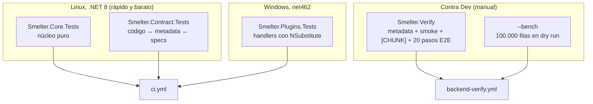

# Pruebas

Este documento describe las cuatro capas de prueba de Smelter: las pruebas del núcleo, las de los plugins, las de contrato entre el código y la metadata de la solución, y la verificación de punta a punta contra Dev (`Smelter.Verify`). Para cada una: qué cubre, cómo se corre y qué no cubre. Está pensado para quien agrega código o necesita saber qué garantiza el CI.

El pipeline que las ejecuta está en [ALM y despliegue](08-alm-y-despliegue.md).

## Cómo funciona



Todas usan **xUnit 2.9** y **FluentAssertions 6.12**; las de plugins añaden **NSubstitute** para simular `IOrganizationService` y los demás contratos. El proyecto se desarrolla con **TDD estricto**: la prueba va primero.

> [!NOTE]
> **No se usa FakeXrmEasy.** Los plugins se prueban con dobles de NSubstitute sobre `IOrganizationService`, `IFileDownloader`, `IAccessChecker` y los demás contratos. Es posible porque cada plugin delega en un `*Handler` que recibe sus dependencias por constructor.

| Proyecto | Framework | Dónde corre | Métodos de prueba (`[Fact]`/`[Theory]`) |
|---|---|---|---|
| `Smelter.Core.Tests` | net8.0 | Linux o Windows | 117 |
| `Smelter.Plugins.Tests` | net462 | **Solo Windows** (en Linux sin Mono aborta con «Could not find 'mono' host») | 165 |
| `Smelter.Contract.Tests` | net8.0 | Linux o Windows | 333 |

Los conteos son de métodos y no de casos: un `[Theory]` se expande en varios.

### Cómo correrlas

```bash
dotnet test tests/Smelter.Core.Tests -c Release       # núcleo
dotnet test tests/Smelter.Contract.Tests -c Release   # contrato
dotnet test tests/Smelter.Plugins.Tests -c Release    # solo Windows (net462)
```

> [!WARNING]
> No corras `dotnet test Smelter.sln` a ciegas en Linux: `Smelter.Plugins.Tests` aborta. El CI las separa por proyecto y por sistema operativo.

No hay cobertura medida ni capa de integración aparte: la verificación de punta a punta es `Smelter.Verify`.

### Pruebas del núcleo (`Smelter.Core.Tests`)

Cubren la lógica pura, sin Dataverse:

| Archivo | Qué prueba |
|---|---|
| `CsvParserServiceTests`, `CsvReaderTests` | Lectura por rango, conteo de filas, cabecera con y sin `HasHeaderRow`, delimitadores, comillas, BOM |
| `CsvByteCursorTests` | El **cursor de bytes**: CRLF y LF, comillas con saltos de línea, multibyte, BOM, archivo sin salto final, borde de chunk a mitad y justo al final de un registro, y la propiedad «los chunks leídos por cursor equivalen a leer todo» para varios tamaños de chunk y de bloque (hasta 1 byte) |
| `CsvDelimiterTests` | Alias `TAB` y `\t` |
| `TransformEngineTests` | Cada función del DSL, anidamiento, errores, `HMAC` (con un proveedor de claves simulado) |
| `DependencyResolverTests` | Orden topológico, ciclos y auto-referencia |
| `TemplateValidatorTests` | Coherencia del template (Dedup Columns, Lookup, relaciones) |
| `TemplateSerializerTests`, `TemplateImportPolicyTests` | Round-trip del JSON, versión, rango de chunk, status, `ManyToMany` rechazado, política de status |
| `TableMappingConfigTests`, `SourceRowTests` | Recorte de Dedup Columns y comparación sin distinguir mayúsculas |

### Pruebas de plugins (`Smelter.Plugins.Tests`)

Prueban los *handlers* con dobles de NSubstitute:

| Archivo | Qué prueba |
|---|---|
| `PrepareImportHandlerTests` | Los gates (estado, acceso, dedup, coherencia), la validación de encabezados, el reset del job (incluidos `endtime` y `failurereason`), el claim con `claimlock` |
| `ProcessChunkHandlerTests` | Avance de offset y cursor, tramo parcial, estado final, gates repetidos, fallos de log |
| `ValidateQueueAccessHandlerTests` | Acceso al template en `Create` y `Update`, guarda de `Processing` |
| `AssignJobOwnerHandlerTests` | Dueño por team, por usuario, sin template, payload explícito |
| `TemplateApiHandlerTests`, `TemplateExporterTests`, `TemplateImporterTests` | Export/import: refs, remapeo de GUID, upsert por nombre, advertencias, status |
| `NormalizationEngine*Tests` | Lotes, categorías de error y la auditoría de campos (default antes de obligatoria, clave del padre por el mismo pipeline, mayúsculas) |
| `UpsertWriterTests`, `UpsertWriterErrorTests` | Upsert, `Create`/`Update`, *Create/Update If*, «Solo inserción», dry run, mensajes de fault sin valores |
| `TypeCoercerTests` | Cada tipo de dato, rangos y mensajes sin valor |
| `DataverseHmacKeyProviderTests` | Lectura de la clave, caché, fallos, hex inválido, nombre ambiguo |
| `ImportContextLoaderTests`, `PrincipalAccessCheckerTests`, `FileDownloaderTests` | Carga de contexto, derecho de lectura y descarga por bloques |

### Pruebas de contrato (`Smelter.Contract.Tests`)

Son el punto donde el código y la metadata se corroboran entre sí. Corren contra [`solutions/unpacked/`](../../solutions/unpacked/) (lector `SolutionMetadata`) y contra las specs de `Smelter.Deploy`. Si el código y la metadata divergen, **fallan**, en vez de dejar que un documento quede obsoleto.

| Grupo | Archivos | Qué atan |
|---|---|---|
| Enums del código y choices | `ChoicesContractTests` | `ImportJobStatus`, `ColumnDataType`, `ErrorCategory`, etc. contra los valores reales de los choices |
| Custom APIs | `CustomApiContractTests`, `ProcessChunkRenameContractTests` | Cada API de `ApiSpec` existe en la metadata con sus parámetros |
| Seguridad y steps | `SecuritySpecContractTests`, `StepSpecContractTests`, `RelationshipSchemaContractTests`, `DevAccessTests` | Matriz de privilegios, nombres de privilegio, cascada, steps (sincrónico, pre-operación) |
| Esquema | `SchemaAdditionsSpecContractTests`, `SchemaAuditSpecContractTests`, `HmacKeyTableSpecContractTests` | Columnas nuevas, ajustes, limpieza y la tabla de claves |
| Interfaz | `SiteMapSpecContractTests`, `FormPolishSpecContractTests`, `MdaComponentsSpecTests`, `MdaXmlTests`, `DashboardSpecContractTests`, `FormXmlEditor*Tests`, `FormLabelsReaderTests` | Sitemap, formularios, componentes fijados (ids contra `AppModule.xml`), dashboard, edición de formxml |
| Localización | `BilingualTests`, `ColumnDescriptionsSpecContractTests`, `TableLabelsSpecContractTests`, `MiscLabelSpecsContractTests`, `IconsSpecContractTests` | Cada columna y opción viva tiene su 3082; sin duplicados ni textos vacíos; los SVG parsean, tienen `viewBox`, un color y están embebidos |
| Cloud Flow | `ClientDataClaimGateTests`, `ClientDataFailedHandlerFixerTests`, `ClientDataFailureReasonWriterTests`, `ClientDataProcessChunkRenamerTests`, `CloudFlowUpdaterApplyWithRestoreTests` | Cada transformer del flow es puro e idempotente; `ApplyWithRestore` restaura el estado |
| Guardas | `DeployGuardsTests`, `SolutionZipBuilderTests`, `AssetLoaderTests` | `SMELTER_ENV=dev`, `--allow-destructive`, el zip mínimo del ribbon |
| Verify | `E2eSpecTests`, `BenchSpecTests`, `MultiChunkSmokeSpecTests`, `HmacSmokeSpecTests` | La parte pura de los pasos de `Smelter.Verify` (CSV determinísticos, selección con `--only`, valores esperados de los transforms contra el `TransformEngine` real) |

> [!NOTE]
> Estas pruebas leen un espejo que es posterior a un Release. Una spec nueva puede quedar en rojo hasta que `solution-sync` actualice `solutions/unpacked/`; es el estado esperado de esa ventana, no un defecto.

### `Smelter.Verify`

Es el único componente que prueba el **runtime desplegado**. Se dispara a mano con el workflow `backend-verify` (o localmente con `dotnet run --project tools/Smelter.Verify -c Release`). Usa la tabla estándar `contact`, con su alternate key en `emailaddress1`, como tabla destino, y limpia todo lo que crea. Argumentos: `--interactive`, `--bench` y `--only <pasos>`.

**1. Aserciones de metadata (solo lectura).**

| Etiqueta | Qué comprueba |
|---|---|
| `[SEC]` | Cada rol contiene los privilegios de `SecuritySpec` con su profundidad; los prohibidos (Create sobre el log) están ausentes; el Operador no tiene Create, Write ni Delete sobre Template; cascade Template → Job; `executeprivilegename` de cada API; la app asociada solo a Configurador (más los roles de plataforma); el Cloud Flow apunta al nombre nuevo |
| `[STEP]` | Los 3 message steps existen con la etapa, el modo y el rank de la spec, y están habilitados |
| `[KEY]` | La alternate key del log tiene **exactamente** esas columnas y el índice `Active` |
| `[CLEAN]` | Los atributos y opciones muertos no existen |
| `[ADD]` | Las columnas nuevas existen con su tipo y precisión, son componentes de la solución y están en el formulario si corresponde |
| `[TUNE]` | Los ajustes de columnas y formularios, incluido el rechazo de Chunk Size 99, 50 y 10001 |
| `[DESC]` | Toda columna custom de las 6 tablas tiene descripción en 1033 y 3082 |
| `[POLISH]` | Los formularios y vistas ya están al día (`Apply` sobre una copia no cambia nada) |
| `[SITEMAP]` | Títulos 1033 y 3082 en cada nodo, sin prefijos técnicos, `VectorIcon`, nombre de la app en ambos idiomas, `SubArea` del panel apuntando al dashboard clásico |
| `[SOLNAME]` | El nombre visible de la solución |
| `[ICONS]` | Web resources SVG con el contenido versionado, `IconVectorName` de cada tabla, ícono de la app |
| `[LABELS]` | Nombres 3082 de tablas, columnas y opciones; el 1033 no quedó vacío |
| `[VIEWS]` | Nombres 1033 y 3082 de las vistas custom y del dashboard; ninguna con el nombre legado |
| `[HMAC]` | La tabla de claves existe, es componente de la solución, de la organización, con auditoría de tabla, sin auditoría del valor, fuera de Advanced Find y asegurada. **No lee ningún valor** |
| `[MDA]` | `ValidateApp` sin errores, sitemap y componentes consistentes, formularios y vistas sin atributos inexistentes, web resources existentes, los 34 componentes fijados, la tabla de claves fuera de la app |

**2. Smoke funcional.**

| Paso | Qué prueba |
|---|---|
| [3] | Importa un template vía `ImportTemplate` (el serializador del núcleo arma el JSON) |
| [3b] | Gate de estado: un template `Draft` es rechazado con `not Active`; se restaura `Active` |
| [4]/[4b] | Alta del job; dueño del job según el dueño del template (team o usuario) |
| [5]/[5b] | Primera corrida de 5 filas: `Completed`, 5 de 5, 5 contactos nuevos; el **cursor de bytes** termina exactamente en el largo del CSV |
| [6] | **Idempotencia**: re-correr no duplica (siguen 5) |
| [6b] | Una fila con `Children` no numérico: `CompletedWithErrors` 5/1; **un** log en la fila física 7, categoría `TypeError`, mensaje que nombra `numberofchildren`; re-correr no duplica el log |
| [6c] | `UpdateIfExists = No`: 5 filas `Skipped`, nada se escribe |
| [6e] | Gate de idempotencia: sin Dedup Columns ni «Solo inserción» se rechaza con `has no dedup columns`; con el flag, se acepta |
| [6d] | **HMAC E2E**: una clave temporal `smoke-verify` generada en proceso (nunca impresa) prueba que SYSTEM lee la columna asegurada; los 3 hashes coinciden con el cálculo local; la clave se borra al terminar |

**3. `[CHUNK]` — smoke multi-chunk.** 250 filas con `ChunkSize = 100`: tres chunks (100 + 100 + 50), campos entrecomillados con salto de línea y caracteres multibyte (`ñ`, `é`) **cruzando los límites** de chunk, y dos filas malas (la primera del segundo chunk y la última del tercero) para fijar los `RowNumber` de los logs. El chunk mínimo real es 100, por eso no se puede forzar un chunk de 5.

**4. Pasos `[E2E-n]`.** La cobertura de cada campo de la MDA contra Dev. Se pueden correr por separado con `--only` (`--only 4a,5c`; un número elige el grupo: `4` trae `4a` y `4b`; `e2e` o `all` trae todos).

| Paso | Qué prueba |
|---|---|
| 1 | `CreateIfNotExists = No`: las filas que no existen quedan `Skipped` |
| 2 | Tipos de dato en `contact`: String, Integer, Decimal, Money, DateTime, Boolean (6 tokens), OptionSet (directo y con mapeo) y Lookup (GUID y clave de negocio) |
| 2g | Tipo GUID (aislado: escribe la clave primaria) |
| 3 | `IsRequired` y `DefaultValue` |
| 4a | Relación `OneToMany` con `ProcessingOrder` invertido: gana el DAG; FK resuelta con padre e hijo en chunks distintos |
| 4b | Relación `OneToMany` con el padre con clave HMAC (regresión del bug #8) |
| 5a | `HasHeaderRow = No` (`Column0..N`) |
| 5b | Delimitador `;` |
| 5c | Delimitador TAB |
| 6 | Template `Archived` rechazado por `PrepareImport` y por `ProcessChunk` |
| 7a | **Cloud Flow de punta a punta**: job vacío → `Queued` → `Completed` |
| 7b | Cloud Flow, camino `Failed`: template en Draft → job `Failed` con motivo sin datos |
| 7c | Cloud Flow anti-duplicados: el mismo job encolado dos veces termina `Completed`, con conteos exactos y sin logs de clave duplicada |
| 7d | Guarda de re-encolado: con el job `Processing`, poner `Queued` es rechazado; el job igual termina `Completed` |
| 8 | Dry run: no crea nada y termina `Completed` |
| 10 | Round-trip Export → Import con todos los campos del DTO |
| 11 | `SourceColumn` sin distinguir mayúsculas (`email` contra `Email`) |
| 12 | `CONCAT`, `UPPER`, `MAP`, `DATEPARSE`, `IF` y `SPLIT` por el plugin real |
| 13 | `ValidateQueueAccess`, camino negativo: **no se prueba** (necesita una identidad sin privilegios); el camino positivo lo cubren 7a y 7b |
| 14 | `ManyToMany` rechazado por la Custom API de import |

El catálogo tiene 20 pasos; el 13 solo emite una nota. El «caso 9» (contadores) no es un paso: se aserta dentro de los demás.

**5. Benchmark (`--bench`, no forma parte del verify por defecto).** Un CSV de **100.000 filas** en **dry run** con chunks de 1000, llamando directo a `PrepareImport` y `ProcessChunk`, cronometrando cada llamada del lado cliente. Imprime total, primer, medio y último chunk, p50, p95 y máximo, y **falla si algún chunk tarda 60 s o más** (el límite de un plugin síncrono es de 2 minutos). Como el dry run no escribe, **no mide el costo de la escritura real**.

**Detalles de robustez.**

- La descarga de la columna File falla a veces con un `400 InvalidQueryParameterValue` de Azure Blob Storage cuando el CSV se subió segundos antes. `Verify` reintenta (hasta 4 intentos, 15 s) **solo** esa firma; cualquier otro error se propaga al primer intento. El `BlockId` de la subida es fijo y seguro para URL, porque el base64 de un GUID a veces traía `+` o `/`.
- Las corridas directas de `PrepareImport` sobre un job ya corrido lo devuelven antes a «sin status», no a `Queued` (eso dispararía el flow): el claim no toma jobs terminados.
- Ante un fallo, imprime el `OrganizationServiceFault` completo con su `TraceText` y la cadena de `InnerFault`.

### Datos de prueba

En [`tests/data/`](../../tests/data/) hay tres CSV de muestra (`Smelter_Test_500.csv`, `Smelter_Test_5000.csv`, `Smelter_Load_Test_100k.csv`) con columnas de empleados (`EmpID`, `FullName`, `Age`, `Salary`, `HireDate`...). **Ningún código del repositorio los referencia hoy**: `Smelter.Verify` genera sus propios CSV determinísticos. Sirven para pruebas manuales de carga.

## Cómo se modifica

**Agregar una prueba de plugin.** Escríbela primero (TDD) en `tests/Smelter.Plugins.Tests/`, contra el handler, con dobles de NSubstitute. Corre en Windows.

**Agregar una prueba del núcleo.** En `tests/Smelter.Core.Tests/`; corre en cualquier sistema.

**Agregar una spec nueva de `Smelter.Deploy`.** Suma su prueba de contrato (que la spec coincida con `solutions/unpacked/` o con su propio catálogo) y su aserción en `Smelter.Verify`. Las aserciones de `Verify` leen metadata y reutilizan el `Apply` puro de la spec.

**Agregar un paso E2E.** Una entrada en `E2eSteps.All` (id y título), su spec pura en `E2eSpec*.cs` (con su prueba en `E2eSpecTests`) y su implementación en `E2eRunner*.cs`. El paso debe limpiar lo que crea (`E2eRunner.DeleteData`).

## Trampas y errores conocidos

- **Las pruebas de plugins no corren en Linux sin Mono.** El CI las ejecuta en `windows-latest`.
- **`Smelter.Verify` escribe en `contact` y en las tablas de Smelter de Dev**, con dominios de prueba (`@smelter-smoke.test`, `@smelter-chunk-smoke.test`, `@smelter-bench.test`). No lo apuntes a un ambiente con datos reales de `contact` sin revisar los filtros de limpieza.
- **`Verify` no cubre Test ni Prod.** El smoke posterior a `solution-import` está pendiente de cablear.
- **El camino negativo de `ValidateQueueAccess` no tiene prueba E2E**: necesita una identidad sin privilegios, y CI tiene un solo service principal. Está cubierto con pruebas unitarias del handler.
- **El tamaño de archivo máximo y el rendimiento de escritura real no están medidos** en el repositorio (el benchmark es en dry run).
- **Un fallo de `[E2E-n]` deja datos de prueba** si el proceso muere; el siguiente `Verify` los limpia al empezar.
