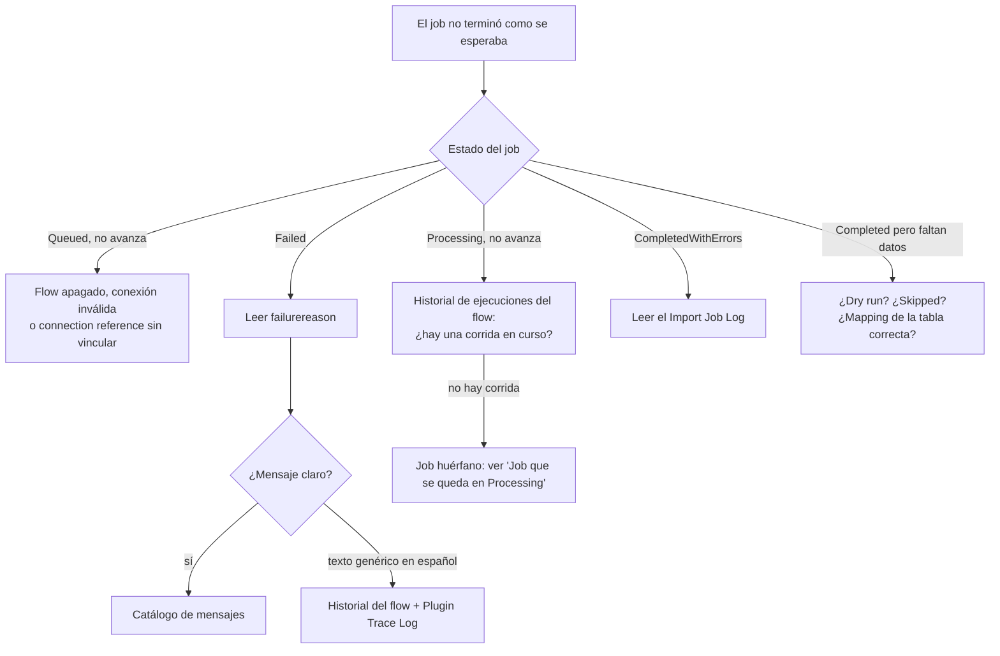

# Mantenimiento

Este documento reúne lo que hace falta para operar Smelter una vez instalado: las tareas recurrentes, cómo diagnosticar un job que falló o que no avanza, el catálogo de mensajes de error tal como aparecen (en inglés) con su causa y su solución, y cómo hacer los cambios más comunes. Está pensado para quien recibe el aviso de que «una carga falló».

Para entender el flujo que se diagnostica, ver [Arquitectura](01-arquitectura.md) y [Ciclo de vida](07-ciclo-de-vida.md).

## Cómo funciona

### Tareas recurrentes

| Frecuencia | Tarea | Cómo |
|---|---|---|
| Cada carga | Revisar el resultado del job | Vista **Active jobs** mientras corre; **Completed with errors** para los que tienen filas fallidas; el **panel** para el panorama |
| Cada carga con errores | Leer el Import Job Log del job | Pestaña **Import logs** del job (más nuevo primero). Ver [Ciclo de vida](07-ciclo-de-vida.md#reintentos) para no confundir logs de una corrida anterior |
| Periódica | Limpiar jobs viejos y sus archivos | Ver [Limpieza](#limpieza-de-jobs-archivos-y-logs) |
| Después de cada actualización | Smoke test y lista de control | [Instalación en otro tenant](09-instalacion-en-otro-tenant.md#verificación-y-lista-de-control) |
| Después de copiar o restaurar un ambiente | Reemplazar la clave HMAC y revisar el dueño del flow | [Seguridad](03-seguridad.md#clave-hmac) |
| Cuando cambia el personal | Revisar quién tiene `Smelter Configurador`, la membresía de los teams y el dueño de la conexión del flow | Admin center |

### Cómo diagnosticar un job

Sigue este orden; cada paso descarta una familia de causas.

1. **El formulario del job.** Estado, `failurereason`, contadores (`totalrows`, `processedrows`, `successcount`, `failedcount`, `skippedcount`), `starttime`/`endtime` y la pestaña de logs. Recuerda que los contadores son por par (fila, tabla destino).
2. **El historial de ejecuciones del Cloud Flow** (Solutions → `smlt_core_smelter` → Cloud flows → *Smelter orchestrator* → **28-day run history**). Las corridas duplicadas sobre el mismo job son normales: terminan sin procesar.
3. **El Plug-in Trace Log.** Sube temporalmente el nivel de trazas a **All** (Admin center → ambiente → **Settings** → **Administration** → **System Settings** → **Customization** → **Enable logging to plug-in trace log**). Cada plugin escribe un marcador al empezar:

   | Plugin | Marcador |
   |---|---|
   | `PrepareImport` | `=== Smelter PrepareImport — BUILD chunked-v2 (no-probe, with-tracing) ===` |
   | `ProcessChunk` | `=== Smelter ProcessChunk — BUILD chunked-v3 (byte-cursor) ===` |
   | `AssignJobOwner` | `=== Smelter AssignJobOwner — BUILD team-ownership-v1 ===` |
   | `ValidateQueueAccess` | `=== Smelter ValidateQueueAccess — BUILD queue-gate-v1 ===` |
   | `ExportTemplate`, `ImportTemplate` | `=== Smelter ExportTemplate (chunked-v2) ===`, `=== Smelter ImportTemplate (chunked-v2) ===` |

   Si el marcador esperado no aparece, el ensamblado no se actualizó (falta subir la versión del package). `ProcessChunk` además traza **cada fila fallida** con su categoría (`FAILED row <n> [<Categoría>] <tabla>: <mensaje>`), de modo que se ve aunque la escritura del log falle. Vuelve el nivel a **Exception** cuando termines.
4. **El template.** Estado `Active`, Dedup Columns, alternate key de la tabla destino en estado `Active`, delimitador y encabezados.
5. **La clave HMAC**, si el template usa `HMAC()`.
6. **El acceso.** ¿La cuenta del flow lee el template? ¿La persona que encola también?

### Catálogo de mensajes

Los mensajes del motor están en **inglés** y no contienen valores de filas.

#### Al preparar (`failurereason` de un job `Failed`)

| Mensaje | Causa | Solución |
|---|---|---|
| `Import Job has no template reference.` | El job se creó sin template | Elegir el template y volver a ejecutar |
| `Import Template '<nombre>' (<id>) is not Active (status=Draft\|Archived). Activate the template before running imports.` | El template no está `Active` | Pasarlo a `Active` |
| `User <id> does not have Read access to the Import Template (<id>) referenced by this Import Job. Prepare aborted.` | La identidad del flow no lee el template | Rol `Smelter Configurador` a la cuenta de la conexión |
| `Table Mapping '<nombre>' (<tabla>) has no dedup columns: Smelter requires an alternate key so reprocessing never duplicates. Set dedup columns or enable 'Insert only (allows duplicates)'.` | Mapping sin clave | Definir Dedup Columns, o marcar «Solo inserción» (duplicará al reprocesar) |
| `Import Template '<nombre>' has configuration errors: ...` | Incoherencia entre registros (ver abajo) | Corregir lo que lista el mensaje |
| `CSV is missing mapped source column(s): <lista>.` | Encabezados que el template mapea y el archivo no trae | Revisar el CSV, el delimitador (¿`;`? ¿TAB?) y los nombres de `Source Column` |

Los errores de configuración (`has configuration errors`) listan, separados, cada problema:

| Fragmento | Significado |
|---|---|
| `dedup column '<c>' is not the Target Column of any of its Column Mappings` | Una Dedup Column no es la Target Column de ningún Column Mapping de ese mapping |
| `Data Type Lookup requires a Lookup Table` | Falta `Lookup Table` en un Column Mapping de tipo Lookup |
| `ManyToMany is not supported; use OneToMany` | Relación con el tipo retirado |
| `OneToMany requires 'Lookup column on child'` | Falta la columna lookup del hijo |
| `the parent Table Mapping does not belong to this template` / `the child ...` | El mapping de la relación es de otro template |
| `parent Table Mapping '<n>' has no dedup columns, so the child cannot reference it by alternate key` | El padre no tiene clave |
| `Parent Dedup Columns lists <a> column(s) but parent Table Mapping '<n>' has <b> dedup column(s); they must match one to one` | Distinta cantidad de columnas de clave |

#### Al procesar

| Mensaje | Causa | Solución |
|---|---|---|
| `Import Job <id> is not in Processing state (status=...). Run PrepareImport first; finished or failed jobs cannot be reprocessed.` | `ProcessChunk` llamado sobre un job que no está `Processing` | Usar **Reintentar** (que pasa por `PrepareImport`) |
| `Circular dependency detected: table '<t>' references itself.` / `...involving tables: <lista>. Check your relationship mappings for cycles.` | Las relaciones forman un ciclo | Corregir las Relationship Mappings |
| Texto genérico en español: `Falló la preparación del import. Revisá el historial de ejecuciones del flujo.` | `PrepareImport` falló sin devolver mensaje en el cuerpo | Mirar el historial del flow y el Trace Log |
| Texto genérico en español: `Falló el procesamiento del import o excedió el tiempo límite. Revisá el historial de ejecuciones del flujo.` | `ProcessChunk` falló o venció sin mensaje | Ídem |

#### Por fila (Import Job Log)

| Categoría | Mensaje típico | Causa y solución |
|---|---|---|
| `ValidationError` | `Required field '<destino>' (Source: '<origen>') is empty.` | Celda vacía en una columna obligatoria, sin valor por defecto. Corregir el archivo o definir `Default Value` |
| `TypeError` | `Column '<destino>' (source '<origen>'): Cannot convert value (<n> chars) to <tipo>.` | La celda no tiene el formato del tipo. Para `Boolean` agrega ` Expected: true/false, 1/0, yes/no.`; para `OptionSet`, ` Use MAP transform if mapping is required.` |
| `LookupUnresolved` | `Lookup '<destino>' value is not a GUID and no LookupMatchColumn is configured.` | El valor no es GUID y falta la columna de coincidencia |
| `TransformError` | `Unknown function: <NOMBRE>`, `Expected EOF`, `HMAC: ...` | Error de sintaxis del DSL o de clave HMAC. Ver [Motor y DSL](05-motor-y-dsl.md#errores-y-categorías) |
| `TargetData` | `Dataverse rejected the write (ErrorCode 0x<código>).` | Dataverse rechazó el registro. El código se busca en el Plug-in Trace Log; causas típicas: restricción de la tabla, privilegio, referencia por alternate key que no resuelve (padre inexistente), texto demasiado largo |
| `SourceError` | Cualquier otro | Fila mal formada o condición inesperada |

Códigos de Dataverse que aparecieron en la historia del proyecto: `0x80060892` (`DuplicateRecordEntityKey`, consecuencia de corridas duplicadas del flow, neutralizadas desde el plugin 1.0.14) y `0x80060882` (`ConcurrencyVersionMismatch`, del claim anterior).

#### Al encolar o usar la app

| Mensaje | Causa | Solución |
|---|---|---|
| `No tenés acceso al Import Template de este job: no se puede poner en cola.` | La persona que encola no puede leer el template | Asignar o compartir el template con su team |
| `El Import Job se está procesando: no se puede volver a poner en cola hasta que termine.` | Se intentó encolar un job `Processing` | Esperar |
| `El job no tiene Import Template. Elegí uno y guardá antes de ejecutar.` | Botón sin template | Elegir template y guardar |
| `El job no tiene archivo cargado. Subí el CSV en 'Source File' antes de ejecutar.` | Botón sin archivo | Subir el CSV |
| `No tenés acceso de lectura al Import Template de este job.` | La persona no lee el template (403) | Idem |
| `Template JSON is ... ` / `Unsupported formatVersion ...` / `Relationship '...' is ManyToMany...` | Import de un JSON inválido | Ver [Plugins y Custom APIs](04-plugins-y-custom-apis.md#importtemplateplugin) |

### Limpieza de jobs, archivos y logs

> [!WARNING]
> **El CSV queda guardado en el job.** Smelter no borra ni purga el archivo de origen al terminar y no incluye ningún trabajo de retención. Si los archivos traen datos sensibles (documentos, números de tarjeta), siguen almacenados en la columna `sanic_smlt_ij_sourcefile` hasta que alguien los quite, y consumen capacidad de almacenamiento de archivos del ambiente.

- **Borrar un job borra sus logs** (cascada total en la relación Import Job → Import Job Log).
- **Para quitar solo el archivo**, elimina el archivo de la columna *Source File* del job (el job y sus contadores se conservan). Un job sin archivo no se puede volver a ejecutar ni reintentar con éxito, porque faltaría el CSV.
- **Para una retención automática**, el camino de plataforma es un *Bulk Delete* de Dataverse (Admin center → **Bulk deletion**) sobre Import Job con criterio de fecha de creación y estados terminales, programado de forma recurrente. El repositorio **no** incluye ese trabajo; su único uso de borrado masivo es `BulkDeleteRequest` del lado servidor en `SchemaCleanupProvisioner`, que purgó logs obsoletos porque 1000 `Delete` en un `ExecuteMultiple` superaban el timeout del cliente.
- **Los logs no se acumulan por reintento** salvo el caso de logs de una corrida anterior (ver [Ciclo de vida](07-ciclo-de-vida.md#reintentos)). Si hace falta limpiar logs de un job sin borrarlo, selecciónalos en la pestaña **Import logs** y elimínalos: los roles de Smelter incluyen Delete sobre el log para el Configurador.
- **No borres un template con jobs.** La relación Template → Import Job usa `RemoveLink`: los jobs quedan sin template. Pasa el template a `Archived`.

### Job que se queda en `Processing`

Un job queda así si el flow se apaga o se cancela a mitad de camino. **Reintentar** no está disponible en `Processing` y `ValidateQueueAccess` rechaza poner `Queued`. El repositorio no define un procedimiento oficial. El único camino que usa el código (`Smelter.Verify` entre corridas directas) es **devolver el status a vacío** con una escritura por API; después el botón **Ejecutar** vuelve a habilitarse y el job se procesa desde el principio. Antes, confirma en el historial del flow que **no hay una corrida activa** sobre ese job.

## Cómo se modifica

**Cambiar el tamaño de chunk de un template.** Edita *Chunk Size* en el template (100 a 10.000; vacío = 1000). Un chunk más grande hace menos llamadas pero se acerca al límite de 2 minutos del sandbox si hay muchas tablas o plugins pesados sobre las tablas destino; uno más chico agrega sobrecarga de orquestación. Calibra por template midiendo.

**Agregar una columna al archivo.** Agrega el Column Mapping al Table Mapping correspondiente. Si la columna forma parte de una clave, revisa también las Dedup Columns y las Parent Dedup Columns de las relaciones. Exporta el template antes de un cambio grande.

**Mover un template a otro ambiente.** **Exportar Smelter Template** en la grilla, y **Importar Smelter Template** en el otro. El import hace *upsert por nombre*: reemplaza el árbol de mappings del template con el mismo nombre. Después, asigna el team dueño.

**Dar de alta a un operador.** Agrégalo como miembro del team que es dueño del template. No necesita rol propio si el team lo tiene.

**Rotar la clave HMAC.** No es un cambio en caliente: ver [Seguridad](03-seguridad.md#reglas-de-custodia).

**Actualizar la solución.** [Instalación en otro tenant](09-instalacion-en-otro-tenant.md#actualizar-a-una-versión-nueva).

**Cambiar el dueño de la conexión del flow.** Crea la conexión nueva, vincula las dos connection references y comprueba que el flow esté **On**. La identidad nueva necesita el rol `Smelter Configurador`.

## Trampas y errores conocidos

- **Un `failurereason` genérico en español** significa que el cuerpo del error no traía mensaje. El motivo real está en el historial del flow y en el Plug-in Trace Log.
- **Comparar logs con `failedcount`.** Después de un reintento, la pestaña de logs puede traer entradas de la corrida anterior.
- **Un dry run limpio no garantiza una ejecución limpia** (ver [Arquitectura](01-arquitectura.md#dry-run)).
- **Un job `Failed` con contadores en cero y sin `starttime`** falló en la preparación, antes del reset.
- **Los jobs de un equipo no aparecen en «My Import Jobs»**: usa las vistas de Smelter.
- **Si cambió el nombre de un encabezado del CSV**, el job falla con `CSV is missing mapped source column(s)`: la comparación ignora mayúsculas pero no acentos ni espacios.
- **El nivel de trazas en `All` deja información en el Trace Log.** Los mensajes del motor no llevan valores, pero conviene volver a **Exception**.
- **`Unknown function: <NOMBRE>` para una función que sí existe** indica un package viejo en el sandbox: sube la versión del package y reimporta.

## Preguntas abiertas

- **Retención.** No hay en el repositorio una política de retención de jobs, archivos ni logs; es una decisión pendiente del equipo que opera la solución.
- **Recuperación de un job huérfano.** El procedimiento descrito arriba se deduce del código; no está documentado ni probado como supuesto de soporte.
