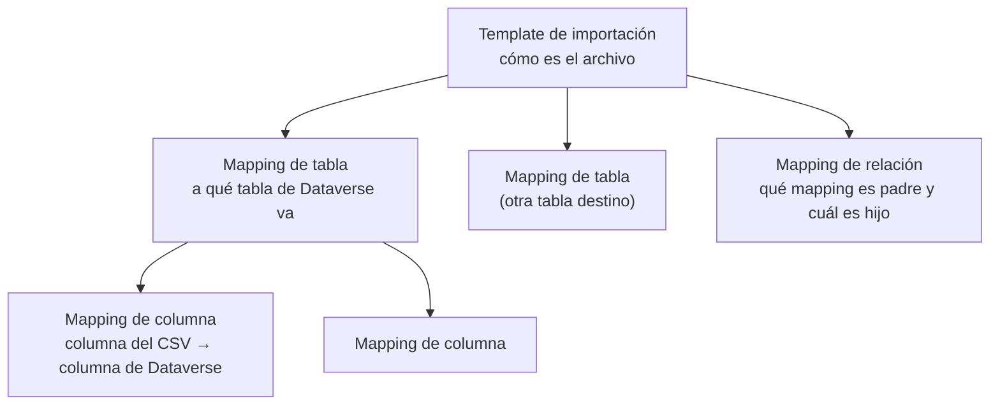
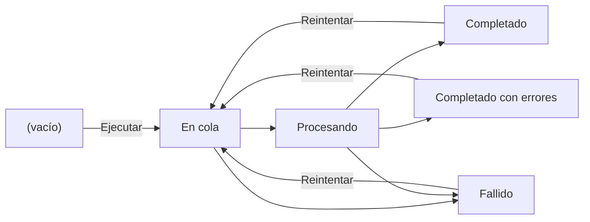
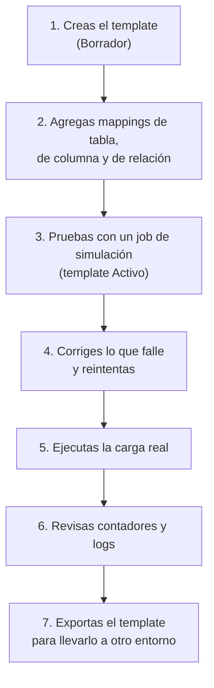

# Conceptos básicos de Smelter

Esta guía es para las personas que configuran importaciones en Smelter, el perfil **Configurador**. Explica qué hace Smelter, las palabras que vas a ver en las pantallas, quién hace qué y cómo viaja un archivo desde tu computadora hasta las tablas de Dataverse. Léela una vez antes de abrir la [guía del Configurador](01-configurador.md); al final tienes el índice de todas las guías.

## Qué es Smelter

Smelter lee archivos **CSV** y los convierte en registros de **Dataverse**. Tú describes una sola vez cómo es el archivo (qué columnas trae, a qué tabla va cada una, cómo se limpia cada dato) y Smelter hace el resto cada vez que alguien le entrega un archivo nuevo: lo lee por bloques, valida cada fila, crea o actualiza los registros y deja un detalle de todo lo que falló.

Esa descripción se llama **Template** (en español, «Template de importación»). Cada archivo que se procesa es un **Import Job**.

Smelter se usa desde dos lugares, según tu perfil:

| Perfil | Dónde trabaja | Para qué |
|---|---|---|
| **Configurador** | La app **Smelter — Configuración de importaciones** (en inglés, **Smelter — Import configuration**). Se abre desde Power Apps, en el navegador | Armar y activar templates, ejecutar y monitorear imports, revisar errores, exportar e importar templates |
| **Operador** | La app de la solución que consume Smelter (por ejemplo, Cobranza) | Cargar archivos y ejecutarlos con los templates que le compartieron. **No ve la app de configuración**: si eres Operador, estas guías no son para ti |

> **Nota:** el perfil lo decide el rol de seguridad de tu usuario: **Smelter Configurador** o **Smelter Operador**. Si no ves la app de configuración en Power Apps, pídele a quien administra los accesos que te asigne el rol Smelter Configurador.

## Cómo es la app por dentro

Al abrir la app ves el menú de la izquierda con tres grupos. Todo lo que hace el Configurador está en estas cuatro pantallas:

| Grupo | Opción del menú (en español) | En inglés | Qué encuentras |
|---|---|---|---|
| **Configuración** | **Templates de importación** | Import templates | Los templates: cómo se interpreta cada tipo de archivo |
| **Ejecución y monitoreo** | **Import Jobs** | Import jobs | Un registro por cada archivo que se procesa, con su estado y sus contadores |
| **Ejecución y monitoreo** | **Panel de Smelter** | Smelter dashboard | Un panel con gráficos y la lista de jobs |
| **Diagnóstico** | **Logs de importación** | Import logs | Cada fila que falló, con su motivo |

*La app al abrir **Templates de importación**. A la izquierda, el menú con Configuración, Ejecución y monitoreo y Diagnóstico; arriba, la barra de comandos con **Nuevo** e **Importar Smelter Template**.*

> **Nota:** la app tiene el idioma de tu interfaz de Power Apps. Algunos nombres no se traducen por decisión del producto y los vas a ver tal cual en español: **Import Jobs**, **Import Job** y los nombres de las vistas de sistema, como **Active TBL | SMLT | Import Jobs**. Los textos de las columnas estándar de la plataforma (por ejemplo **Owner** o **Created On**) también aparecen en inglés. Más detalle en el [Glosario](../glosario.md).

## Las piezas de un template

Un template se arma como un árbol: el template contiene mappings de tabla, cada mapping de tabla contiene mappings de columna, y las relaciones entre mappings de tabla se guardan aparte, también dentro del template.

| Pieza | Qué es | Ejemplo |
|---|---|---|
| **Template de importación** | La descripción completa de un tipo de archivo: separador, si trae encabezados, tamaño de cada bloque de filas y estado | «Demo · Contactos»: un CSV con Nombre, Apellido y Correo |
| **Mapping de tabla** | Indica a qué tabla de Dataverse se escriben las filas, en qué orden se procesa esa tabla y cómo se decide si el registro ya existe | Tabla destino `contact`, clave `emailaddress1` |
| **Mapping de columna** | Une una columna del CSV con una columna de la tabla destino, con su tipo de dato, si es obligatoria, su valor por defecto y, si hace falta, una transformación | Columna de origen `Apellido` → columna destino `lastname` con `UPPER(Apellido)` |
| **Mapping de relación** | Cuando un mismo archivo llena dos tablas relacionadas (por ejemplo, clientes y sus cuentas), dice cuál es la tabla padre, cuál la hija y por qué columnas del archivo se encuentra al padre | Cliente (padre) → Cuenta (hija) por la columna `CIF` |

Un archivo puede alimentar **varias tablas a la vez**: cada fila del CSV genera un registro por cada mapping de tabla del template.

## Conceptos clave de la configuración

### Deduplicación

Para no crear el mismo registro dos veces, cada mapping de tabla indica en **Columnas de deduplicación** qué columnas destino forman la clave del registro (por ejemplo, `emailaddress1`). Si el archivo trae una fila cuya clave ya existe, Smelter **actualiza** el registro en lugar de crear otro. Esto hace que reprocesar el mismo archivo sea seguro.

> **Importante:** la tabla destino tiene que tener en Dataverse una **clave alternativa** (alternate key) activa sobre esas mismas columnas. Si no existe, Dataverse rechaza las filas y verás errores de tipo **Error de datos de destino**. Crear la clave alternativa lo hace quien administra Dataverse, no el Configurador.

### Crear si no existe y Actualizar si existe

Dos opciones de cada mapping de tabla que deciden qué pasa según si la clave ya existe:

| Opción | Por defecto | Si está en **Sí** | Si está en **No** |
|---|---|---|---|
| **Crear si no existe** | Sí | La fila crea el registro cuando la clave no existe | La fila se **omite** y cuenta en **Filas omitidas** |
| **Actualizar si existe** | **Sí** | La fila actualiza el registro cuando la clave ya existe | La fila se **omite** y cuenta en **Filas omitidas** |

Las filas omitidas **no** se anotan en los logs: solo suman al contador.

### Solo insertar (Solo inserción)

Con **Solo inserción (permite duplicados)** en **Sí**, el mapping siempre **crea** registros nuevos y no usa claves: no necesita columnas de deduplicación, pero si reprocesas el archivo **puede duplicar datos**. Úsalo solo para tablas donde repetir filas sea válido (por ejemplo, un historial). Sin esta opción, un mapping sin columnas de deduplicación hace fallar el job.

### Transformaciones

Un mapping de columna puede llevar una **Expresión de transformación** que cambia el valor antes de guardarlo: `UPPER(Apellido)` convierte el apellido a mayúsculas, `CONCAT(Nombre, " ", Apellido)` junta dos columnas. Hay funciones para texto, fechas, condiciones, traducciones de valores y valores fijos. Cuando hay una expresión, tiene prioridad sobre el valor crudo del CSV. El detalle completo está en [Mappings de columna](01-configurador.md#paso-3-define-los-mappings-de-columna).

### Dry run (simulación)

Un job con **Es simulación (Dry Run)** en **Sí** recorre todo el archivo y valida el formato, los tipos y las transformaciones de cada fila, pero **no escribe nada en Dataverse**. Sirve para probar un archivo o un template nuevo sin riesgo. Las filas con problemas igual quedan registradas en los logs.

## Qué es un Import Job

Un **Import Job** es una ejecución: un template, un archivo CSV y, si quieres, la marca de simulación. Al ejecutarlo, Smelter lo procesa **en el servidor**, por bloques de filas (el **Tamaño de chunk** del template). Puedes cerrar la pestaña del navegador: el procesamiento sigue.

Mientras corre y cuando termina, el job muestra sus contadores (**Total de filas**, **Filas procesadas**, **Filas exitosas**, **Filas fallidas**, **Filas omitidas**) y sus horas (**Hora de inicio**, **Hora de fin**). Son campos de solo lectura: los escribe el sistema.

### Estados de un job

Un job recién creado tiene el **Estado** vacío. Después pasa por estos estados:

| Estado (como se ve en pantalla) | En inglés | Qué significa |
|---|---|---|
| *(vacío)* | — | El job se creó pero todavía no se ejecutó |
| **En cola** | Queued | Pulsaste **Ejecutar** o **Reintentar**; el servidor aún no empezó |
| **Procesando** | Processing | El servidor está leyendo el archivo y escribiendo en Dataverse |
| **Completado** | Completed | Terminó y ninguna fila falló |
| **Completado con errores** | CompletedWithErrors | Terminó, pero al menos una fila falló. Las demás se guardaron |
| **Fallido** | Failed | Falló el proceso completo (por ejemplo, el template no está activo o al CSV le falta una columna). El motivo queda en **Motivo de la falla** |

### Estados de un template

El **Estado** de un template tiene tres valores. Solo uno permite ejecutar:

| Estado | En inglés | Qué significa |
|---|---|---|
| **Borrador** | Draft | Lo estás armando. No se puede ejecutar |
| **Activo** | Active | Listo para usar. Es el único estado con el que un job puede correr, y el único que ofrece la lista de templates al crear un job |
| **Archivado** | Archived | Retirado. No se puede ejecutar |

## Qué es un Log de importación

Cada vez que una fila falla, Smelter escribe un **Log de importación** con la fila del archivo, la tabla destino, la **Categoría del error** y el **Mensaje de error**. Los logs los escribe **solo el sistema**: no se crean a mano. Solo se registran las filas **fallidas**; las exitosas y las omitidas viven únicamente en los contadores del job.

Las categorías de error son seis:

| Categoría | En inglés | Cuándo ocurre |
|---|---|---|
| **Error de origen** | SourceError | La fila no se pudo leer o falló algo inesperado al armarla |
| **Error de transformación** | TransformError | Una expresión de transformación está mal escrita o falló |
| **Error de tipo** | TypeError | El valor del CSV no se puede convertir al tipo del mapping (por ejemplo, texto en una columna **Entero**) |
| **Error de validación** | ValidationError | Una columna **Es obligatoria** quedó vacía |
| **Lookup sin resolver** | LookupUnresolved | Un lookup trae un valor que no es un GUID y el mapping no tiene **Columna de coincidencia del lookup** |
| **Datos de destino** | TargetData | Dataverse rechazó la escritura (por ejemplo, falta la clave alternativa o hay una clave duplicada) |

## Un día de trabajo del Configurador

1. **Creas el template** en **Templates de importación** con el estado **Borrador**. Ver [Guía del Configurador](01-configurador.md).
2. **Agregas los mappings** de tabla, de columna y, si hay tablas relacionadas, de relación.
3. **Activas el template** (Estado **Activo**) y haces una **prueba con simulación** en **Import Jobs**. Ver [Ejecución y monitoreo](02-ejecucion-y-monitoreo.md).
4. **Corriges** lo que falle: revisas **Motivo de la falla** o los **Logs de importación** y usas **Reintentar**.
5. **Ejecutas la carga real** con el mismo template.
6. **Revisas** los contadores, la vista **Completados con errores** y el **Panel de Smelter**.
7. Si necesitas el template en otro entorno, lo **exportas** y lo **importas** allá. Ver [Exportar e importar templates](03-exportar-e-importar.md).

## Índice de las guías

| Guía | Para qué |
|---|---|
| [Conceptos básicos](00-conceptos.md) (esta guía) | Entender qué hace Smelter y sus palabras clave |
| [Guía del Configurador](01-configurador.md) | Armar un template paso a paso, desde el template hasta activarlo |
| [Ejecución y monitoreo](02-ejecucion-y-monitoreo.md) | Crear jobs, ejecutarlos, leer estados y logs, reintentar y entender los mensajes |
| [Exportar e importar templates](03-exportar-e-importar.md) | Mover templates entre entornos o hacer copias |
| [Preguntas frecuentes](04-preguntas-frecuentes.md) | Respuestas cortas a los problemas más comunes |
| [Glosario](../glosario.md) | Todos los términos, en español y en inglés |
