# Guía del Configurador

Esta guía es para quien arma los templates de Smelter. Con ella vas a poder crear un template, definir a qué tabla va cada fila del CSV, mapear cada columna (con su tipo, su valor por defecto y sus transformaciones), relacionar tablas padre e hijo y dejar el template **Activo** para que se pueda ejecutar.

Si todavía no conoces los términos básicos (template, mapping, deduplicación, dry run), lee primero [Conceptos](00-conceptos.md).

Vamos a construir un ejemplo de punta a punta: un template llamado **Demo · Contactos** que importa contactos desde un CSV con tres columnas, **Nombre**, **Apellido** y **Correo**, a la tabla `contact` de Dataverse.

## Antes de empezar

- **Cómo se entra.** Abre la app **Smelter — Configuración de importaciones** desde Power Apps, en el navegador. Entras directo a **Templates de importación**.
- **Qué permiso hace falta.** Tu usuario tiene que tener el rol **Smelter Configurador**. Si no ves la app, pídeselo a quien administra los accesos.
- **Qué necesita la tabla destino.** La tabla de Dataverse a la que vas a importar ya tiene que existir, y tiene que tener una **clave alternativa activa** sobre las columnas que vas a usar para deduplicar. Eso lo prepara quien administra Dataverse. En el ejemplo, `contact` tiene una clave alternativa sobre `emailaddress1`.
- **Ten a mano un CSV de ejemplo.** Para ver los nombres de sus columnas. El del ejemplo se ve así:

```csv
Nombre,Apellido,Correo
Ana,Pérez,ana@example.com
Luis,Gómez,luis@example.com
Marta,Ruiz,marta@example.com
```

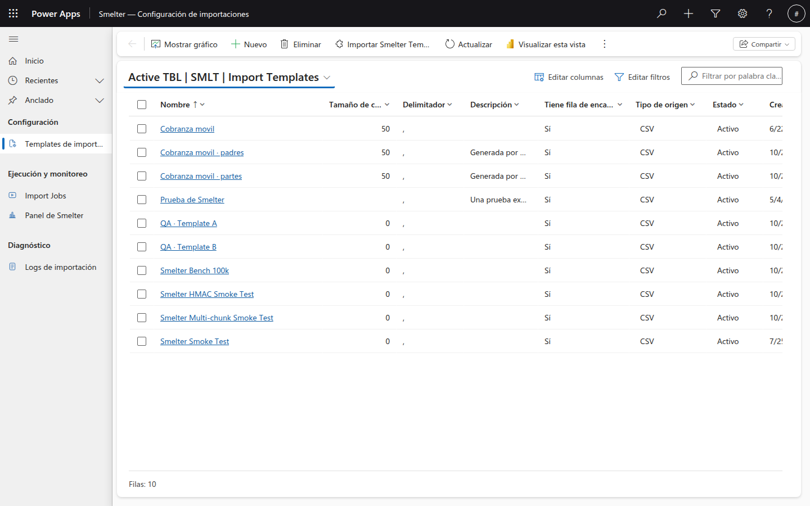

*La lista de templates. El botón **Nuevo** crea un template; **Importar template** carga uno desde un archivo (ver [Exportar e importar](03-exportar-e-importar.md)). La vista se llama **Active TBL | SMLT | Import Templates**: es un nombre de sistema que no se traduce.*

## Paso 1: Crea el template

**Para qué:** el template describe cómo es el archivo en general. Lo que va a cada tabla se define en los pasos siguientes.

1. En la lista de **Templates de importación**, pulsa **Nuevo**.
2. Completa los campos. Los que tienen asterisco rojo son obligatorios.

| Campo | Qué poner | En el ejemplo |
|---|---|---|
| **Nombre** (obligatorio) | Un nombre claro y único. Es lo que Smelter usa para reconocer el template al [importarlo](03-exportar-e-importar.md) | `Demo · Contactos` |
| **Tiene fila de encabezados** (obligatorio) | **Sí** si la primera fila del CSV son los nombres de las columnas. **No** si el archivo empieza directamente con datos | **Sí** |
| **Delimitador** | El carácter que separa las columnas. Si lo dejas vacío, se usa la coma | `,` |
| **Tamaño de chunk** | Cuántas filas procesa Smelter por bloque. Entre **100 y 10000**; vacío usa el valor por defecto del sistema (**1000**) | Ver el aviso de abajo |
| **Descripción** | Texto libre para tu equipo: para qué archivo sirve el template. Smelter no lo usa al procesar, pero viaja en la exportación | `Importa contactos desde un CSV con Nombre, Apellido y Correo.` |
| **Estado** | Déjalo en **Borrador** mientras lo armas | **Borrador** |
| **Owner** | El propietario del registro. Por defecto, eres tú | — |

3. Pulsa **Guardar**.

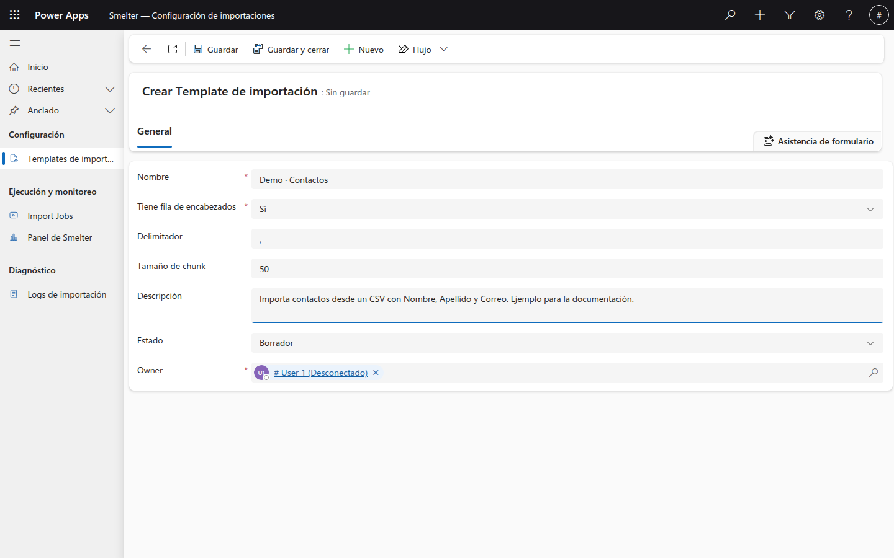

*El formulario de un template nuevo. El título dice **Sin guardar** hasta que pulsas **Guardar**.*

> **Consejo:** los campos de la plataforma, como **Owner**, aparecen en inglés aunque la app esté en español. Es normal.

### Delimitador

El delimitador es texto libre:

| Si tu archivo separa con… | Escribe en Delimitador |
|---|---|
| Coma | `,` (o déjalo vacío) |
| Punto y coma | `;` |
| Barra vertical | `\|` |
| **Tabulador** (archivos TSV) | `TAB` o `\t` (sin distinguir mayúsculas de minúsculas) |

Cualquier otro texto se usa tal cual. El tabulador no se puede escribir en un campo de texto: por eso Smelter acepta las palabras `TAB` o `\t`.

### Tamaño de chunk

El **chunk** es el bloque de filas que el servidor procesa de una vez. El valor debe estar **entre 100 y 10000**. Si lo dejas vacío, Smelter usa **1000**. Un valor fuera de ese rango **se rechaza al guardar**: no se ajusta en silencio.

> **Nota:** en las capturas de esta guía el template de ejemplo tiene **50** en **Tamaño de chunk**. Es un valor de una prueba anterior a la regla de 100 a 10000. Hoy ya no se puede guardar un valor así; si encuentras templates antiguos con valores menores a 100, el motor los trata como 100. Usa un valor entre 100 y 10000, o déjalo vacío.

### Campos obligatorios

Si intentas guardar con un campo obligatorio vacío, la pantalla no guarda y te lo marca.

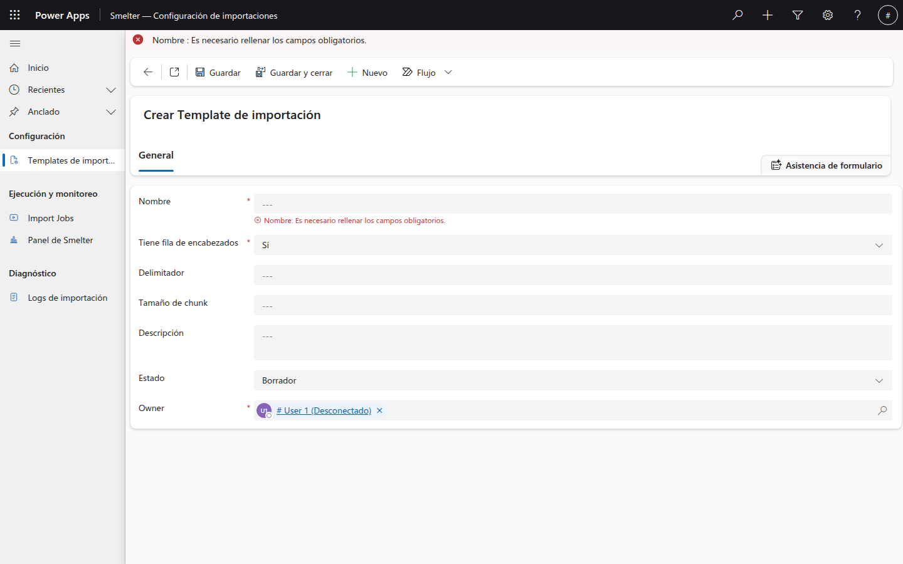

*El mensaje aparece arriba y debajo del campo. Completa **Nombre** y vuelve a guardar.*

### Después de guardar

Al guardar, el formulario muestra el nombre del template, el texto **Guardado** y aparecen dos cosas nuevas: la pestaña **Relacionados** y la sección **Mappings de tabla**, donde vas a trabajar en el paso siguiente.

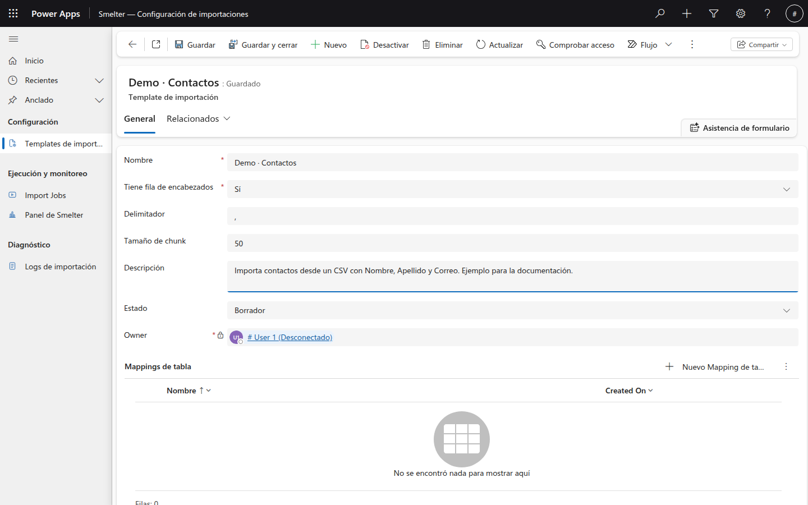

*El template guardado. La sección **Mappings de tabla** está vacía: todavía no definimos a qué tabla va cada fila.*

## Paso 2: Define el mapping de tabla

**Para qué:** el mapping de tabla dice a qué tabla de Dataverse se escriben las filas y cómo se reconoce un registro que ya existe. Necesitas **uno por cada tabla** que el archivo vaya a llenar.

1. Dentro del template, en la sección **Mappings de tabla**, pulsa **Nuevo Mapping de tabla**.
2. Completa los campos:

| Campo | Qué poner | En el ejemplo |
|---|---|---|
| **Nombre** (obligatorio) | Un nombre descriptivo. Solo es informativo | `Contactos` |
| **Tabla destino** (obligatorio) | El **nombre lógico** de la tabla de Dataverse, no su nombre visible | `contact` |
| **Orden de procesamiento** (obligatorio) | Un número entero. Las tablas con número menor se procesan primero. Los padres van antes que sus hijos | `1` |
| **Columnas de deduplicación** | Los nombres lógicos de las columnas **destino**, separados por coma, que forman la clave para saber si el registro ya existe | `emailaddress1` |
| **Crear si no existe** (obligatorio) | **Sí**: crea el registro si la clave no existe. **No**: omite la fila | **Sí** |
| **Actualizar si existe** (obligatorio) | **Sí**: actualiza el registro si la clave ya existe (es el valor por defecto). **No**: omite la fila | **Sí** |
| **Solo inserción (permite duplicados)** | **Sí**: siempre crea registros nuevos, sin clave. Reprocesar puede duplicar. Por defecto, **No** | **No** |

3. Pulsa **Guardar**.

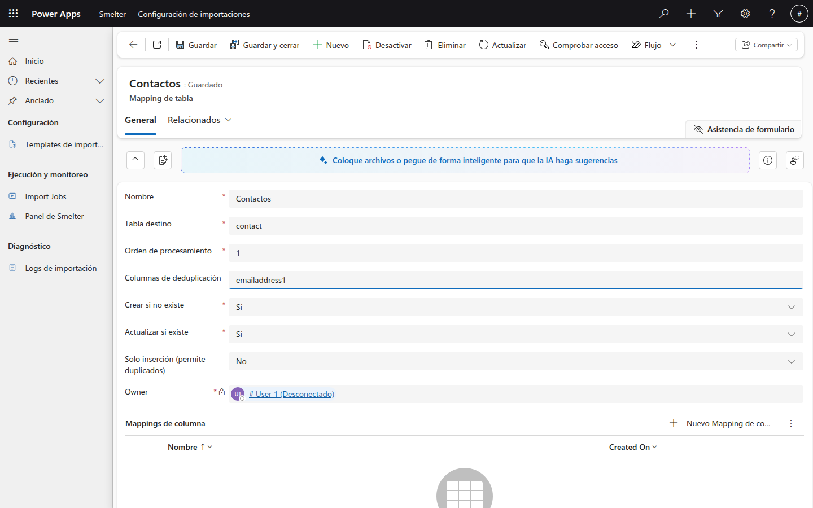

*El mapping de tabla ya guardado. Abajo aparece la sección **Mappings de columna**, todavía vacía. Si ves una franja que dice «Coloque archivos o pegue de forma inteligente…», es una ayuda de IA de Power Apps: no es parte de Smelter y puedes ignorarla.*

### Cómo elegir las columnas de deduplicación

- Escribe los nombres lógicos de las columnas **destino** (por ejemplo `emailaddress1`), no los nombres de las columnas del CSV.
- **Cada columna de deduplicación tiene que ser la Columna destino de algún mapping de columna** de este mismo mapping de tabla. Si no, el job falla antes de empezar (ver [Mensajes frecuentes](02-ejecucion-y-monitoreo.md#mensajes-frecuentes-y-qué-hacer)).
- Si la clave tiene varias columnas, sepáralas con coma: `sanic_cif,sanic_tipo`.
- Deben coincidir con una clave alternativa activa de la tabla en Dataverse.

> **Importante:** todo mapping de tabla necesita **Columnas de deduplicación**, salvo que tenga **Solo inserción (permite duplicados)** en **Sí**. Con **Solo inserción** en **Sí**, el mapping siempre crea registros nuevos: si reprocesas el archivo, **se duplican**. Úsalo solo cuando repetir filas sea válido.

> **Nota:** **Crear si no existe** y **Actualizar si existe** solo tienen efecto cuando el mapping tiene columnas de deduplicación. Las filas omitidas por estas opciones cuentan en **Filas omitidas** del job y **no** quedan en los logs.

## Paso 3: Define los mappings de columna

**Para qué:** cada mapping de columna une una columna del CSV con una columna de la tabla destino y dice cómo convertir el valor. Necesitas **uno por cada columna** que quieras guardar.

1. Abre el mapping de tabla (haz clic en su nombre) y, en la sección **Mappings de columna**, pulsa **Nuevo Mapping de columna**.
2. Completa los campos:

| Campo | Qué poner |
|---|---|
| **Nombre** (obligatorio) | Un nombre descriptivo. Solo es informativo |
| **Columna de origen** | El nombre de la columna **en el CSV**. No distingue mayúsculas de minúsculas y se ignoran los espacios alrededor. Es opcional si una transformación no lee del CSV (por ejemplo `STATIC`). Si el template tiene **Tiene fila de encabezados** en **No**, las columnas se llaman `Column0`, `Column1`, `Column2`… según su posición |
| **Columna destino** (obligatorio) | El **nombre lógico** de la columna de Dataverse donde se guarda el valor (por ejemplo `emailaddress1`) |
| **Tipo de dato** (obligatorio) | A qué tipo se convierte el valor antes de guardarlo. Ver la tabla siguiente |
| **Es obligatoria** | **Sí**: si el valor queda vacío (y no hay valor por defecto), la fila falla con **Error de validación** |
| **Valor por defecto** | El valor que se usa cuando la celda del CSV viene vacía. Se aplica **antes** de revisar **Es obligatoria** |
| **Tabla del lookup** | Solo para el tipo **Lookup**: nombre lógico de la tabla a la que apunta |
| **Columna de coincidencia del lookup** | Solo para **Lookup**: la columna de la tabla referenciada por la que se busca el registro cuando el valor no es un GUID. Tiene que ser una clave alternativa |
| **Mapeo de opciones** | Solo para **Conjunto de opciones**: un JSON que traduce el texto del CSV al número de la opción |
| **Expresión de transformación** | Una expresión que cambia el valor antes de guardarlo. Ver más abajo |

3. Pulsa **Guardar**. Repite para cada columna.

En el ejemplo creamos tres mappings:

| Nombre | Columna de origen | Columna destino | Tipo de dato | Es obligatoria | Expresión de transformación |
|---|---|---|---|---|---|
| Nombre | `Nombre` | `firstname` | Texto | No | — |
| Apellido | `Apellido` | `lastname` | Texto | No | `UPPER(Apellido)` |
| Correo | `Correo` | `emailaddress1` | Texto | **Sí** | — |

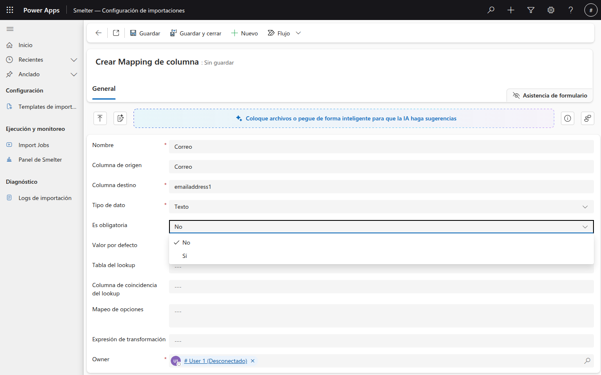

*Creando el mapping de **Correo**. Al desplegar **Es obligatoria** eliges **No** o **Sí**. Observa que **Columna destino** y **Tipo de dato** también tienen asterisco rojo.*

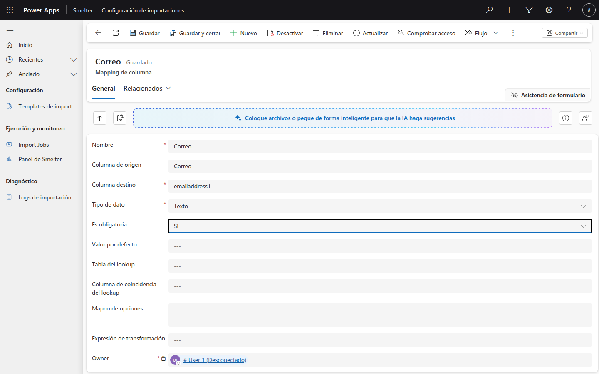

*El mismo mapping ya guardado, con **Es obligatoria** en **Sí**. Si una fila llega con **Correo** vacío, esa fila falla y las demás siguen.*

### Tipos de dato

| Tipo de dato | Para qué | Qué acepta el CSV |
|---|---|---|
| **Texto** | Nombres, códigos, direcciones | Cualquier texto. Se quitan los espacios de los extremos |
| **Entero** | Cantidades, días, niveles | Números sin decimales, como `12` o `-3` |
| **Decimal** | Montos, porcentajes | Números con **punto** decimal, como `1250.75` |
| **Fecha y hora** | Fechas | Formatos estándar como `2026-10-28` o `2026-10-28T14:30:00` (ver el aviso de abajo) |
| **Booleano** | Sí/No | `true`/`false`, `1`/`0` o `yes`/`no` |
| **Lookup** | Referencia a otro registro | Un GUID, o un valor de negocio si configuras **Columna de coincidencia del lookup** |
| **Conjunto de opciones** | Listas de opciones de Dataverse | El número de la opción, o texto si configuras **Mapeo de opciones** |
| **Moneda** | Campos de moneda | Números con punto decimal |
| **GUID** | Identificadores únicos | Un GUID válido |

Si un valor no se puede convertir, la fila falla con **Error de tipo**.

> **Importante:** el tipo **Booleano** solo entiende `true`/`false`, `1`/`0` y `yes`/`no` (en inglés). Un valor como `Sí` o `Verdadero` **no** se acepta. Si tu archivo trae `Sí`/`No`, conviértelo con una transformación, por ejemplo `IF(Activo, "Sí", 1, 0)`.

> **Importante:** las fechas con formato **día/mes/año** (como `03/04/2026`) se leen con el formato estándar internacional, que pone el **mes primero**: ese valor se interpretaría como 4 de marzo. Para archivos con día/mes/año usa `DATEPARSE`, por ejemplo `DATEPARSE(Fecha, "dd/MM/yyyy")`.

### Lookups: apuntar a otro registro por un valor de negocio

Si una columna del CSV trae un código o un nombre (no un GUID) que identifica un registro de otra tabla:

1. **Tipo de dato:** **Lookup**.
2. **Tabla del lookup:** el nombre lógico de la tabla referenciada.
3. **Columna de coincidencia del lookup:** la columna de esa tabla por la que se busca el valor. Debe ser una clave alternativa.

Si el valor no es un GUID y no configuraste **Columna de coincidencia del lookup**, la fila falla con **Lookup sin resolver**. Un mapping con tipo **Lookup** sin **Tabla del lookup** hace fallar el job antes de empezar.

### Conjunto de opciones: traducir texto a número

En **Mapeo de opciones** escribe un JSON `{"texto del CSV": número}`. Por ejemplo, si el CSV trae `Activo` o `Inactivo` y las opciones de Dataverse son 1 y 2:

```json
{"Activo": 1, "Inactivo": 2}
```

Si el texto del CSV no está en el mapeo y no es un número, la fila falla con **Error de tipo**.

### Valor por defecto

Úsalo cuando una celda vacía debe llenarse con un valor fijo. Se aplica **antes** de revisar **Es obligatoria**, así que un campo obligatorio con valor por defecto nunca falla por estar vacío. También puedes dejar **Columna de origen** vacía y usar solo el valor por defecto para una columna que siempre lleva el mismo valor.

### Expresión de transformación

Una expresión cambia el valor antes de convertirlo al tipo y guardarlo. Se escribe como una función, `FUNCION(argumento, argumento)`:

- Los **nombres de columna del CSV** van sin comillas: `UPPER(Apellido)`.
- Los **textos fijos** van entre comillas dobles: `CONCAT(Nombre, " ", Apellido)`. Para escribir una comilla dentro de un texto, duplícala: `""`.
- Las funciones se pueden **anidar**: `UPPER(TRIM(Apellido))`.
- Los nombres de las funciones no distinguen mayúsculas de minúsculas.
- Si hay una expresión, **tiene prioridad** sobre el valor crudo de la columna del CSV.

| Función | Qué hace | Ejemplo |
|---|---|---|
| `UPPER(valor)` | Pasa a mayúsculas | `UPPER(Apellido)` |
| `LOWER(valor)` | Pasa a minúsculas | `LOWER(Correo)` |
| `TRIM(valor)` | Quita los espacios de los extremos | `TRIM(Nombre)` |
| `CONCAT(a, b, ...)` | Junta valores | `CONCAT(Nombre, " ", Apellido)` |
| `LEFT(valor, n)` | Toma los primeros *n* caracteres | `LEFT(Codigo, 3)` |
| `RIGHT(valor, n)` | Toma los últimos *n* caracteres | `RIGHT(Telefono, 8)` |
| `REPLACE(valor, buscar, reemplazo)` | Reemplaza un texto por otro | `REPLACE(Telefono, "-", "")` |
| `SPLIT(valor, separador, posición)` | Divide el texto y toma una parte (la primera es la posición 0) | `SPLIT(NombreCompleto, " ", 0)` |
| `DATEPARSE(valor, formato)` | Lee una fecha con el formato que indiques | `DATEPARSE(Fecha, "dd/MM/yyyy")` |
| `IF(valor, igual_a, entonces, sino)` | Si el valor es igual a `igual_a`, devuelve `entonces`; si no, `sino` | `IF(Estado, "Activo", 1, 0)` |
| `COALESCE(a, b, ...)` | El primer valor que no esté vacío | `COALESCE(Celular, Telefono)` |
| `MAP(valor, "mapa")` | Traduce un valor con un mapa JSON (las comillas del mapa se duplican) | `MAP(Region, "{""N"":1,""S"":2}")` |
| `STATIC(valor)` | Un valor fijo, sin leer del CSV | `STATIC("Importado")` |
| `HMAC(valor, "etiqueta")` | Calcula un código hash del valor con una clave guardada en el sistema. Se usa para datos sensibles | `HMAC(Documento, "mi-clave")` |

En el ejemplo, el mapping de **Apellido** lleva `UPPER(Apellido)` para guardar todos los apellidos en mayúsculas.

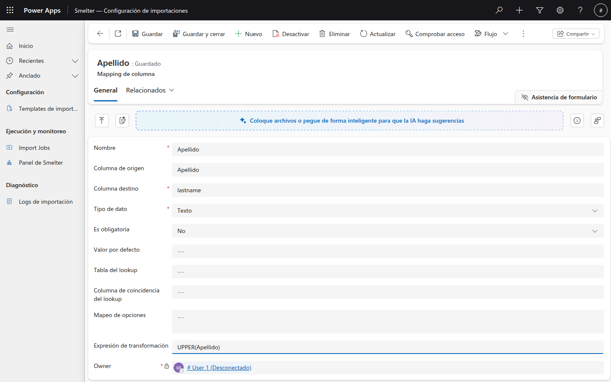

*El mapping de **Apellido** con la **Expresión de transformación** `UPPER(Apellido)`. Un `Pérez` del CSV se guarda como `PÉREZ`.*

> **Importante:** si escribes mal el nombre de una columna **dentro** de una expresión (por ejemplo `UPPER(Apelido)`), Smelter **no da error**: el valor queda vacío. Revisa que el nombre coincida con el encabezado del CSV.

> **Importante:** en `HMAC`, el segundo argumento es solo el **nombre** de una clave, escrito entre comillas y sin espacios (por ejemplo `"mi-clave"`). **Nunca escribas la clave en sí en la expresión**: la expresión se guarda en el template y viaja en la exportación. La clave la registra quien administra el entorno.

### Revisa que todo quedó en su lugar

Vuelve al mapping de tabla: en **Mappings de columna** deben aparecer todos tus mappings.

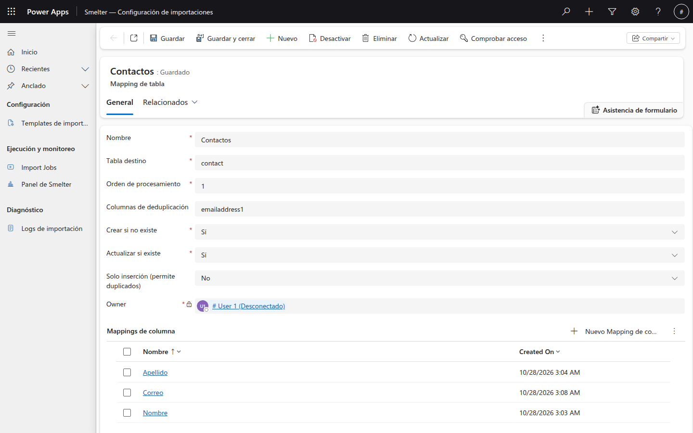

*El mapping de tabla **Contactos** con sus tres mappings de columna: **Apellido**, **Correo** y **Nombre**.*

## Paso 4: Define los mappings de relación

**Para qué:** solo los necesitas cuando **un mismo archivo llena dos tablas relacionadas** (por ejemplo, clientes y sus cuentas) y la tabla hija tiene que apuntar al registro padre correcto. Si tu template llena una sola tabla, sáltate este paso.

El mapping de relación vive en el template, no en un mapping de tabla. Para crearlo:

1. Abre el template y despliega la pestaña **Relacionados**.
2. Elige **Mappings de relación** y pulsa **Nuevo**.

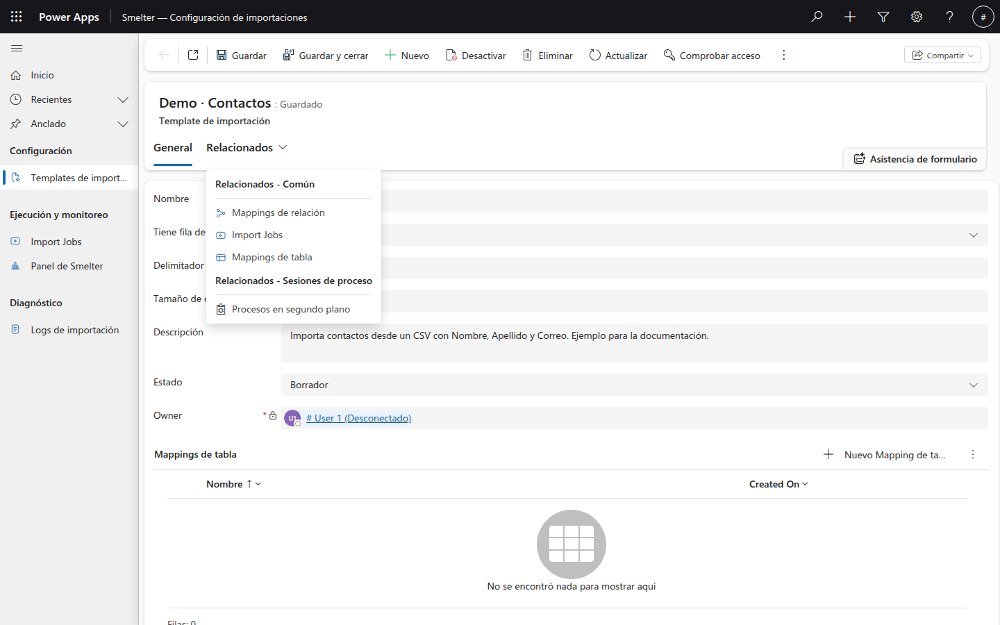

*El menú **Relacionados** del template. **Mappings de relación** y **Mappings de tabla** muestran esos registros del template; **Import Jobs** muestra los jobs que usan este template. **Procesos en segundo plano** es una opción de la plataforma.*

3. Completa los campos:

| Campo | Qué poner |
|---|---|
| **Nombre** | Un nombre descriptivo. Solo es informativo |
| **Template de importación** | El template al que pertenece la relación. Filtra los mappings de tabla que puedes elegir como padre e hijo |
| **Mapping de tabla padre** | El mapping del lado «uno». **Debe tener Columnas de deduplicación**, porque con ellas se encuentra al padre |
| **Mapping de tabla hija** | El mapping del lado «muchos»: el que recibe el lookup hacia el padre |
| **Tipo de relación** | Solo existe **Uno a muchos** |
| **Columna lookup en la tabla hija** | El nombre lógico de la columna lookup de la tabla hija que apunta al padre. Es obligatoria |
| **Columnas de deduplicación del padre** | Las columnas **del CSV** (separadas por coma) con las que se identifica al padre en cada fila |

### Cómo funciona «Columnas de deduplicación del padre»

Esta es la parte que más confunde. Responde a la pregunta: *«¿qué columnas del archivo me dicen quién es el padre de esta fila?»*

Smelter empareja esas columnas **por posición** con las **Columnas de deduplicación** del mapping padre, así que **tienen que ser la misma cantidad**.

Ejemplo ilustrativo (no es el template de esta guía): un CSV de cobranza con una columna `CIF`, que llena clientes y sus cuentas.

| Mapping de tabla | Tabla destino | Columnas de deduplicación | Orden de procesamiento |
|---|---|---|---|
| Clientes (padre) | `sanic_cliente` | `sanic_cif` | 1 |
| Cuentas (hijo) | `sanic_cuenta` | `sanic_numerocuenta` | 2 |

Mapping de relación **Clientes → Cuentas**:

| Campo | Valor |
|---|---|
| Mapping de tabla padre | Clientes |
| Mapping de tabla hija | Cuentas |
| Tipo de relación | Uno a muchos |
| Columna lookup en la tabla hija | `sanic_clienteid` |
| Columnas de deduplicación del padre | `CIF` |

En cada fila, Smelter toma el valor de `CIF`, lo asocia con `sanic_cif` y deja la cuenta apuntando a ese cliente. Si la clave del padre tiene dos columnas, escribe las dos columnas del CSV en el **mismo orden**: `CIF,Tipo`.

> **Nota:** si el mapping padre aplica una transformación a la columna de la clave (por ejemplo `HMAC`), la relación aplica **la misma transformación** a la columna del CSV para encontrar al padre. No tienes que repetirla.

> **Importante:** los padres se procesan antes que los hijos. Pon un **Orden de procesamiento** menor en el mapping padre. Smelter además ordena las tablas según las relaciones que definiste.

## Paso 5: Revisa y activa el template

**Para qué:** un template en **Borrador** no se puede ejecutar. Activarlo es el último paso.

Antes de activar, repasa esta lista:

- [ ] Cada **Mapping de tabla** tiene **Tabla destino**, **Orden de procesamiento** y **Columnas de deduplicación** (o **Solo inserción** en **Sí**).
- [ ] Cada columna de deduplicación es la **Columna destino** de algún mapping de columna de ese mismo mapping de tabla.
- [ ] Cada mapping de tipo **Lookup** tiene **Tabla del lookup**.
- [ ] Cada **Columna de origen** coincide con un encabezado real del CSV (si el template tiene **Tiene fila de encabezados** en **Sí**).
- [ ] Cada mapping de relación tiene padre, hijo y **Columna lookup en la tabla hija**, y el padre tiene columnas de deduplicación.
- [ ] La tabla destino tiene su clave alternativa activa en Dataverse.

Para activarlo:

1. Abre el template.
2. En **Estado**, elige **Activo**.
3. Pulsa **Guardar**.

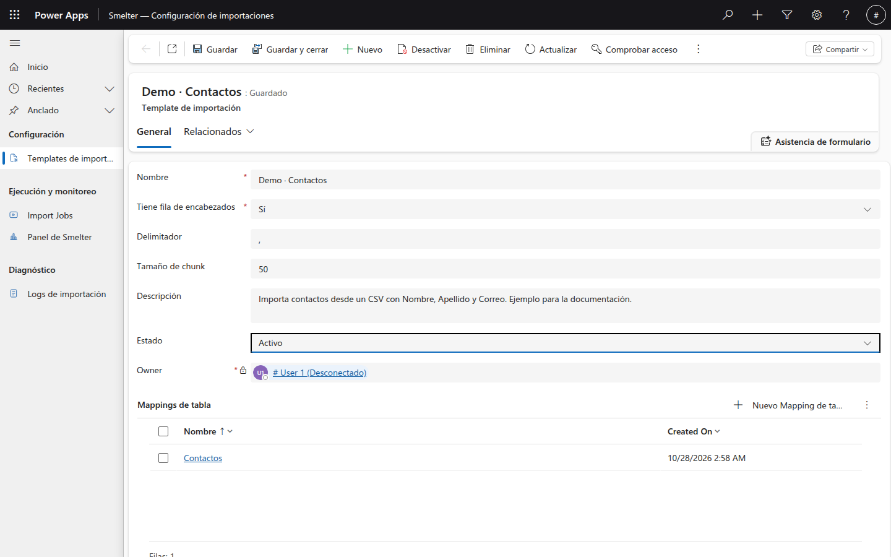

*El template con **Estado** en **Activo**. Ahora aparece en la lista de templates disponibles al crear un Import Job.*

Un template **Activo** es el único que se puede ejecutar. Si el **Estado** es **Borrador** o **Archivado**, el job falla con un mensaje que lo dice (ver [Mensajes frecuentes](02-ejecucion-y-monitoreo.md#mensajes-frecuentes-y-qué-hacer)).

> **Importante:** el campo **Estado** del template (Borrador, Activo, Archivado) es **distinto** de los botones estándar **Activar** y **Desactivar** de la barra de comandos, que son de la plataforma Dataverse. Para habilitar un template usa siempre el campo **Estado**.

> **Consejo:** usa **Archivado** para retirar un template que ya no quieres usar sin perder su configuración.

### Cambios en un template activo

Evita editar un template mientras tenga jobs **En cola** o **Procesando**: Smelter lee la configuración al procesar cada bloque de filas, y un cambio a mitad de camino puede dar resultados mezclados. Espera a que los jobs terminen.

## Lo que Smelter revisa antes de empezar

Cuando ejecutas un job, antes de leer el archivo Smelter comprueba la configuración. Si algo está mal, el job queda **Fallido** y el **Motivo de la falla** lo explica. Lo que revisa:

| Revisión | Si falla |
|---|---|
| El template está **Activo** | `Import Template '...' is not Active ...` |
| El job tiene template y archivo | Aviso al pulsar **Ejecutar**, sin cambiar el estado |
| Tu usuario puede leer el template | Aviso de acceso |
| Todo mapping de tabla tiene columnas de deduplicación (o **Solo inserción**) | `Table Mapping '...' has no dedup columns ...` |
| Las columnas de deduplicación existen como **Columna destino** | `... dedup column '...' is not the Target Column ...` |
| Los lookups tienen **Tabla del lookup** | `... Data Type Lookup requires a Lookup Table.` |
| Las relaciones están completas y coherentes con el padre | `Relationship Mapping '...': ...` |
| El CSV trae todas las columnas de origen mapeadas | `CSV is missing mapped source column(s): ...` |

Todos estos mensajes se explican en [Mensajes frecuentes](02-ejecucion-y-monitoreo.md#mensajes-frecuentes-y-qué-hacer).

## Siguiente paso

Con el template **Activo**, ya puedes probarlo: crea un job con **Es simulación (Dry Run)** y revisa el resultado. Sigue con [Ejecución y monitoreo](02-ejecucion-y-monitoreo.md).
