# Ejecución y monitoreo

Esta guía es para quien ejecuta importaciones con Smelter y revisa cómo salieron. Con ella vas a poder crear un job, subir el CSV, ejecutarlo, seguir su avance, leer los contadores y los logs, entender un job **Completado con errores** o **Fallido**, reintentarlo y hacer pruebas con simulación.

Si todavía no conoces los términos básicos (job, estados, logs), lee primero [Conceptos](00-conceptos.md). Para ejecutar necesitas un template **Activo**: ver [Guía del Configurador](01-configurador.md).

> **Nota:** los mensajes técnicos del motor (el **Motivo de la falla** de un job y el **Mensaje de error** de un log) aparecen **en inglés**. Esta guía los muestra tal cual y los explica en [Mensajes frecuentes](#mensajes-frecuentes-y-qué-hacer). Algunos avisos de los botones están escritos en español informal («Subí el CSV…», «podés cerrar esta ventana»): se muestran literalmente, como los verás en pantalla.

## Antes de empezar

- **Qué necesitas.** El rol **Smelter Configurador**, un template en estado **Activo** y un archivo `.csv` de hasta **128 MB**.
- **Dónde está todo.** En el menú de la izquierda, grupo **Ejecución y monitoreo**: **Import Jobs** (los jobs) y **Panel de Smelter**. Los errores fila por fila están en **Diagnóstico → Logs de importación** y también dentro de cada job.
- **Cuánto tarda.** Depende del tamaño del archivo. El procesamiento corre en el servidor y **puedes cerrar la pestaña**: el job sigue.

## Cómo ejecutar un import, paso a paso

### Paso 1: Crea el Import Job

**Para qué:** el job junta un template con un archivo.

1. En el menú, abre **Import Jobs**.
2. Pulsa **Nuevo**.
3. Completa los campos:

| Campo | Qué poner |
|---|---|
| **Nombre** (obligatorio) | Un nombre que te permita reconocer el job después, por ejemplo el template y la fecha |
| **Template de importación** (obligatorio) | El template que define cómo se lee el archivo. La lista ofrece solo los **Templates activos**: si el template que buscas no aparece, no está en estado **Activo** |
| **Archivo de origen** | El CSV que vas a importar (paso siguiente) |
| **Es simulación (Dry Run)** | **No** para una carga real. **Sí** para probar sin escribir en Dataverse (ver [Simulación](#hacer-una-prueba-con-simulación-dry-run)) |

Los demás campos del formulario (**Total de filas**, **Filas exitosas**, **Estado**, **Hora de inicio**…) tienen un candado: los escribe el sistema y no se pueden editar.

### Paso 2: Sube el CSV

1. En **Archivo de origen**, pulsa el botón de elegir archivo (lo dibuja tu navegador: puede decir **Elegir archivo** o **Choose File**) y selecciona el CSV.
2. Pulsa **Guardar** para subirlo.

Cuando el archivo está guardado, el campo muestra el nombre del archivo como enlace y un botón **Eliminar** al lado.

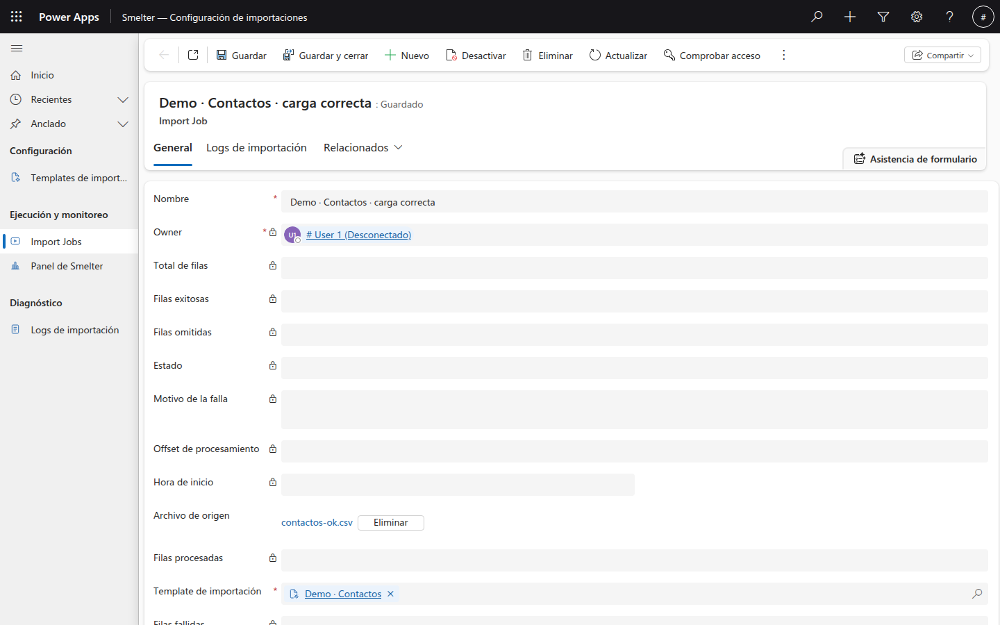

*Un job listo para ejecutar: tiene template y archivo, y **Estado** y los contadores están vacíos porque todavía no corrió. Fíjate en los candados: esos campos no se editan.*

Si olvidas subir el archivo, al ejecutar la pantalla te avisa.

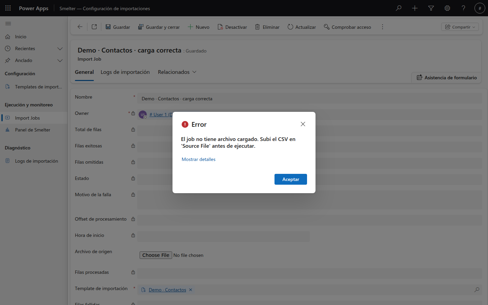

*El aviso al ejecutar sin archivo. Dice **'Source File'**, que es el nombre en inglés del campo **Archivo de origen**. Sube el CSV, guarda y vuelve a ejecutar.*

### Paso 3: Ejecuta

1. En la barra de comandos del job, abre el menú **⋮** (**Más comandos para Import Job**).
2. Pulsa **Ejecutar**.

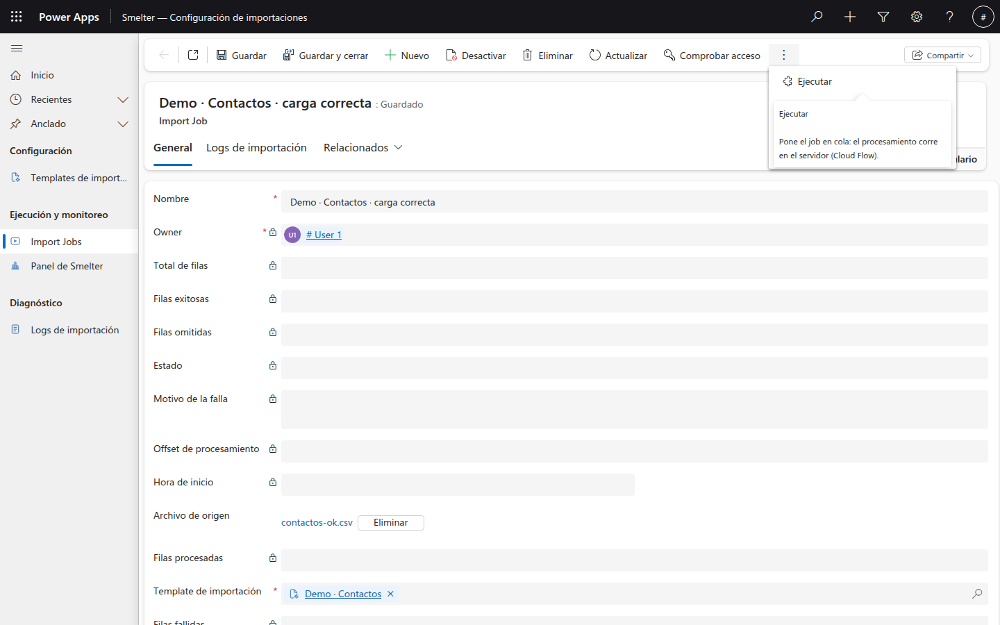

*El comando **Ejecutar** está dentro del menú **⋮**. Al pasar el cursor, explica que pone el job en cola y que el procesamiento corre en el servidor.*

**Ejecutar** guarda primero los cambios pendientes del formulario, comprueba que el job tenga template y archivo y que puedas leer el template, y pone el job en cola. No procesa nada en tu navegador. Si falta algo, verás un cuadro de error y el job **no** cambia de estado:

| Aviso (literal, en pantalla) | Qué hacer |
|---|---|
| El job no tiene Import Template. Elegí uno y guardá antes de ejecutar. | Elige un template y guarda |
| El job no tiene archivo cargado. Subí el CSV en 'Source File' antes de ejecutar. | Sube el CSV en **Archivo de origen** y guarda |
| No tenés acceso de lectura al Import Template de este job. | Pide acceso al template a quien administra Smelter |

Si todo está bien, aparece una franja verde y el **Estado** pasa a **En cola**.

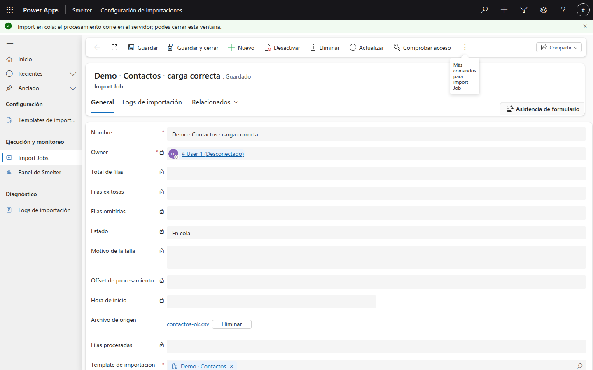

*Tras **Ejecutar**: la franja verde confirma que el job está en cola y el **Estado** dice **En cola**. Puedes cerrar la pestaña.*

> **Consejo:** después de pulsar **Ejecutar**, mientras el job esté **En cola** o **Procesando** y dejes el formulario abierto, este se actualiza solo cada pocos segundos: verás avanzar los contadores sin recargar.

> **Importante:** **Ejecutar** solo está habilitado en un job que **nunca corrió** (con el **Estado** vacío). Mientras el job está **En cola** o **Procesando**, ni **Ejecutar** ni **Reintentar** están disponibles. Un job **Procesando** no se puede volver a poner en cola.

## Qué ves mientras corre y cuando termina

### El estado del job

Un job pasa por **En cola** → **Procesando** → **Completado**, **Completado con errores** o **Fallido**. La tabla completa está en [Conceptos](00-conceptos.md#estados-de-un-job).

### Los contadores

Todos son de solo lectura y los escribe el sistema:

| Campo | Qué cuenta |
|---|---|
| **Total de filas** | Las filas de datos del CSV (sin contar el encabezado). Lo calcula Smelter al empezar |
| **Filas procesadas** | Cuántas filas ya se leyeron, hayan salido bien o mal. Avanza después de cada bloque |
| **Filas exitosas** | Las que se escribieron en Dataverse (creadas o actualizadas). En una simulación, las que pasaron todas las validaciones |
| **Filas fallidas** | Las que fallaron. El detalle de cada una está en los logs |
| **Filas omitidas** | Las que Smelter salteó por **Crear si no existe** o **Actualizar si existe** en **No**. No quedan en los logs |
| **Offset de procesamiento** | Cuántas filas de datos ya se consumieron. Es el punto desde el que retoma el siguiente bloque |
| **Hora de inicio** / **Hora de fin** | Cuándo empezó y cuándo terminó el procesamiento |
| **Motivo de la falla** | Solo si el job quedó **Fallido**: el mensaje del paso que falló |

> **Nota:** si tu template tiene **varios mappings de tabla**, cada fila del archivo genera un resultado por cada mapping. Los contadores de exitosas, fallidas y omitidas cuentan esos resultados, así que su suma puede ser mayor que **Total de filas**.

### Un job que terminó bien: Completado

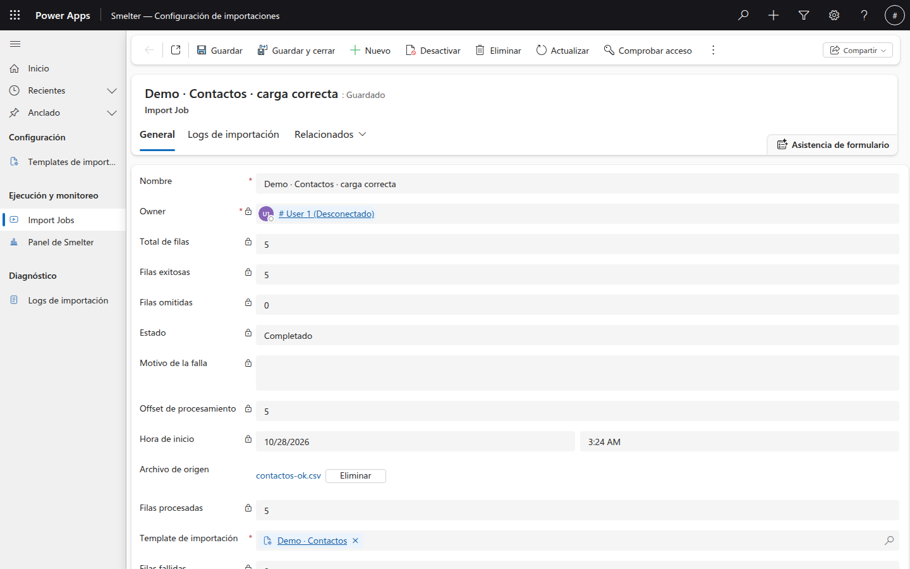

*Un job **Completado**: 5 filas, 5 exitosas y **Motivo de la falla** vacío.*

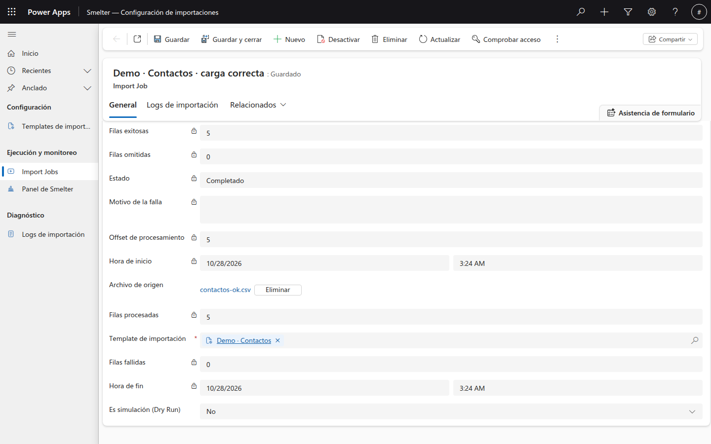

*Más abajo en el mismo formulario: **Filas fallidas** 0, **Hora de fin** y **Es simulación (Dry Run)** en **No**.*

En un job **Completado** no hay logs: la pestaña **Logs de importación** del job aparece vacía.

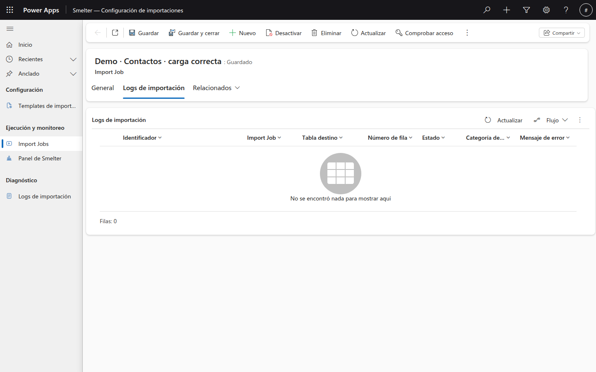

*Sin errores, la pestaña **Logs de importación** está vacía: «No se encontró nada para mostrar aquí».*

## Seguir tus jobs: vistas y Panel de Smelter

### Las vistas de Import Jobs

En la lista de **Import Jobs**, el nombre de la vista (arriba a la izquierda) es un selector. Al desplegarlo eliges una de estas vistas:

| Vista | Qué muestra |
|---|---|
| **Active TBL \| SMLT \| Import Jobs** | La vista predeterminada, con todos los jobs y sus contadores. Es un nombre de sistema que **no se traduce** |
| **Jobs activos** | Los jobs que están **En cola** o **Procesando**. Un job recién creado que todavía no ejecutaste (con el **Estado** vacío) **no** aparece acá |
| **Completados con errores** | Los jobs que tienen **al menos una fila fallida** |
| **Todos los jobs** | Todos los jobs, sin filtro, los más recientes primero |

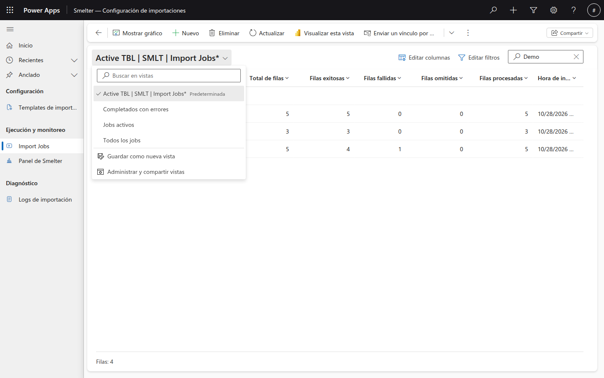

*El selector de vistas. Además de las vistas, ofrece **Guardar como nueva vista** y **Administrar y compartir vistas**.*

La vista predeterminada muestra **Nombre**, **Estado**, **Total de filas**, **Filas exitosas**, **Filas fallidas**, **Filas omitidas** y **Filas procesadas**, entre otras. Para encontrar un job, escribe una palabra en **Filtrar por palabra clave** (arriba a la derecha).

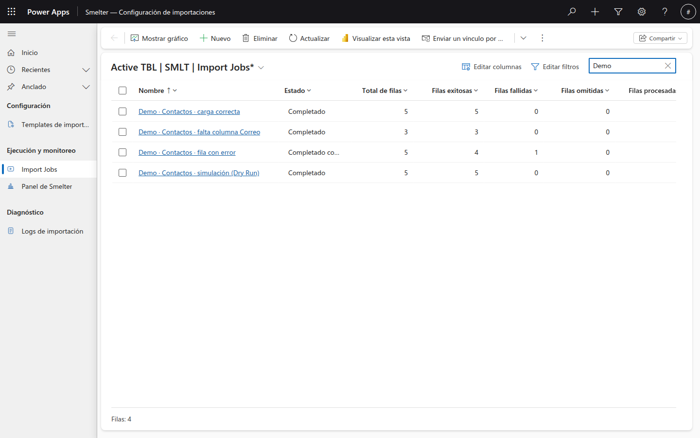

*La lista filtrada por «Demo». De un vistazo ves el **Estado** y los contadores de cada job. El asterisco junto al nombre de la vista aparece porque hay un filtro de búsqueda aplicado.*

### El Panel de Smelter

En **Ejecución y monitoreo → Panel de Smelter** hay un panel clásico de Dataverse con tres partes:

1. **Arriba a la izquierda**, un **gráfico circular** con la cantidad de jobs agrupados por **Estado**: te dice cuántos están en cola, procesando, completados, completados con errores o fallidos.
2. **Arriba a la derecha**, un **gráfico de barras** con la cantidad de jobs por **template**: te dice qué templates se usan más.
3. **Abajo, a todo el ancho**, una **lista de jobs** (la vista predeterminada **Active TBL | SMLT | Import Jobs**), de a 10 por página, con sus contadores.

Es la forma más rápida de ver si hay muchos jobs **Fallido** o **Completado con errores**. Para el detalle de un job, ábrelo desde la lista.

## Revisar los errores de un job

### Un job Completado con errores

**Completado con errores** significa que el job terminó, pero al menos una fila falló. **Las demás filas sí se guardaron.**

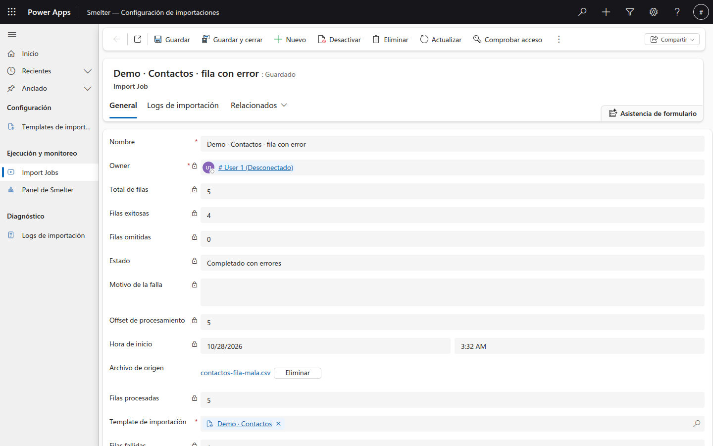

*Un job con 5 filas: 4 **exitosas** y 1 fallida. El **Estado** dice **Completado con errores**. **Motivo de la falla** está vacío porque el job no falló como proceso: falló una fila.*

Para ver qué falló, abre la pestaña **Logs de importación** del job.

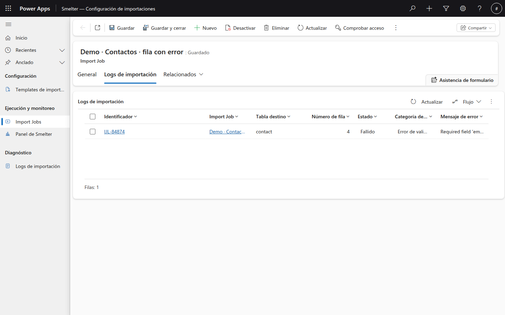

*La pestaña **Logs de importación**: una fila de log por cada fila del archivo que falló, con la **Tabla destino**, el **Número de fila**, la **Categoría del error** y el **Mensaje de error**. Los más recientes aparecen primero.*

Abre el registro (haz clic en el **Identificador**) para leer el mensaje completo.

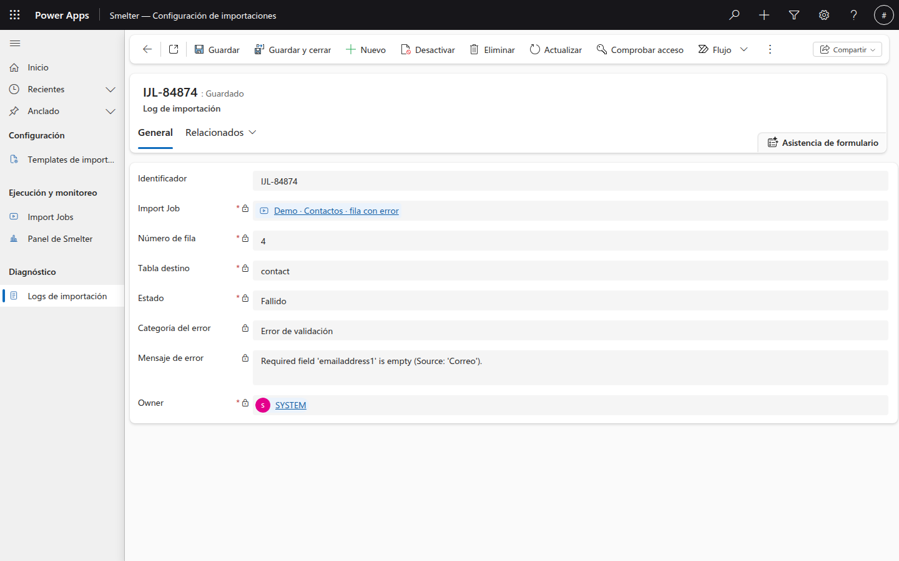

*El detalle del log. El mensaje dice que el campo obligatorio `emailaddress1` está vacío y que viene de la columna `Correo` del archivo.*

Los logs **los escribe el sistema** al procesar: no se crean, y no se editan a mano. Todos los campos del log son de solo lectura.

> **Nota:** el rol Configurador no puede crear logs: no hay botón **Nuevo Log de importación** en la subgrilla. Los logs solo los crea el motor.

También puedes ver los errores de **todos los jobs** juntos en **Diagnóstico → Logs de importación**. Los más recientes aparecen primero.

> **Los logs solo registran filas fallidas.** Las filas exitosas y las omitidas no tienen log: están en los contadores del job.

### El «Número de fila» de un log

> **Importante:** el **Número de fila** es el número de fila **en el archivo, contando la fila de encabezados**. Si el archivo tiene encabezado, la primera fila de datos es la **fila 2**. Por eso, la **fila de datos 3** aparece como **4** en el log. Si el template tiene **Tiene fila de encabezados** en **No**, la numeración empieza en 1.

Ejemplo con el archivo de la captura anterior (`contactos-fila-mala.csv`):

```csv
Nombre,Apellido,Correo
Ana,Pérez,ana@example.com
Luis,Gómez,luis@example.com
Marta,Ruiz,
Pablo,Soto,pablo@example.com
Elena,Vega,elena@example.com
```

| Fila del archivo | Contenido | Fila de datos |
|---|---|---|
| 1 | `Nombre,Apellido,Correo` (encabezado) | — |
| 2 | Ana | 1 |
| 3 | Luis | 2 |
| **4** | **Marta, sin correo** | **3** |
| 5 | Pablo | 4 |
| 6 | Elena | 5 |

El log dice **Número de fila 4**: es la fila de Marta, tal como la verías abierta en una hoja de cálculo. Ábrela en la fila 4, corrige el dato y reintenta.

### Un job Fallido

**Fallido** significa que falló el **proceso completo**, no una fila puntual: el template no estaba **Activo**, al CSV le falta una columna, la configuración del template tiene un error, etc. La razón queda en el campo **Motivo de la falla**.

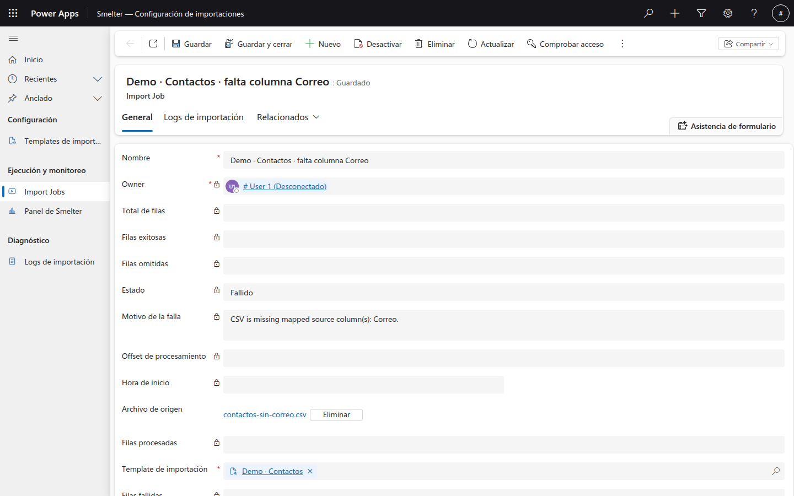

*Un job **Fallido**: el **Motivo de la falla** dice, en inglés, que al CSV le falta la columna mapeada `Correo`. Los contadores están vacíos porque el job nunca llegó a procesar filas.*

Otro caso típico: el job usa un template que quedó en **Borrador**.

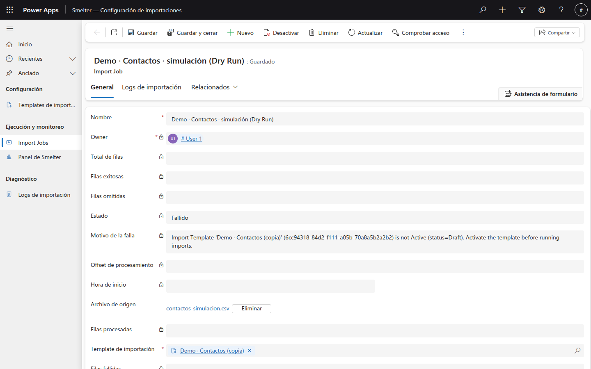

*Este job de simulación falló porque su template está en **Borrador**: el mensaje pide activar el template antes de ejecutar. Una simulación también exige un template **Activo**.*

Si el **Motivo de la falla** dice «Revisá el historial de ejecuciones del flujo», el error vino de la plataforma y lo revisa quien administra el flujo de Power Automate de Smelter.

### Reintentar

Cuando un job terminó (**Completado**, **Completado con errores** o **Fallido**), puedes volver a correrlo con **Reintentar**. Está en el mismo menú **⋮** donde estaba **Ejecutar**: cuando el job ya corrió, en ese lugar aparece **Reintentar** en vez de **Ejecutar**.

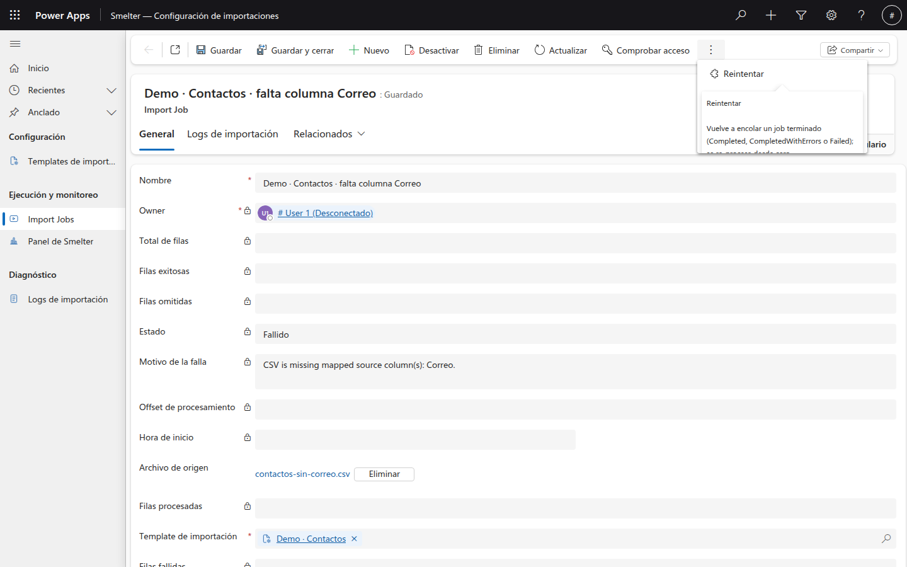

*El comando **Reintentar** en el menú **⋮** de un job **Fallido**. La descripción aclara que el job se vuelve a encolar y se reprocesa **desde cero**.*

**Reintentar** funciona igual que **Ejecutar**: guarda, valida y pone el job **En cola**. Cuando el servidor lo toma, **resetea** los contadores, el offset y las horas, y **limpia el Motivo de la falla**; el job se procesa desde la primera fila.

El flujo típico para recuperar un job **Fallido**:

1. Lee el **Motivo de la falla**.
2. Corrige la causa: el template (por ejemplo, actívalo o corrige un mapping) o el archivo.
3. Si hay que cambiar el archivo, pulsa **Eliminar** al lado del nombre del archivo en **Archivo de origen** y confirma.

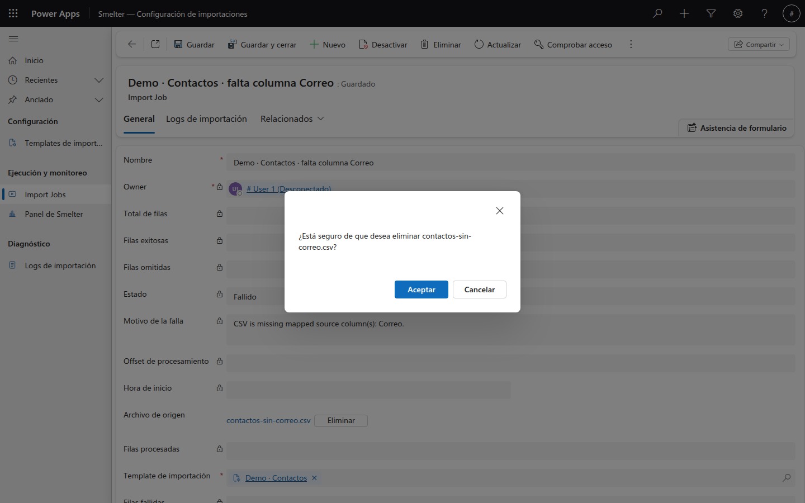

*Eliminar el archivo pide confirmación. Solo se quita el archivo del job; luego puedes subir el corregido.*

4. Sube el archivo corregido en **Archivo de origen**.
5. Pulsa **Reintentar** (guarda primero lo pendiente).

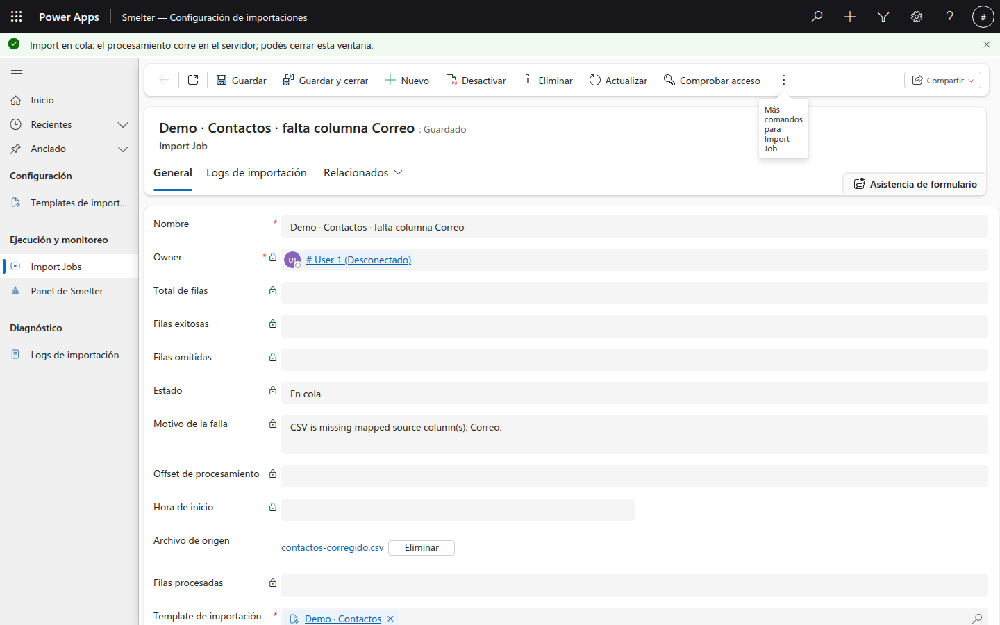

*Tras **Reintentar** con el archivo corregido (`contactos-corregido.csv`) el job queda **En cola**. Mientras está en cola todavía se ve el **Motivo de la falla** anterior: se limpia cuando el servidor empieza a procesar el job. Pulsa **Actualizar** para ver el estado al día.*

Al empezar a procesar, el servidor también **borra los logs de la corrida anterior**: al terminar, la pestaña **Logs de importación** muestra solo los errores de la corrida nueva, y su cantidad coincide con **Filas fallidas**. En un job con muchísimos logs (decenas de miles), la limpieza puede completarse durante los primeros bloques.

> **Importante:** reintentar es seguro para los mappings con **Columnas de deduplicación**: las filas que ya se cargaron se **actualizan** con los mismos valores en vez de duplicarse. En cambio, un mapping con **Solo inserción (permite duplicados)** en **Sí** **crea de nuevo** los registros: reintentar un job con esos mappings duplica los datos.

## Hacer una prueba con simulación (Dry Run)

**Para qué:** comprobar que un archivo y un template funcionan **sin escribir nada** en Dataverse.

1. Crea el job como siempre, pero pon **Es simulación (Dry Run)** en **Sí**.
2. Sube el CSV y pulsa **Ejecutar**.
3. Revisa el resultado: contadores y logs.

Qué hace la simulación y qué no:

| La simulación **sí** hace | La simulación **no** hace |
|---|---|
| Leer todo el archivo y validar el formato de cada fila | Escribir ni modificar registros en Dataverse |
| Convertir los tipos y evaluar las transformaciones | Detectar problemas que solo Dataverse ve: claves alternativas inexistentes, lookups que no existen, permisos |
| Contar **Filas exitosas** (las que pasaron todas las validaciones) y **Filas fallidas** | Contar **Filas omitidas** ni simular claves que ya existen |
| Escribir los **Logs de importación** de las filas con problemas | — |

> **Importante:** una simulación **también exige un template Activo** y pasa por las mismas revisiones previas. Que una simulación salga limpia no garantiza que la carga real no tenga **Error de datos de destino**, porque esas respuestas dependen de Dataverse.

## Mensajes frecuentes y qué hacer

Los mensajes del motor están en inglés. Aquí aparecen tal cual (con `...` donde el mensaje trae un nombre o un identificador propio) y con su significado.

### En «Motivo de la falla» (el job quedó Fallido)

| Mensaje | Qué significa | Qué hacer |
|---|---|---|
| `Import Template '...' (...) is not Active (status=Draft). Activate the template before running imports.` | El template está en **Borrador** (o `Archived`, si está **Archivado**) | Pon el **Estado** del template en **Activo** y usa **Reintentar** |
| `CSV is missing mapped source column(s): Correo.` | El CSV no tiene una columna que algún mapping usa como **Columna de origen**. El mensaje nombra las columnas que faltan | Revisa el encabezado del CSV y los mappings. Corrige el archivo o el mapping y reintenta |
| `Table Mapping '...' (...) has no dedup columns: Smelter requires an alternate key so reprocessing never duplicates. Set dedup columns or enable 'Insert only (allows duplicates)'.` | Un mapping de tabla no tiene **Columnas de deduplicación** ni **Solo inserción** | Completa **Columnas de deduplicación** (o activa **Solo inserción (permite duplicados)** si repetir filas es válido) |
| `Import Template '...' has configuration errors: ...` | La configuración del template es incoherente. Después de los dos puntos el mensaje lista cada problema | Corrige cada problema de la lista (siguiente tabla) y reintenta |
| `User ... does not have Read access to the Import Template (...) referenced by this Import Job. Prepare aborted.` | Tu usuario no tiene permiso de lectura sobre el template | Pide acceso al template |
| `Falló la preparación del import. Revisá el historial de ejecuciones del flujo.` | Falló la preparación del job y la plataforma no devolvió detalle | Avisa a quien administra el flujo de Power Automate de Smelter |
| `Falló el procesamiento del import o excedió el tiempo límite. Revisá el historial de ejecuciones del flujo.` | Falló el procesamiento o tardó más del tiempo permitido | Avisa a quien administra el flujo de Power Automate de Smelter |

Los problemas que lista `has configuration errors` son:

| Mensaje | Qué significa | Qué hacer |
|---|---|---|
| `Table Mapping '...' (...): dedup column '...' is not the Target Column of any of its Column Mappings.` | Una columna de deduplicación no es la **Columna destino** de ningún mapping de columna de ese mapping de tabla | Crea el mapping de columna que falta o corrige el nombre en **Columnas de deduplicación** |
| `Column Mapping '...' (target '...') in Table Mapping '...': Data Type Lookup requires a Lookup Table.` | Un mapping de tipo **Lookup** no tiene **Tabla del lookup** | Completa **Tabla del lookup** |
| `Relationship Mapping '...': OneToMany requires 'Lookup column on child'.` | Falta **Columna lookup en la tabla hija** | Complétala |
| `Relationship Mapping '...': the parent Table Mapping does not belong to this template.` | El **Mapping de tabla padre** (o el hijo, con el mensaje equivalente `the child Table Mapping ...`) es de otro template | Elige un mapping de tabla de este mismo template |
| `Relationship Mapping '...': parent Table Mapping '...' has no dedup columns, so the child cannot reference it by alternate key.` | El mapping padre no tiene **Columnas de deduplicación** | Agrégalas al mapping padre |
| `Relationship Mapping '...': Parent Dedup Columns lists N column(s) but parent Table Mapping '...' has M dedup column(s); they must match one to one.` | **Columnas de deduplicación del padre** y las **Columnas de deduplicación** del padre no tienen la misma cantidad | Iguala las cantidades (se emparejan por posición) |

### Al pulsar Ejecutar o Reintentar (cuadro de error, el job no cambia de estado)

| Mensaje | Qué significa | Qué hacer |
|---|---|---|
| `El job no tiene Import Template. Elegí uno y guardá antes de ejecutar.` | Falta el template | Elige uno y guarda |
| `El job no tiene archivo cargado. Subí el CSV en 'Source File' antes de ejecutar.` | Falta el archivo | Sube el CSV en **Archivo de origen** |
| `No tenés acceso de lectura al Import Template de este job.` | No puedes leer el template | Pide acceso |
| `No tenés acceso al Import Template de este job: no se puede poner en cola.` | Lo mismo, detectado al encolar | Pide acceso |
| `El Import Job se está procesando: no se puede volver a poner en cola hasta que termine.` | Intentaste encolar un job que está **Procesando** | Espera a que termine |

### En «Mensaje de error» de un log (falló una fila)

| Categoría | Mensaje | Qué significa | Qué hacer |
|---|---|---|---|
| **Error de validación** | `Required field '...' is empty (Source: '...').` | La columna destino es **Es obligatoria**, la celda venía vacía y no hay **Valor por defecto** | Completa el dato en el CSV o define un valor por defecto |
| **Error de validación** | `Dedup key '...' is empty (Source: '...').` | La columna es una **Columna de deduplicación** del mapping y la celda venía vacía (después del valor por defecto y la transformación). Sin clave no se puede saber si el registro ya existe, así que la fila **no se carga** para no crear un duplicado | Completa el dato en el CSV, define un **Valor por defecto**, o pon **Solo inserción** en **Sí** si se aceptan duplicados |
| **Error de tipo** | `Column '...' (source '...'): Cannot convert value (N chars) to Integer.` | El valor no se pudo convertir al tipo del mapping. El mensaje nombra la columna y el tipo (`Integer`, `Decimal`, `DateTime`, `Boolean`, `Money`, `GUID`, `OptionSet`) y la **cantidad de caracteres**, no el valor | Revisa el dato de esa fila y el **Tipo de dato** del mapping |
| **Error de tipo** | `... to Boolean. Expected: true/false, 1/0, yes/no.` | El valor no es un booleano válido | Usa `true`/`false`, `1`/`0` o `yes`/`no`, o transforma el valor |
| **Error de tipo** | `... to OptionSet. Use MAP transform if mapping is required.` | El valor no es un número y no está en el **Mapeo de opciones** | Agrega el valor al **Mapeo de opciones** o usa `MAP` |
| **Lookup sin resolver** | `Lookup '...' value is not a GUID and no LookupMatchColumn is configured.` | El lookup trae un valor que no es GUID y falta **Columna de coincidencia del lookup** | Configúrala en el mapping de columna |
| **Error de transformación** | `Unknown function: ...` | La expresión usa una función que no existe | Revisa el nombre de la función |
| **Error de transformación** | `Unexpected character at position N: ...`, `Expected ')' after arguments for ...`, `Unexpected token: ...`, `Expected EOF` | La expresión tiene un error de sintaxis: un carácter inesperado, un paréntesis sin cerrar o texto de sobra | Revisa la **Expresión de transformación** |
| **Error de transformación** | `HMAC: ...` | Falló la función `HMAC`: la clave no existe, tiene un formato inválido o el nombre de la clave no es un texto fijo | Avisa a quien administra las claves del entorno |
| **Datos de destino** | `Dataverse rejected the write (ErrorCode 0x...).` | Dataverse rechazó la escritura. El mensaje solo trae el código del error, nunca datos de la fila | Si se repite en muchas filas, revisa la **clave alternativa** de la tabla destino y los datos. Pasa el código a quien administra Dataverse |

> **Nota:** los mensajes de las filas nunca incluyen el valor de la celda, para no exponer datos sensibles: solo el nombre de la columna, el tipo y la cantidad de caracteres.

## Siguiente paso

Para llevar un template a otro entorno, o para hacer una copia, sigue con [Exportar e importar templates](03-exportar-e-importar.md). Si algo no sale como esperas, revisa las [Preguntas frecuentes](04-preguntas-frecuentes.md).
