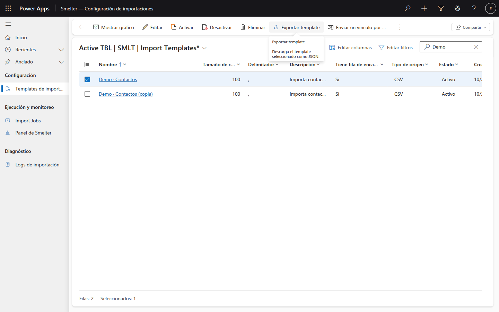
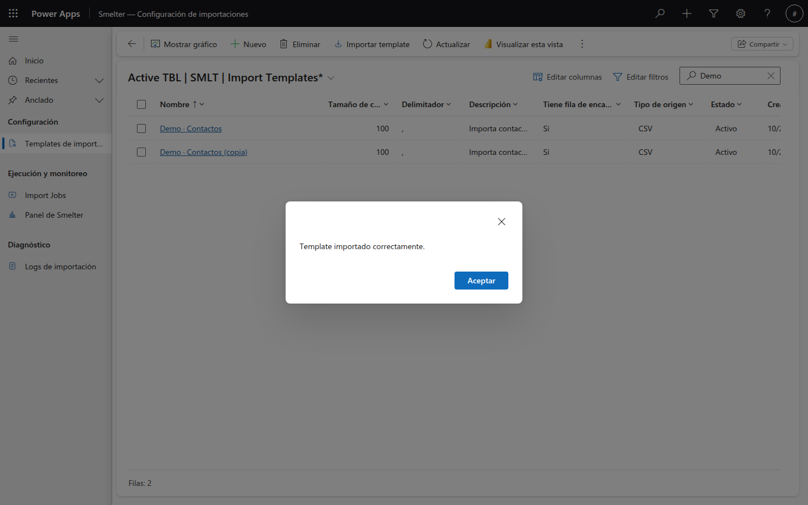
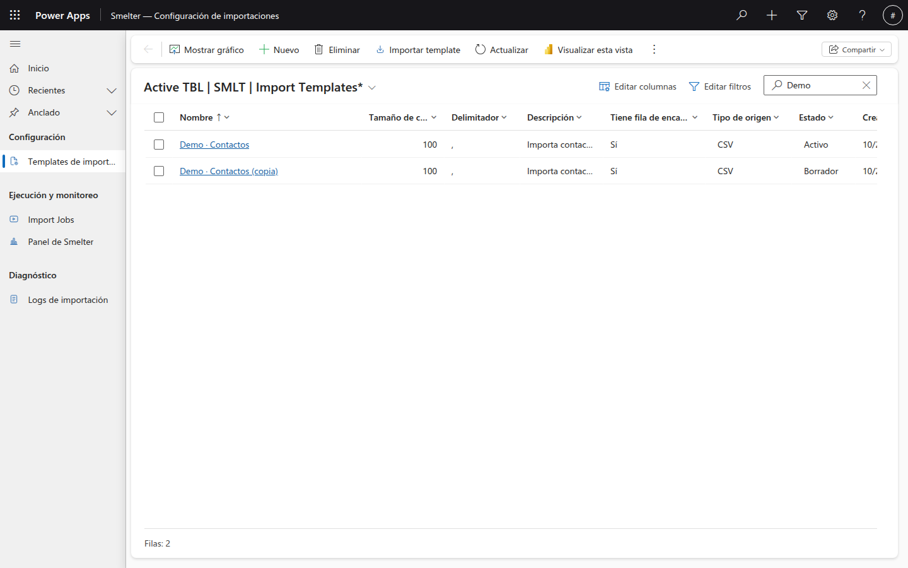

# Exportar e importar templates

Esta guía es para quien necesita llevar un template de un entorno a otro (por ejemplo, de desarrollo a pruebas), guardar una copia de respaldo o clonar un template como punto de partida. Con ella vas a poder exportar un template a un archivo y volver a importarlo.

Si todavía no conoces los términos básicos (template, mapping), lee primero [Conceptos](00-conceptos.md).

## Qué hacen exportar e importar

- **Exportar** guarda un template completo en un archivo llamado **`smelter-template.json`**: sus datos generales, sus mappings de tabla, sus mappings de columna y sus mappings de relación.
- **Importar** lee ese archivo y crea el template en el entorno donde estás, o lo actualiza si ya existe.

El archivo **no** incluye los jobs, los CSV ni las claves de ningún tipo. Una **Expresión de transformación** viaja como texto; si usa `HMAC`, viaja solo el *nombre* de la clave, nunca la clave.

Los dos botones están en la barra de comandos de la lista **Templates de importación**:

| Botón | Qué hace | Cuándo está disponible |
|---|---|---|
| **Exportar template** | Descarga el template seleccionado | Solo con una fila seleccionada (si no hay ninguna, no se muestra) |
| **Importar template** | Carga un template desde un archivo `.json` | Siempre, sin seleccionar nada |

## Cómo exportar un template

**Para qué:** sacar una copia del template para llevarlo a otro entorno o guardarla.

1. En el menú, abre **Templates de importación**.
2. Marca la casilla de la fila del template que quieres exportar.
3. En la barra de comandos, pulsa **Exportar template**.

*Con una fila seleccionada, la barra de comandos suma **Exportar template** (con ícono de subida). Al pasar el cursor, un cuadro de ayuda dice que descarga el template seleccionado como JSON. Abajo se lee **Seleccionados: 1**.*

4. Tu navegador descarga el archivo **`smelter-template.json`**. Búscalo en tu carpeta de descargas.

> **Importante:** selecciona **un solo** template a la vez. Si marcas varios, Smelter exporta únicamente el primero de la selección. Sin ninguna fila seleccionada, el botón **Exportar template** no se muestra en la barra de comandos.

> **Consejo:** al descargar varios templates en seguida, el navegador les pone el mismo nombre. Renombra cada archivo (por ejemplo `contactos.json`) para no mezclarlos.

## Cómo importar un template

**Para qué:** crear en este entorno un template a partir de un archivo exportado antes.

1. En el menú, abre **Templates de importación**.
2. En la barra de comandos, pulsa **Importar template**.
3. Se abre el selector de archivos de tu equipo, que acepta archivos `.json`. Elige el archivo exportado.
4. Smelter importa el template. Cuando termina, aparece un cuadro con el mensaje **Template importado correctamente.** Pulsa **Aceptar**.

*El cuadro de resultado. Al pulsar **Aceptar**, la lista se actualiza sola.*

*La lista después de importar: apareció **Demo · Contactos (copia)**. En este ejemplo el archivo traía ese nombre, que no existía en el entorno, así que se creó un template nuevo; llegó con el **Estado** **Borrador**.*

Si el cuadro agrega un bloque **Advertencias**, léelo: significa que el template se importó, pero hay algo que revisar. La advertencia que puedes ver es:

| Advertencia (en inglés) | Qué significa | Qué hacer |
|---|---|---|
| `Target table '...' does not exist in this environment. Create the table and its alternate key before importing data.` | Un mapping de tabla apunta a una tabla de Dataverse que **no existe** en este entorno | Pide que se cree la tabla (con su clave alternativa) antes de ejecutar imports con este template |

### Qué pasa según el nombre del template

Smelter reconoce un template por su **Nombre**:

| Situación | Qué hace Smelter |
|---|---|
| **No existe** un template con ese nombre en el entorno | **Crea** el template nuevo, con todos sus mappings |
| **Ya existe** un template con ese nombre | **Actualiza** ese template y **reemplaza todos sus mappings** por los del archivo. No se duplican mappings |

> **Importante:** al reimportar sobre un template existente, sus mappings se **borran y se vuelven a crear** a partir del archivo. Cualquier cambio que hubieras hecho a mano en esos mappings se pierde. Si quieres conservar el original, cambia el **Nombre** en el archivo antes de importar, o crea el template con otro nombre.

### Con qué Estado llega el template

El **Estado** del template **viaja dentro del archivo**: el template llega con el estado (**Borrador**, **Activo** o **Archivado**) que tenía al exportarse. Si el archivo no trae estado (archivos de un formato antiguo), un template **nuevo** queda **Activo**, y en uno que ya existe se respeta el estado actual.

> **Importante:** revisa siempre el **Estado** del template recién importado. Para ejecutarlo tiene que estar **Activo**. Si llegó en **Borrador** (como en la captura), ábrelo, cambia **Estado** a **Activo** y guarda. Ver [Activar el template](01-configurador.md#paso-5-revisa-y-activa-el-template).

### Qué valida Smelter al importar

Si el archivo no cumple alguna de estas reglas, la importación se rechaza con un cuadro de error y **no se crea ni se modifica nada**:

| Regla | Mensaje (en inglés) |
|---|---|
| El archivo no puede estar vacío | `Template JSON is empty.` |
| Tiene que ser un JSON válido | `Template JSON is malformed: ...` |
| Tiene que traer el template | `Template JSON is invalid (missing template).` |
| El formato no puede ser más nuevo que el que entiende este entorno (hasta la versión 1.1) | `Unsupported formatVersion '...'. Expected 1.1 or lower.` |
| El **Tamaño de chunk** debe ser **0** (usa el valor por defecto del sistema) o estar **entre 100 y 10000** | `Template JSON is invalid: chunkSize N is out of range; it must be between 100 and 10000 (or 0 for the system default).` |
| El estado debe ser válido (0 = Borrador, 1 = Activo, 2 = Archivado) | `Template JSON is invalid: status N is not a valid template status (0=Draft, 1=Active, 2=Archived).` |
| Las relaciones solo pueden ser de tipo **Uno a muchos** | `Relationship '...' is ManyToMany, which is not supported; only OneToMany is.` |
| Cada relación debe apuntar a mappings de tabla que estén en el archivo | `Relationship references unknown parentRef '...'.` (o `childRef`) |

> **Nota:** el **Tamaño de chunk** se valida igual al importar que al guardar a mano: un valor fuera del rango **se rechaza**, no se corrige en silencio. Un **0** en el archivo se guarda como vacío, y el motor usa el valor por defecto de **1000**.

## Para qué sirve

| Quiero… | Cómo |
|---|---|
| Llevar un template de desarrollo a pruebas | Expórtalo en un entorno, impórtalo en el otro y actívalo allá. Antes verifica que existan las tablas destino y sus claves alternativas |
| Tener un respaldo | Exporta y guarda el `.json` |
| Partir de un template existente | Exporta, abre el archivo, cambia el **Nombre** (el valor de `"Name"` dentro de `"Template"`, al comienzo del archivo) e impórtalo: se crea uno nuevo |
| Actualizar un template en otro entorno | Exporta del entorno de origen e importa en el de destino con el **mismo Nombre**: se reemplaza su configuración |

## Siguiente paso

Si algo no sale como esperas, revisa las [Preguntas frecuentes](04-preguntas-frecuentes.md).
